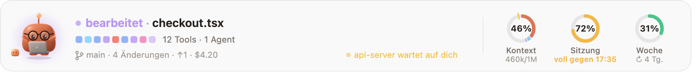
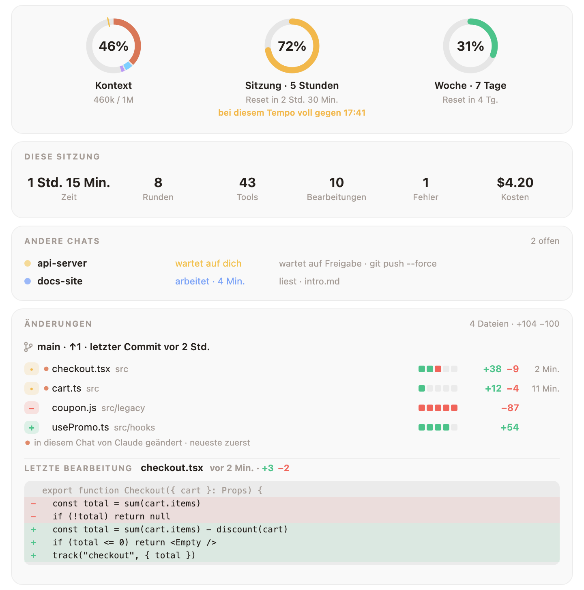
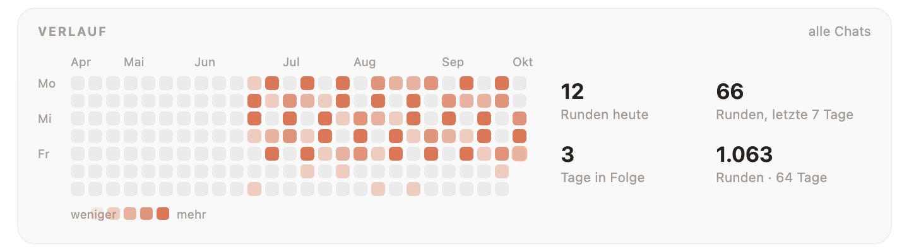

<div align="center">


# Mochi Buddy

### Ein kleiner Freund aus Knete, der über deinem Claude-Code-Prompt wohnt.

Er reagiert auf alles, was Claude tut, hält die Befehle auf, die du bereuen würdest,<br>
und hat Kontext, Sitzung und Wochenlimit immer gut sichtbar für dich im Blick.

<a href="https://cdn.jsdelivr.net/gh/oztrkemree/mochi@main/docs/mochi-short.mp4"></a>

[](LICENSE)
[](#-in-10-sekunden-installiert)
[](#-16-sprachen)
[](#-ein-kleiderschrank-der-mit-dir-wächst)
[](#-worauf-mochi-zugreift)

<sub>[English](README.md) · [Türkçe](README.tr.md) · [Español](README.es.md) · **Deutsch** · [Français](README.fr.md) · [Português](README.pt.md) · [Русский](README.ru.md) · [中文](README.zh.md) · [日本語](README.ja.md) · [한국어](README.ko.md)</sub>

<br>


<sub>Eine echte Runde. Jedes Gesicht und jede Zeile hier stammt aus Mochis eigenem Zeichen- und Reaktionscode.</sub>

</div>

<br>

## ⚡ In 10 Sekunden installiert

```
/plugin install mochi-buddy --marketplace oztrkemree/mochi
```

Tipp das in einen beliebigen Claude-Code-Chat, antworte mit `y`, um den Marketplace hinzuzufügen, und wähle den Scope **user**. Das war's: Mochi ist sofort da und ab dann in jedem Chat dabei, den du öffnest. Einrichten musst du nichts.

> [!NOTE]
> Mochi baut auf den Hooks-Modulen (Function Hooks) von Claude Code auf und braucht **Claude Code 2.1.293 oder neuer** (`claude --version` zeigt dir deine Version). Ältere Builds wie 2.1.286 laden das Modul gar nicht, und Mochi taucht nie auf.

> [!TIP]
> **Aktualisieren.** Mochi sagt Bescheid, wenn eine neue Version da ist, und `/mochi aktualisieren` zeigt, was auszuführen ist. Claude Code frischt einen GitHub-Marketplace nicht selbst auf, daher kann der Update-Knopf grau bleiben; im Terminal:
>
> ```
> claude plugin marketplace update mochi
> claude plugin update mochi-buddy@mochi
> ```
>
> dann Claude Code neu starten.

> [!IMPORTANT]
> **Hattest du Mochi schon vor 0.7.0?** Es heißt jetzt Mochi Buddy. Im Terminal:
>
> ```
> claude plugin marketplace update mochi
> claude plugin install mochi-buddy@mochi
> claude plugin uninstall mochi@mochi
> ```
>
> und starte Claude Code dann neu. Deine Einstellungen kommen mit, Level, Verlauf und Garderobe bleiben, wie sie sind. Führst du stattdessen `claude plugin update mochi@mochi` aus, zeigt das alte Mochi einen Button **Wechseln**, der dasselbe tut.

<br>

<table>
<tr>
<td align="center" width="25%">🎭<br><b>30 Stimmungen</b><br><sub>die jedem Tool-Aufruf folgen</sub></td>
<td align="center" width="25%">🛡️<br><b>Ein Schild</b><br><sub>gegen <code>rm -rf</code>, Force-Pushes und geleakte Schlüssel</sub></td>
<td align="center" width="25%">📊<br><b>Limit-Ringe</b><br><sub>mit Prognose, wann es knapp wird</sub></td>
<td align="center" width="25%">👒<br><b>136 Teile zum Anziehen</b><br><sub>verdient durch echte Arbeit</sub></td>
</tr>
</table>

## 🎭 Er spürt, was Claude gerade tut

Nachdenken, lesen, suchen, tippen, einen Befehl ausführen, auf dich warten, einen grünen Testlauf feiern, nach drei Fehlern in Folge ganz schwindelig sein, schlafen, wenn du weg bist. **Dreißig Stimmungen und keine harten Schnitte**: Jede Pose geht fließend aus der vorigen hervor, die Leiste flackert also nie, sie atmet.

<p align="center">
  
</p>

Neben dem Gesicht: was gerade passiert, in klaren Worten (`bearbeitet checkout.tsx`, `Tests bestanden · 4s`), die letzten Tool-Aufrufe als Reihe kleiner Kästchen (ein laufender atmet, ein fehlgeschlagener wird rot), dein Branch und wie viele Dateien sich geändert haben.

## 📊 Deine Limits auf einen Blick, mit Prognose

<picture>
  <source media="(prefers-color-scheme: dark)" srcset="docs/band-de-dark.png">
  
</picture>

Drei Ringe: das **Kontextfenster**, die **5‑Stunden-Sitzung** und die **Woche**. Nie mehr alle zehn Minuten `/usage` tippen.

- **Eine Prognose, nicht nur eine Zahl.** Verbrauchst du ein Limit schneller, als es zurückgesetzt wird? Dann sagt der Ring dir, *wann* es voll ist (`voll gegen 16:40`), erst in Bernstein, dann in Rot, je näher es rückt.
- **Auch gute Nachrichten.** Wenn ein Limit, das du fast aufgebraucht hattest, zurückgesetzt wird, sagt Mochi es dir.
- **Der Kontext-Ring weiß, was drinsteckt**: Systemprompt, Tools, MCP, Memory, Skills, Nachrichten, jedes in seiner eigenen Farbe, und eine Markierung, ab der Auto‑Compact einsetzt.

## 🛡️ Der Schild: hält auf, was sich nicht rückgängig machen lässt

<p align="center">
  
</p>

Der Schild liest jeden Befehl, den Claude über Bash oder PowerShell ausführt, und jede Änderung, die Claude an Dateien macht. Vor allem, was sich nicht rückgängig machen lässt, hält er an und fragt nach, **und sagt in klaren Worten, was dabei zerstört würde**: Dateien und Ordner endgültig löschen (`rm -rf`, `Remove-Item -Recurse`, `del /s`), ein Laufwerk plattmachen, die Historie eines Branches überschreiben, nicht committete Änderungen verwerfen, eine Datenbank löschen, Infrastruktur oder einen Cloud-Bucket abreißen, `npm unpublish`, `docker system prune -a`, ein Skript direkt aus dem Internet in die Shell, `sudo`.

- **Force-Pushes werden nach Branch beurteilt.** Auf `main`, `master`, `trunk` oder `develop` fragt er nach und nennt den Branch. Auf deinen eigenen Branch fragt er mit einem nervösen Blick statt mit Alarm; ein `--force-with-lease` dorthin bekommt nur den Blick.
- **Geheimnisse bleiben aus deiner Historie draußen.** Bevor Claude etwas schreibt, per `git add` hinzufügt oder committet, das wie ein echter Schlüssel oder Token aussieht (AWS, GitHub, Anthropic, OpenAI, Slack, Stripe, ein privater Schlüssel, ein Passwort), oder eine Datei wie `.env` oder `id_rsa`, fragt Mochi nach und zeigt den Wert maskiert: `AKIA••••••LE`. Platzhalter und offensichtliche Testwerte gehen durch.
- **Hier immer erlauben.** Die Frage bietet **Ausführen** (oder **Schreiben**), **Abbrechen** und **Hier immer erlauben**; Letzteres merkt sich diese Art von Befehl für dieses Repository. Das gilt für alles, was darin bleibt: Ein Befehl oder eine Änderung, die darüber hinausgreift (`rm -rf ~`, eine Datei in deinem Home-Ordner), fragt wieder. `/mochi schild` zeigt, was wo erlaubt ist; `/mochi schild zurücksetzen` vergisst alles wieder.
- **Ein Sicherheitsnetz, keine Sandbox.** Der Schild gleicht den Text eines Befehls mit bekannten Mustern ab und fängt daher Versehen ab, auch verschachtelt in `bash -c`, Subshells und `$(…)`. Er sieht keinen Befehl, der erst zur Laufzeit entsteht (Variablen, Kodierungen), in einem Skript steckt oder außerhalb der Bash- und PowerShell-Werkzeuge läuft, und hält niemanden auf, der ihn umgehen will. Für echte Isolation nimm eine Sandbox oder einen Container. [Was er sieht und was nicht](docs/SHIELD.md).

<details>
<summary><b>Schreib deine eigenen Regeln</b> in <code>~/.claude/mochi/shield.json</code></summary>

<br>

```json
{
  "add": [{ "match": "terraform\\s+apply", "says": "ändert die Live-Infrastruktur" }],
  "off": ["publish", "sudo"]
}
```

- `match` ist ein regulärer Ausdruck, der auf jeden Bash- und PowerShell-Befehl angewendet wird, ohne auf Groß- und Kleinschreibung zu achten. `says` beschreibt, was so ein Befehl tun würde, und steht in der Frage; fehlt es, sagt die Frage, dass der Befehl zu einer deiner Regeln passt.
- `off` listet die eingebauten Arten auf, bei denen Mochi nicht mehr nachfragen soll: jeder Schlüssel von `danger` in [`hooks/lang/de.ts`](hooks/lang/de.ts) (`rm`, `forcePush`, `publish`, `sudo`…), `secret` oder eine Art davon (`secret:aws`, `secret:github`, `secret:apiKey`, `secret:slack`, `secret:stripe`, `secret:privateKey`, `secret:generic`), `secretFile` und `secretEdit`.
- Mochi liest die Datei neu ein, sobald sie sich ändert, und sagt es in einer Meldung. Was er nicht verwenden kann, wird übersprungen und genannt; ist die Datei kein gültiges JSON, gilt keine deiner Regeln, bis sie es wieder ist. Bevor Claude selbst die Datei ändert, fragt der Schild.

</details>

## 🧡 Was Mochi sonst noch alles mitbekommt

<table>
<tr>
<td width="50%" valign="top">

### 🔁 Ein Auge auf Schleifen
Derselbe Befehl schlägt dreimal fehl, derselbe Fehler taucht immer wieder auf, derselbe Aufruf liefert immer dasselbe: Mochi merkt es, **bevor dein Limit es merkt**, und sagt dir, dass du Esc drücken sollst.

</td>
<td width="50%" valign="top">

### 🔔 Hinweise, während du weg bist
Eine Systembenachrichtigung (macOS, Windows oder Linux), wenn eine Runde von über zwei Minuten endet, wenn ein langer Job anhält und auf dich wartet, wenn dein Limit zurückgesetzt wird oder wenn die CI fehlschlägt. **Mach dir ruhig einen Tee.**

</td>
</tr>
<tr>
<td valign="top">

### 💬 Alle Chats in einer Übersicht
Jeder Claude-Code-Chat auf deinem Rechner, dieser hier zuerst und gleich danach die, die auf dich warten, jeweils mit Branch (Worktrees markiert), was er gerade tut und wie lange schon. Wartet ein Chat seit fünf Minuten auf dich, kommt noch eine Benachrichtigung.

</td>
<td valign="top">

### 🚦 CI nach dem Push
Mochi verfolgt deine GitHub-Actions-Läufe über dein eigenes `gh`: `CI läuft · 2/5` in der Leiste, eine kleine Feier, wenn alles grün ist, und der Name des fehlgeschlagenen Workflows, wenn nicht. Zwischen den Läufen: der Pull Request deines Branches, sein Review und seine Checks (`PR #12 · genehmigt · Checks 4/5`).

</td>
</tr>
<tr>
<td valign="top">

### 💡 Tipps, die gerade passen
Ab und zu, während Mochi Pause hat, ein kurzer Claude-Code-Tipp zu dem, was gerade passiert ist: Esc Esc nach einer abgebrochenen Runde, `/compact`, wenn der Kontext voll wird. Gibst du dieselbe Anweisung zum dritten Mal, bietet Mochi an, sie in die `CLAUDE.md` aufzunehmen; geschrieben wird nur, wenn du **Aufnehmen** sagst.

</td>
<td valign="top">

### 🏅 Abzeichen für echte Arbeit
Achtzehn Stück, jedes wird genau einmal gefeiert: der erste grüne Testlauf, ein Comeback in einer einzigen Runde, ein Aufräumtag, an dem mehr wegfällt als dazukommt, Nachteule, Frühaufsteher, Polyglott, eine Marathon-Runde, hundert Commits, und ein paar harte: 30 Tage in Folge, 500 Commits, 5.000 Bearbeitungen, 10.000 entfernte Zeilen…

</td>
</tr>
<tr>
<td valign="top">

### 🎉 Besondere Tage, kleine Überraschungen
Die Kirschblütenzeit, Hacktoberfest, Halloween, Neujahr und dein Geburtstag ziehen Mochi jeweils etwas an, aus dem, was er sich verdient hat. Sag Mochi gute Nacht oder bedank dich bei ihm. Nach zwei Stunden ohne Pause schlägt er vor, dich kurz zu strecken.

</td>
<td valign="top">

### 🧩 Andere Plugins können durch ihn sprechen
Dein Deploy-Plugin kann Mochi jubeln lassen, wenn ein Release rausgeht, dein Linter kann ihn die Stirn runzeln lassen. Ein Aufruf: `$.mochi.react({ mood, line })`. Siehe [für Plugin-Autoren](#-für-plugin-autoren).

</td>
</tr>
</table>

## 🔍 Die Detailansicht

**Klick auf die Ringe** und alles klappt auf: diese Sitzung auf einen Blick, alle Chats auf deinem Rechner, deine CI und dein Pull Request und **jede geänderte Datei mit hinzugefügten und entfernten Zeilen**, die von Claude in diesem Chat bearbeiteten zuerst, mit dem Diff jeder Datei in Rot und Grün.

<picture>
  <source media="(prefers-color-scheme: dark)" srcset="docs/details-de-dark.png">
  
</picture>

Weiter unten: der Kontext nach Kategorien, deine letzten Runden, ein Kalender mit den Tagen all deiner Chats, dein Level, dein Kleiderschrank und deine Abzeichen und jede Einstellung und Aktion, nur einen Klick entfernt.

<picture>
  <source media="(prefers-color-scheme: dark)" srcset="docs/history-de-dark.png">
  
</picture>

## 👒 Ein Kleiderschrank, der mit dir wächst

<p align="center">
  
</p>

Jede Runde, jede Bearbeitung, jeder Commit und jeder Arbeitstag bringt Erfahrung. Mit den Levels schaltest du Sachen zum Anziehen frei: **136 Teile** für Kopf, Gesicht, Hals, Hand und den Platz neben Mochi. Nichts gibt es einfach nach Datum: Das meiste öffnen die Levels, einiges deine Gewohnheiten und den Rest die harten Abzeichen (ein Hexenhut und ein Kürbis für hundertfünfzig Nächte, ein Kuchen für fünfhundert Commits). Einmal verdient, kommt der Hexenhut an Halloween und der Kuchen an deinem Geburtstag; Kaffee gibt es am Morgen und eine Schlafmütze nach Mitternacht.

<p align="center">
  
</p>

<picture>
  <source media="(prefers-color-scheme: dark)" srcset="docs/level-de-dark.png">
  
</picture>

Was Mochi trägt, suchst du im Bereich **Kleiderschrank** der Detailansicht aus, oder mit `/mochi tragen brille`. Deinen Geburtstag verrätst du Mochi mit `/mochi geburtstag 04-23`; er bleibt auf deinem Rechner. Du hast eine Idee für ein neues Teil? [docs/OUTFITS.md](docs/OUTFITS.md) zeigt, wie du es hinzufügst.

## 📸 Zum Herzeigen

- **`/mochi karte`** zeichnet eine Karte: Mochi im heutigen Outfit, dein Level, deine Erfahrung und deine Serien.
- **`/mochi rückblick`** fasst deinen Monat über alle Chats hinweg in einem Bild zusammen: Stunden, Runden, Commits, dein aktivster Tag, deine längste Serie und der Ordner, in dem du die meiste Zeit verbracht hast. `/mochi rückblick jahr` macht das fürs ganze Jahr. In der ersten Woche eines Monats sagt Mochi dir einmal, dass der Rückblick auf den letzten Monat fertig ist.
- **`/mochi foto`** speichert die Leiste und die Detailansicht so, wie sie gerade sind. Schau es dir an, bevor du es postest: Es zeigt, was die Leiste zeigt, deinen Branch eingeschlossen. Deine anderen Chats und die Zeilen deiner letzten Änderung bleiben draußen.

Das sind SVG-Dateien unter `~/.claude/mochi/share/`, gemacht für helle und dunkle Seiten, und sie brauchen nichts von außen. X und Reddit nehmen nur PNG: Ist `rsvg-convert` oder ImageMagick installiert, speichert `/mochi foto` von jeder auch ein PNG.

<details>
<summary><b>Bring deine Karte in dein GitHub-Profil</b></summary>

<br>

1. Klone dein Profil-Repository, das so heißt wie dein Benutzername (`dein-name/dein-name`).
2. Führe `/mochi karte ~/code/dein-name` mit dem Pfad zu diesem Ordner aus; die Karte landet dort als `mochi-card.svg`.
3. Füge die Zeile, die Mochi dir gibt, in die `README.md` des Repositorys ein, dann committen und pushen:

   ```md
   [](https://github.com/oztrkemree/mochi)
   ```

Die Karte ist eine Momentaufnahme: Nach einem Level-up führst du `/mochi karte` einfach noch einmal aus und pushst die neue.

</details>

## ⌨️ Befehle

Du brauchst keinen einzigen: Mochi legt los, sobald er installiert ist. Wenn du ihn steuern willst, findest du alles unter `/mochi`.

| Befehl | Was er macht |
| --- | --- |
| `/mochi` | Leiste aus- oder einblenden (gezielt mit `/mochi hide` · `/mochi show`) |
| `/mochi details` | Detailansicht öffnen |
| `/mochi wear [item \| auto \| none]` | Etwas anziehen, Mochi sich selbst einkleiden lassen oder alles ablegen |
| `/mochi shield [on \| off]` | Sehen, ob der Schild an ist und was wo immer erlaubt ist |
| `/mochi card [path]` · `/mochi wrapped [year]` · `/mochi snap` | Ein Bild zum Teilen speichern |
| `/mochi small` · `/mochi big` | Eine Zeile oder volle Größe |

<details>
<summary><b>Alle Befehle</b></summary>

<br>

| Befehl | Was er macht |
| --- | --- |
| `/mochi` | Leiste aus- oder einblenden (gezielt mit `/mochi hide` · `/mochi show`) |
| `/mochi details` | Detailansicht öffnen |
| `/mochi level` | Dein Level, deine Erfahrung und was noch gesperrt ist |
| `/mochi wear [item \| auto \| none]` | Etwas anziehen, Mochi sich selbst einkleiden lassen oder alles ablegen |
| `/mochi badges` | Deine Abzeichen, und wie du die übrigen bekommst |
| `/mochi chats` | Alle Chats auf diesem Rechner, die wartenden zuerst |
| `/mochi shield [on \| off]` | Sehen, ob der Schild an ist und was wo immer erlaubt ist; `on` oder `off` schaltet ihn so |
| `/mochi shield reset` | Alles vergessen, was sich „Hier immer erlauben“ gemerkt hat |
| `/mochi alerts` | Benachrichtigungen an- oder ausschalten (samt der Nachricht, dass dein Rückblick fertig ist) |
| `/mochi ci` | CI-Beobachtung an- oder ausschalten |
| `/mochi tips` | Tipps, `CLAUDE.md`-Vorschläge und den Hinweis auf Neuigkeiten an- oder ausschalten |
| `/mochi breaks` | Den Vorschlag, dich zu strecken, an- oder ausschalten |
| `/mochi sound` | Töne an- oder ausschalten |
| `/mochi plugins` | Reaktionen anderer Plugins an- oder ausschalten |
| `/mochi card [path]` | Eine Karte für dein GitHub-Profil speichern |
| `/mochi wrapped [year]` | Deinen Monat oder dein Jahr in einem Bild speichern |
| `/mochi snap` | Leiste und Detailansicht als Bilder speichern |
| `/mochi tour` | Den Rundgang vom ersten Start noch einmal ansehen |
| `/mochi news` | Was diese Version Neues bringt |
| `/mochi birthday [MM-DD \| none]` | Mochi deinen Geburtstag verraten, ihn anzeigen oder vergessen lassen |
| `/mochi lang [code \| auto]` | Sprache anzeigen oder ändern |
| `/mochi small` · `/mochi big` | Eine Zeile oder volle Größe |
| `/mochi export` | Alles, was Mochi speichert, in einer JSON-Datei sichern |
| `/mochi reset [level \| history \| all]` | Den Level-Speicher, den Verlauf oder alles löschen, Einstellungen eingeschlossen; Mochi fragt vorher nach, und Exporte und deine `shield.json` bleiben erhalten |
| `/mochi feedback` | Ein Link zu einem Bugreport, schon ausgefüllt mit den Versionen, deinem System, der Oberfläche und der Sprache |
| `/mochi status` | Was Mochi gerade weiß |

Die englischen Befehlswörter funktionieren immer, und jede Sprache bringt ihre eigenen mit (`/mochi aksesuar`, `/mochi idioma`, `/mochi sprache`…). Ein Befehl, der etwas an- oder ausschaltet, schaltet es jedes Mal um; mit `on` oder `off` (oder `an` und `aus`) stellst du es fest ein: `/mochi tips off`.

</details>

## 🌍 16 Sprachen

English · Türkçe · Español · Deutsch · Français · Português · Русский · 中文 · 日本語 · 한국어 · Italiano · Polski · Українська · हिन्दी · Bahasa Indonesia · العربية

Mochi spricht die Sprache aus der `language`-Einstellung von Claude Code, wenn sie eine davon ist; sonst die bevorzugte Sprache deines Systems, dann `LANG`; und wenn nichts davon passt, Englisch. Mit `/mochi sprache de` legst du sie selbst fest, `/mochi sprache automatisch` schaltet zurück auf automatisch.

## 🔒 Worauf Mochi zugreift

**Alles bleibt auf deinem Rechner.** Mochi schickt nichts über dich oder deine Arbeit irgendwohin. Seine einzige eigene Anfrage liest höchstens alle 12 Stunden seine Versionsnummer von GitHub, damit er dir sagen kann, wenn ein Update da ist; solange `CLAUDE_CODE_DISABLE_NONESSENTIAL_TRAFFIC` gesetzt ist, lässt er auch das. Das Einzige, was sonst mit dem Internet spricht, ist dein eigenes `gh`, für die CI-Beobachtung, und `/mochi ci` schaltet die aus.

<details>
<summary><b>Die vollständige Liste</b></summary>

<br>

- **git**, im Ordner des Chats und nur lesend: `git status`, `git log`, `git diff --numstat` und `git rev-parse` für die Leiste und die Detailansicht. Wenn der Schild genauer hinsehen muss, fragt er den Branch und den Standard-Branch ab, die Dateien, die ein `git add` hinzufügen würde (`git ls-files`), und was ein `git commit` committen würde (`git diff`).
- **gh**, nur solange die CI-Beobachtung an ist, mit deinem eigenen Login (Mochi sieht dein Token nie): `gh pr view`, wenn ein Chat startet, wenn du die Detailansicht öffnest und rund um einen Push; `gh run list` nur nach einem Push in diesem Chat, alle 30 Sekunden, bis die Läufe fertig sind, höchstens eine halbe Stunde lang. `/mochi ci` schaltet beides aus.
- **GitHub, für Updates**: höchstens alle 12 Stunden und wenn du `/mochi update` aufrufst, ein einfacher Download von `.claude-plugin/plugin.json` von `raw.githubusercontent.com/oztrkemree/mochi`, um Versionsnummern zu vergleichen. Er trägt nichts über dich oder deine Arbeit und entfällt, solange `CLAUDE_CODE_DISABLE_NONESSENTIAL_TRAFFIC` gesetzt ist.
- **Die Werkzeuge des Systems**: Benachrichtigungen über `osascript` unter macOS, PowerShell unter Windows und `notify-send` unter Linux. Für die Sprache `defaults read -g AppleLanguages` unter macOS und `reg query` unter Windows; `uname` unterscheidet macOS von Linux. Für die PNGs von `/mochi foto` `rsvg-convert` oder `magick` von ImageMagick, falls installiert. Dateien geschlossener Chats und das, was `/mochi zurücksetzen` löscht, werden einzeln beim Namen mit `rm` gelöscht, unter Windows mit `del` aus `cmd`, und nur innerhalb von `~/.claude/mochi/`.
- **Dateien unter `~/.claude/mochi/`**: der Stand jedes offenen Chats, Tageszählungen, dein Level und deine Abzeichen, Verbrauchswerte für die Prognose, wie oft jeder Tipp gezeigt wurde und die kurzen Anweisungen, die du wiederholst (nie ganze Prompts), die Markierungen, mit denen nur ein Chat ein zurückgesetztes Limit meldet, deine `shield.json`, falls du eine schreibst, und was `/mochi karte`, `rückblick`, `foto` und `exportieren` speichern. Einstellungen, was immer erlaubt ist, und dein Geburtstag liegen im Plugin-Speicher von Claude Code.
- **Dein Projekt**: Mochi liest die `CLAUDE.md`, bevor er eine Anweisung vorschlägt, und hängt erst dann eine Zeile an, wenn du **Aufnehmen** wählst. Die Karte schreibt er nur dorthin, wenn du `/mochi karte` einen Pfad dorthin gibst. Um Zeilen zu zählen und Geheimnisse zu erkennen, liest er eine Datei, die Claude gleich überschreiben will, und bei einem Befehl, der in einem Rutsch hinzufügt und committet, die neuen Dateien, die dabei hinzukämen (bis zu 20, jeweils unter 1 MB). Nichts davon wird gespeichert.
- **Andere Plugins** können über Mochi eine Stimmung und eine kurze Zeile zeigen, mit ihrem Namen unterschrieben, jedes höchstens einmal alle 10 Sekunden; `/mochi erweiterungen` schaltet das aus. `/mochi rückmeldung` gibt nur einen Link aus: Gesendet wird nichts.
- **Die Hooks von Claude Code**: Mochi beobachtet Tool-Aufrufe, Prompts, Subagenten und Turns, um sein Gesicht zu wählen und die Zahlen des Tages zu führen, und gibt jedes Ereignis unverändert weiter; die Nachrichten des Chats liest es nur, um seinen Titel zu finden. Bei einer Berechtigungsanfrage zeigt es nur, dass Claude auf dich wartet, und beantwortet sie nie. Der Schutzschild ist der einzige Hook, der handelt: Vor einem Befehl oder einer Änderung, die er für unumkehrbar hält, fragt er dich, und nur wenn du **Abbrechen** wählst oder die Frage nicht zu Ende gestellt werden kann, lehnt er diesen Aufruf ab. Er erlaubt nie etwas für dich. Mochi fügt den Befehl `/mochi` hinzu und, für Plugins, die von ihm abhängen, `$.mochi`. Es schreibt nichts in seinen eigenen Plugin-Ordner und lädt keinen Code außer seinen eigenen Dateien. Beim ersten Start liest es einmal die Einstellungen des alten Plugins `mochi` aus dem Speicher von Claude Code in `~/.claude/plugins/store/`, um sie zu übernehmen.

</details>

## ❓ Häufige Fragen

<details>
<summary><b>Ich habe ihn installiert, aber Mochi taucht nicht auf.</b></summary>

<br>

Prüf `claude --version`: Mochi braucht **2.1.293 oder neuer**. Ältere Builds laden Hooks-Module überhaupt nicht. Ist dein Build neu genug, sagt dir `/mochi status`, was Mochi weiß, und `/mochi rückmeldung` gibt dir einen schon ausgefüllten Bugreport.

</details>

<details>
<summary><b>Er nimmt zu viel Platz weg.</b></summary>

<br>

`/mochi klein` bringt ihn auf eine Zeile. `/mochi` blendet ihn ganz aus, und noch einmal holt ihn zurück.

</details>

<details>
<summary><b>Schickt er meinen Code oder meine Prompts irgendwohin?</b></summary>

<br>

Nein. Mochi schickt nichts über deinen Code oder deine Prompts irgendwohin; seine einzige Anfrage liest seine eigene Versionsnummer von GitHub. Er speichert kurze Zählungen unter `~/.claude/mochi/`, nie ganze Prompts. Siehe [worauf Mochi zugreift](#-worauf-mochi-zugreift).

</details>

<details>
<summary><b>Kann mir der Schild im Weg stehen?</b></summary>

<br>

Er fragt nur vor dem nach, was sich nicht rückgängig machen lässt, und **Hier immer erlauben** merkt sich deine Antwort für dieses Repository. `/mochi schild aus` schaltet ihn ab; mit der `shield.json` schaltest du einzelne Arten ab.

</details>

## 🧩 Für Plugin-Autoren

Dein Plugin kann Mochi reagieren lassen: jubeln, wenn ein Deploy fertig ist, besorgt schauen, wenn ein Check fehlschlägt. Trag `mochi-buddy` unter `dependencies` ein und ruf `$.mochi.react({ mood, line })` oder `$.mochi.celebrate({ line })` auf. In [docs/API.md](docs/API.md) findest du die Aufrufe, die Grenzen und ein komplettes Beispiel-Plugin.

## 🤝 Mitmachen

Bugreports, Ideen, Übersetzungen, Artwork und Pull Requests sind herzlich willkommen. [Eröffne ein Issue](https://github.com/oztrkemree/mochi/issues/new/choose) (`/mochi rückmeldung` gibt dir einen schon ausgefüllten Bugreport) oder lies [CONTRIBUTING.md](CONTRIBUTING.md), um mit dem Code loszulegen: Zwei Befehle prüfen alles (`claude plugin validate .` und `claude plugin test .`), und eine neue Sprache braucht ein Wörterbuch und ein paar Zeilen. Was sich in welcher Version geändert hat, steht in [CHANGELOG.md](CHANGELOG.md).

Die bewegten Bilder auf dieser Seite zeichnet Mochis eigener Code: `node scripts/gifs.mjs` und `node scripts/demo.mjs` erzeugen sie neu.

## 📄 Lizenz

[MIT](LICENSE). Benutz es, bau es um, teil es.

<br>

<div align="center">

**Wenn Mochi dich zum Lächeln gebracht hat, hilft ein ⭐ anderen, ihn zu finden.**

<sub>Mit viel Liebe gemacht von <a href="https://github.com/oztrkemree">Emre Öztürk</a> und Claude.</sub>

</div>
