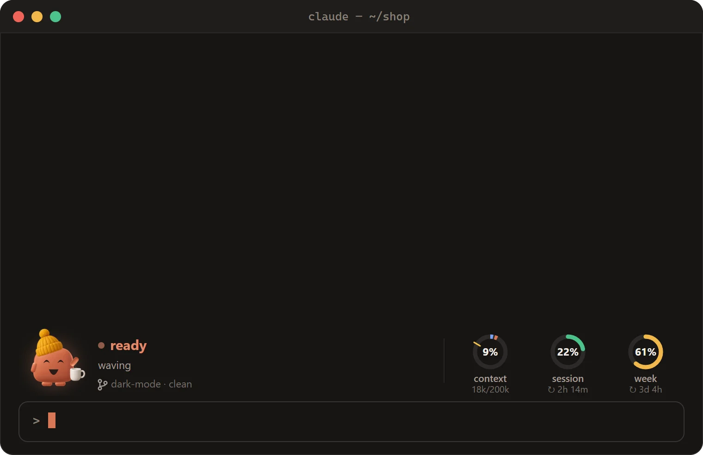
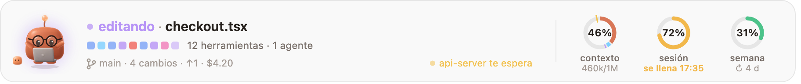
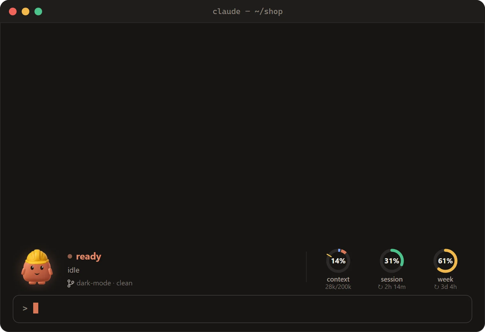
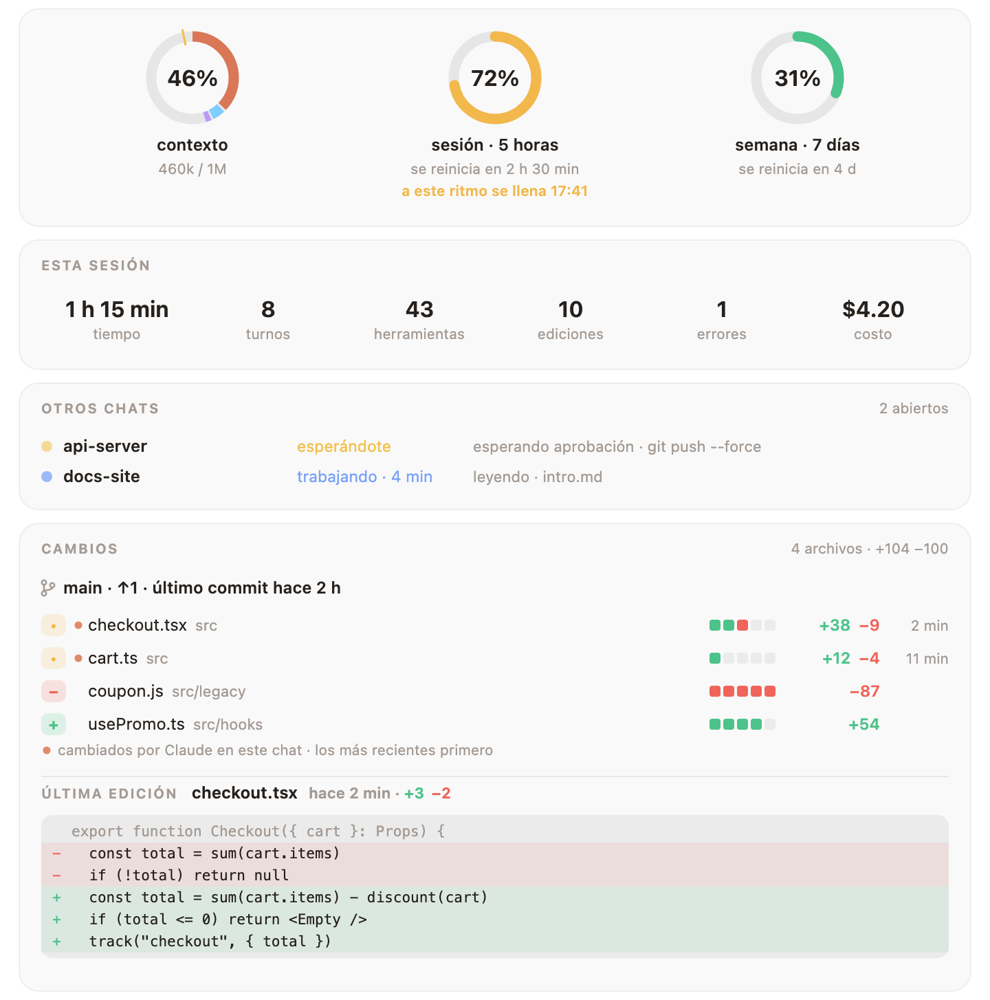
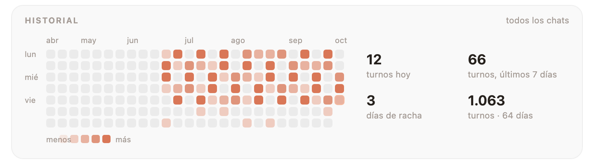
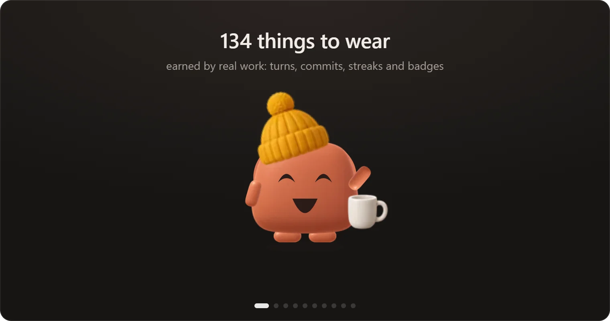
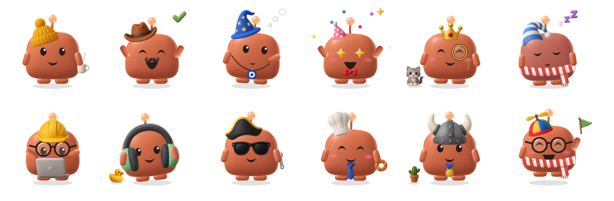

<div align="center">


# Mochi

### Un pequeño amigo de arcilla que vive encima de tu prompt de Claude Code.

Reacciona a todo lo que hace Claude, frena los comandos de los que te arrepentirías<br>
y mantiene a la vista tu contexto y tus límites de sesión y de semana.

<a href="https://cdn.jsdelivr.net/gh/oztrkemree/mochi@main/docs/mochi-short.mp4"></a>

[](LICENSE)
[](#-instalación-en-10-segundos)
[](#-16-idiomas)
[](#-un-armario-que-crece-contigo)
[](#-qué-toca)

<sub>[English](README.md) · [Türkçe](README.tr.md) · **Español** · [Deutsch](README.de.md) · [Français](README.fr.md) · [Português](README.pt.md) · [Русский](README.ru.md) · [中文](README.zh.md) · [日本語](README.ja.md) · [한국어](README.ko.md)</sub>

<br>



<sub>Un turno real. Cada cara y cada frase sale del propio código de dibujo y de reacciones de Mochi.</sub>

</div>

<br>

## ⚡ Instalación en 10 segundos

```
/plugin install mochi --marketplace oztrkemree/mochi
```

Escríbelo en cualquier chat de Claude Code, responde `y` para añadir el marketplace y elige el ámbito **user**. Y listo: Mochi aparece al instante, y también en cada chat que abras a partir de ahí. No hay nada que configurar.

> [!NOTE]
> Mochi está construido sobre los módulos de hooks de Claude Code (hooks de función) y necesita **Claude Code 2.1.293 o posterior** (`claude --version` te dice cuál tienes). Las versiones anteriores, como la 2.1.286, no llegan a cargar el módulo, así que Mochi nunca aparece.

> [!TIP]
> **Actualizar.** Mochi avisa cuando sale una versión nueva, y `/mochi actualizar` muestra qué ejecutar. Claude Code no refresca solo un marketplace de GitHub, así que el botón Update puede quedar gris; en una terminal:
>
> ```
> claude plugin marketplace update mochi
> claude plugin update mochi@mochi
> ```
>
> y reinicia Claude Code.

<br>

<table>
<tr>
<td align="center" width="25%">🎭<br><b>30 estados de ánimo</b><br><sub>que siguen cada llamada a herramientas</sub></td>
<td align="center" width="25%">🛡️<br><b>Un escudo</b><br><sub>para <code>rm -rf</code>, los force push y las claves filtradas</sub></td>
<td align="center" width="25%">📊<br><b>Anillos de límites</b><br><sub>con un pronóstico de cuándo te quedarás sin margen</sub></td>
<td align="center" width="25%">👒<br><b>136 cosas que ponerse</b><br><sub>ganadas con trabajo de verdad</sub></td>
</tr>
</table>

## 🎭 Siente lo que está haciendo Claude

Pensando, leyendo, buscando, escribiendo, ejecutando un comando, esperándote, celebrando unos tests en verde, mareado tras tres errores seguidos, durmiendo cuando no estás. **Treinta estados de ánimo, sin cortes bruscos**: cada pose fluye con suavidad desde la anterior, así que la franja nunca parpadea, respira.

<p align="center">
  
</p>

Junto a la cara: lo que está pasando en palabras claras (`editando checkout.tsx`, `tests superados · 4s`), las últimas llamadas a herramientas como una fila de cuadraditos (la que está en curso respira, la que falla se pone roja), tu rama y cuántos archivos han cambiado.

## 📊 Tus límites, de un vistazo y con pronóstico

<picture>
  <source media="(prefers-color-scheme: dark)" srcset="docs/band-es-dark.png">
  
</picture>

Tres anillos: la **ventana de contexto**, la **sesión de 5 horas** y la **semana**. Se acabó escribir `/usage` cada diez minutos.

- **Un pronóstico, no solo un número.** ¿Gastas un límite más rápido de lo que se reinicia? El anillo te dice *cuándo* se agotará (`lleno 16:40`), primero en ámbar y luego en rojo a medida que se acerca.
- **También buenas noticias.** Cuando se reinicia un límite que tenías casi agotado, Mochi te avisa.
- **El anillo de contexto sabe lo que lleva dentro**: el prompt del sistema, las herramientas, MCP, la memoria, las skills y los mensajes, cada uno con su color, y una marca en el punto donde saltará la compactación automática.

## 🛡️ El escudo: frena lo que no se puede deshacer

<p align="center">
  
</p>

El escudo lee cada comando que ejecuta Claude, por Bash o por PowerShell, y cada edición que hace. Antes de cualquier cosa que no se pueda deshacer, se detiene y pregunta, **explicando en palabras claras qué se destruiría**: borrar archivos y carpetas para siempre (`rm -rf`, `Remove-Item -Recurse`, `del /s`), borrar un disco entero, reescribir el historial de una rama, tirar los cambios sin commit, eliminar una base de datos, destruir infraestructura o un bucket en la nube, `npm unpublish`, `docker system prune -a`, un script de internet que va directo a la shell, `sudo`.

- **Los force push se juzgan según la rama.** Hacia `main`, `master`, `trunk` o `develop`, pregunta y nombra la rama. Hacia tu propia rama pregunta con una mirada nerviosa en vez de la alarma; un `--force-with-lease` allí solo se lleva la mirada.
- **Los secretos no entran en tu historial.** Antes de que Claude escriba, añada con `git add` o haga commit de algo que parezca una clave o un token reales (AWS, GitHub, Anthropic, OpenAI, Slack, Stripe, una clave privada, una contraseña) o de un archivo como `.env` o `id_rsa`, Mochi pregunta y muestra el valor enmascarado: `AKIA••••••LE`. Los marcadores de posición y los valores de prueba evidentes pasan sin preguntar.
- **Permitir siempre aquí.** La pregunta ofrece **Ejecutar** (o **Escribir**), **Detener** y **Permitir siempre aquí**, que recuerda ese tipo de comando para este repositorio. Vale para lo que se queda dentro de él: un comando o una edición que sale de él (`rm -rf ~`, un archivo de tu carpeta personal) vuelve a preguntar. `/mochi escudo` muestra qué está permitido y dónde; `/mochi escudo restablecer` lo olvida todo.
- **Una red de seguridad, no un sandbox.** El escudo compara el texto de un comando con patrones conocidos, así que atrapa descuidos, también dentro de `bash -c`, subshells y `$(…)`. No ve un comando que se arma al ejecutarse (variables, codificaciones), que está dentro de un script o que corre fuera de las herramientas Bash y PowerShell, y no detiene a quien intenta esquivarlo. Para un aislamiento real usa un sandbox o un contenedor. [Qué ve y qué no](docs/SHIELD.md).

<details>
<summary><b>Escribe tus propias reglas</b> en <code>~/.claude/mochi/shield.json</code></summary>

<br>

```json
{
  "add": [{ "match": "terraform\\s+apply", "says": "changes the live infrastructure" }],
  "off": ["publish", "sudo"]
}
```

- `match` es una expresión regular que se prueba con cada comando de Bash y de PowerShell, sin distinguir mayúsculas. `says` es lo que haría ese comando y aparece en la pregunta; si falta, la pregunta dice que coincide con una de tus reglas.
- `off` enumera los tipos incorporados por los que ya no quieres que pregunte: cualquier clave de `danger` en [`hooks/lang/es.ts`](hooks/lang/es.ts) (`rm`, `forcePush`, `publish`, `sudo`…), `secret` o uno de sus tipos (`secret:aws`, `secret:github`, `secret:apiKey`, `secret:slack`, `secret:stripe`, `secret:privateKey`, `secret:generic`), `secretFile` y `secretEdit`.
- Mochi vuelve a leer el archivo cada vez que cambia, y lo dice en un aviso. Lo que no puede usar se omite y lo nombra; si el archivo no es JSON válido, ninguna de tus reglas se aplica hasta que lo sea. Antes de que el propio Claude cambie el archivo, el escudo pregunta.

</details>

## 🧡 Todo lo demás en lo que se fija

<table>
<tr>
<td width="50%" valign="top">

### 🔁 Vigilancia de bucles
El mismo comando fallando tres veces, el mismo error que vuelve, la misma llamada que devuelve siempre lo mismo: Mochi se da cuenta **antes que tu límite**, y te dice que pulses Esc.

</td>
<td width="50%" valign="top">

### 🔔 Alertas mientras no estás
Una notificación del sistema (macOS, Windows o Linux) cuando termina un turno de más de dos minutos, cuando un trabajo largo se para a esperarte, cuando se reinicia tu límite o cuando falla la CI. **Aprovecha para prepararte un té.**

</td>
</tr>
<tr>
<td valign="top">

### 💬 Todos los chats en un tablero
Cada chat de Claude Code de tu máquina, primero este y después los que te esperan, con su rama (los worktrees, marcados), qué está haciendo y desde hace cuánto. Si un chat lleva cinco minutos esperándote, te llega una notificación más.

</td>
<td valign="top">

### 🚦 CI después de cada push
Mochi sigue las ejecuciones de GitHub Actions con tu propio `gh`: `ci en curso · 2/5` en la franja, una fiesta cuando pasan y el nombre del workflow que ha fallado cuando no. Entre ejecuciones: el pull request de tu rama, su revisión y sus checks (`PR #12 · aprobado · checks 4/5`).

</td>
</tr>
<tr>
<td valign="top">

### 💡 Consejos en el momento justo
De vez en cuando, mientras Mochi está en reposo, un consejo breve de Claude Code sobre lo que acaba de pasar: Esc Esc tras un turno detenido, `/compact` cuando el contexto se llena. Si das la misma instrucción por tercera vez, Mochi se ofrece a añadirla a `CLAUDE.md`; solo la escribe si eliges **Añadir**.

</td>
<td valign="top">

### 🏅 Insignias por trabajo de verdad
Dieciocho, y cada una se celebra una sola vez: los primeros tests en verde, una remontada en un solo turno, un día de limpieza en el que quitas más de lo que añades, búho nocturno, madrugador, políglota, un turno maratoniano, cien commits, y algunas difíciles: una racha de 30 días, 500 commits, 5.000 ediciones, 10.000 líneas eliminadas…

</td>
</tr>
<tr>
<td valign="top">

### 🎉 Días especiales, pequeñas sorpresas
La temporada de sakura, Hacktoberfest, Halloween, Año Nuevo y tu cumpleaños visten a Mochi con lo que se ha ganado. Dale las buenas noches a Mochi, o las gracias. Si llevas dos horas sin descansar, te propone estirar un poco.

</td>
<td valign="top">

### 🧩 Otros plugins pueden hablar a través de él
Tu plugin de despliegue puede hacer que Mochi aplauda cuando sale una versión, y tu linter, que frunza el ceño. Basta con una llamada: `$.mochi.react({ mood, line })`. Mira [para autores de plugins](#-para-autores-de-plugins).

</td>
</tr>
</table>

## 🔍 El panel de detalles

**Haz clic en los anillos** y todo se despliega: esta sesión de un vistazo, todos los chats de tu máquina, tu CI y tu pull request, y **cada archivo modificado con sus líneas añadidas y eliminadas**, primero los que Claude tocó en este chat, cada uno con su diff en rojo y verde.

<picture>
  <source media="(prefers-color-scheme: dark)" srcset="docs/details-es-dark.png">
  
</picture>

Más abajo: el contexto por categoría, tus turnos recientes, un calendario con los días de todos tus chats, tu nivel, tu armario y tus insignias, y todos los ajustes y acciones, a un clic.

<picture>
  <source media="(prefers-color-scheme: dark)" srcset="docs/history-es-dark.png">
  
</picture>

## 👒 Un armario que crece contigo

<p align="center">
  
</p>

Cada turno, edición, commit y día de trabajo suma experiencia. Los niveles desbloquean cosas que ponerse: **136 accesorios** para la cabeza, la cara, el cuello, la mano y el hueco al lado de Mochi. Nada se abre por la fecha: los niveles abren la mayoría, los hábitos algunos y las insignias difíciles el resto (un sombrero de bruja y una calabaza por ciento cincuenta noches, un pastel por quinientos commits). Una vez ganados, el sombrero de bruja aparece en Halloween y el pastel en tu cumpleaños; el café llega por la mañana y el gorro de dormir pasada la medianoche.

<p align="center">
  
</p>

<picture>
  <source media="(prefers-color-scheme: dark)" srcset="docs/level-es-dark.png">
  
</picture>

Elige qué ponerle en la sección **Armario** del panel de detalles, o con `/mochi poner gafas`. Dile a Mochi cuándo es tu cumpleaños con `/mochi cumpleaños 04-23`; el dato no sale de tu máquina. ¿Se te ocurre algo nuevo que ponerle? [docs/OUTFITS.md](docs/OUTFITS.md) explica cómo añadirlo.

## 📸 Presume de él

- **`/mochi tarjeta`** dibuja una tarjeta: Mochi con el atuendo de hoy, tu nivel, tu experiencia y tus rachas.
- **`/mochi resumen`** resume tu mes, en todos tus chats, en una sola imagen: horas, turnos, commits, tu día más activo, tu racha más larga y la carpeta en la que más tiempo pasaste. `/mochi resumen año` hace lo mismo con el año. En la primera semana de cada mes, Mochi te avisa una vez de que el del mes anterior ya está listo.
- **`/mochi captura`** guarda la franja y el panel de detalles tal como están ahora mismo. Échale un vistazo antes de publicarla: muestra lo mismo que la franja, incluida tu rama. Tus otros chats y las líneas de tu última edición se quedan fuera.

Son archivos SVG en `~/.claude/mochi/share/`, pensados para verse bien en páginas claras y oscuras, y no dependen de nada externo. X y Reddit solo aceptan PNG: con `rsvg-convert` o ImageMagick instalado, `/mochi captura` guarda también un PNG de cada uno.

<details>
<summary><b>Pon tu tarjeta en tu perfil de GitHub</b></summary>

<br>

1. Clona el repositorio de tu perfil, el que se llama como tu usuario (`tu-usuario/tu-usuario`).
2. Ejecuta `/mochi tarjeta ~/code/tu-usuario` con la ruta de esa carpeta; la tarjeta se guarda ahí como `mochi-card.svg`.
3. Pega en el `README.md` del repositorio la línea que te da Mochi, y luego haz commit y push:

   ```md
   [](https://github.com/oztrkemree/mochi)
   ```

La tarjeta es una instantánea: cuando subas de nivel, vuelve a ejecutar `/mochi tarjeta` y haz push de la nueva.

</details>

## ⌨️ Comandos

No te hace falta ninguno: Mochi funciona en cuanto lo instalas. Cuando quieras manejarlo, todo está bajo `/mochi`.

| Comando | Qué hace |
| --- | --- |
| `/mochi` | Oculta o muestra la franja (o elige tú con `/mochi hide` · `/mochi show`) |
| `/mochi details` | Abre el panel de detalles |
| `/mochi wear [item \| auto \| none]` | Ponle algo, deja que Mochi se vista solo o quítale todo |
| `/mochi shield [on \| off]` | Dice si el escudo está activo y qué está siempre permitido y dónde |
| `/mochi card [path]` · `/mochi wrapped [year]` · `/mochi snap` | Guarda una imagen para compartir |
| `/mochi small` · `/mochi big` | Una línea o tamaño completo |

<details>
<summary><b>Todos los comandos</b></summary>

<br>

| Comando | Qué hace |
| --- | --- |
| `/mochi` | Oculta o muestra la franja (o elige tú con `/mochi hide` · `/mochi show`) |
| `/mochi details` | Abre el panel de detalles |
| `/mochi level` | Tu nivel, tu experiencia y lo que aún está bloqueado |
| `/mochi wear [item \| auto \| none]` | Ponle algo, deja que Mochi se vista solo o quítale todo |
| `/mochi badges` | Las insignias que has ganado y cómo conseguir las demás |
| `/mochi chats` | Todos los chats de esta máquina, primero los que te esperan |
| `/mochi shield [on \| off]` | Dice si el escudo está activo y qué está siempre permitido y dónde; `on` u `off` lo cambia |
| `/mochi shield reset` | Olvida todo lo que recordó «Permitir siempre aquí» |
| `/mochi alerts` | Activa o desactiva las notificaciones (y el aviso de que tu resumen está listo) |
| `/mochi ci` | Activa o desactiva la vigilancia de CI |
| `/mochi tips` | Activa o desactiva los consejos, las sugerencias para `CLAUDE.md` y la nota de novedades |
| `/mochi breaks` | Activa o desactiva la sugerencia de estirarte |
| `/mochi sound` | Activa o desactiva los sonidos |
| `/mochi plugins` | Activa o desactiva las reacciones de otros plugins |
| `/mochi card [path]` | Guarda una tarjeta para tu perfil de GitHub |
| `/mochi wrapped [year]` | Guarda tu mes, o tu año, en una sola imagen |
| `/mochi snap` | Guarda la franja y el panel de detalles como imágenes |
| `/mochi tour` | Vuelve a ver el recorrido de bienvenida |
| `/mochi news` | Lo que trae esta versión |
| `/mochi birthday [MM-DD \| none]` | Dile a Mochi tu cumpleaños, consúltalo u olvídalo |
| `/mochi lang [code \| auto]` | Muestra o cambia el idioma |
| `/mochi small` · `/mochi big` | Una línea o tamaño completo |
| `/mochi export` | Guarda todo lo que conserva Mochi en un solo archivo JSON |
| `/mochi reset [level \| history \| all]` | Borra la memoria del nivel, el historial o todo, ajustes incluidos; pregunta antes, y las exportaciones y tu `shield.json` se conservan |
| `/mochi feedback` | Un enlace a un informe de error, ya relleno con las versiones, tu sistema, la interfaz y el idioma |
| `/mochi status` | Lo que Mochi sabe ahora mismo |

Las palabras en inglés siempre funcionan, y cada idioma añade las suyas (`/mochi aksesuar`, `/mochi idioma`, `/mochi sprache`…). Un comando que activa o desactiva algo lo cambia cada vez; añade `on` u `off` para fijarlo: `/mochi tips off`.

</details>

## 🌍 16 idiomas

English · Türkçe · Español · Deutsch · Français · Português · Русский · 中文 · 日本語 · 한국어 · Italiano · Polski · Українська · हिन्दी · Bahasa Indonesia · العربية

Mochi habla el idioma del ajuste `language` de Claude Code si es uno de estos; si no, el idioma preferido de tu sistema y luego `LANG`; y si nada encaja, inglés. Con `/mochi idioma ja` eliges uno tú mismo, y con `/mochi idioma automático` vuelves al modo automático.

## 🔒 Qué toca

**Todo se queda en tu máquina.** Mochi no envía nada sobre ti ni sobre tu trabajo a ningún sitio. Su única petición propia lee su número de versión en GitHub, como mucho cada 12 horas, para avisarte cuando hay una actualización; mientras `CLAUDE_CODE_DISABLE_NONESSENTIAL_TRAFFIC` esté definida, ni eso. Lo único más que habla con internet es tu propio `gh`, para la vigilancia de CI, y `/mochi ci` la desactiva.

<details>
<summary><b>La lista completa</b></summary>

<br>

- **git**, en la carpeta del chat y solo para leer: `git status`, `git log`, `git diff --numstat` y `git rev-parse` para la franja y el panel de detalles. Cuando el escudo necesita mirar más de cerca, consulta la rama y la rama por defecto, los archivos que añadiría un `git add` (`git ls-files`) y lo que entraría en un `git commit` (`git diff`).
- **gh**, solo mientras la vigilancia de CI está activada y con tu propia sesión (Mochi nunca ve tu token): `gh pr view` cuando empieza un chat, cuando abres el panel de detalles y en torno a un push; `gh run list` solo después de un push en este chat, cada 30 segundos hasta que terminan las ejecuciones, media hora como mucho. `/mochi ci` desactiva los dos.
- **GitHub, para las actualizaciones**: como mucho cada 12 horas, y cuando ejecutas `/mochi update`, una simple descarga de `.claude-plugin/plugin.json` desde `raw.githubusercontent.com/oztrkemree/mochi` para comparar números de versión. No lleva nada sobre ti ni sobre tu trabajo y no se hace mientras `CLAUDE_CODE_DISABLE_NONESSENTIAL_TRAFFIC` esté definida.
- **Las herramientas del propio sistema**: notificaciones con `osascript` en macOS, PowerShell en Windows y `notify-send` en Linux. Para el idioma, `defaults read -g AppleLanguages` en macOS y `reg query` en Windows; `uname` distingue macOS de Linux. Para los PNG de `/mochi captura`, `rsvg-convert` o el `magick` de ImageMagick, si lo tienes. Los archivos de los chats cerrados, y lo que borra `/mochi restablecer`, se eliminan por nombre con `rm`, o con el `del` de `cmd` en Windows, y solo dentro de `~/.claude/mochi/`.
- **Archivos en `~/.claude/mochi/`**: cómo va cada chat abierto, recuentos diarios, tu nivel y tus insignias, lecturas de uso para el pronóstico, cuántas veces se ha mostrado cada consejo y las instrucciones cortas que repites (nunca prompts enteros), las marcas que le indican a un chat que anuncie el reinicio de un límite, tu `shield.json` si escribes uno, y lo que guardan `/mochi tarjeta`, `resumen`, `captura` y `exportar`. Los ajustes, lo que está siempre permitido y tu cumpleaños se guardan en el almacén que Claude Code reserva a los plugins.
- **Tu proyecto**: Mochi lee `CLAUDE.md` antes de sugerir una instrucción y solo añade una línea después de que elijas **Añadir**. Solo guarda ahí la tarjeta si le das a `/mochi tarjeta` una ruta dentro del proyecto. Para contar líneas y detectar secretos, lee el archivo que Claude está a punto de sobrescribir y, si un comando añade y hace commit a la vez, los archivos nuevos que añadiría (hasta 20, de menos de 1 MB cada uno). No conserva nada de lo que lee.
- **Otros plugins** pueden mostrar un estado de ánimo y una frase corta a través de Mochi, firmados con su nombre, cada uno como mucho una vez cada 10 segundos; `/mochi complementos` lo desactiva. `/mochi comentarios` solo muestra un enlace: no se envía nada.

</details>

## ❓ Preguntas frecuentes

<details>
<summary><b>Lo he instalado, pero Mochi no aparece.</b></summary>

<br>

Comprueba `claude --version`: Mochi necesita **2.1.293 o posterior**. Las versiones anteriores no llegan a cargar los módulos de hooks. Si tu versión es lo bastante nueva, `/mochi estado` te dice lo que sabe Mochi, y `/mochi comentarios` te da un informe de error ya relleno.

</details>

<details>
<summary><b>Ocupa demasiado espacio.</b></summary>

<br>

`/mochi pequeño` lo deja en una sola línea. `/mochi` lo oculta del todo, y si lo vuelves a escribir, regresa.

</details>

<details>
<summary><b>¿Envía mi código o mis prompts a alguna parte?</b></summary>

<br>

No. Mochi no envía nada sobre tu código ni tus prompts a ningún sitio; su única petición lee su propio número de versión en GitHub. Guarda recuentos cortos en `~/.claude/mochi/`, nunca prompts enteros. Mira [qué toca](#-qué-toca).

</details>

<details>
<summary><b>¿El escudo puede estorbarme?</b></summary>

<br>

Solo pregunta antes de lo que no se puede deshacer, y **Permitir siempre aquí** recuerda tu respuesta para ese repositorio. `/mochi escudo desactivar` lo apaga; `shield.json` desactiva tipos concretos.

</details>

## 🧩 Para autores de plugins

Tu plugin puede hacer que Mochi reaccione: que aplauda cuando termina un despliegue o que ponga cara de preocupación cuando falla un check. Añade `mochi` en `dependencies` y llama a `$.mochi.react({ mood, line })` o a `$.mochi.celebrate({ line })`. En [docs/API.md](docs/API.md) tienes las llamadas, los límites y un plugin de ejemplo completo.

## 🤝 Contribuir

Informes de errores, ideas, traducciones, ilustraciones y pull requests: todo es bienvenido. [Abre un issue](https://github.com/oztrkemree/mochi/issues/new/choose) (`/mochi comentarios` te da un informe de error ya relleno) o lee [CONTRIBUTING.md](CONTRIBUTING.md) para meterte con el código: dos comandos lo comprueban todo (`claude plugin validate .` y `claude plugin test .`), y añadir un idioma es un diccionario y unas pocas líneas. Los cambios de cada versión están en [CHANGELOG.md](CHANGELOG.md).

Las imágenes animadas de esta página las dibuja el propio código de Mochi: `node scripts/gifs.mjs` y `node scripts/demo.mjs` las vuelven a generar.

## 📄 Licencia

[MIT](LICENSE). Úsalo, cámbialo, compártelo.

<br>

<div align="center">

**Si Mochi te ha sacado una sonrisa, una ⭐ ayuda a que otros lo encuentren.**

<sub>Hecho con cariño por <a href="https://github.com/oztrkemree">Emre Öztürk</a> y Claude.</sub>

</div>
