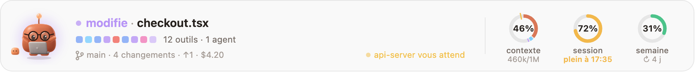
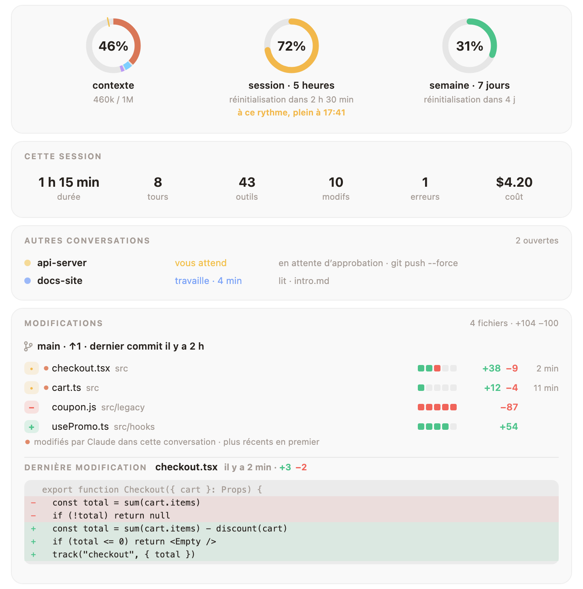
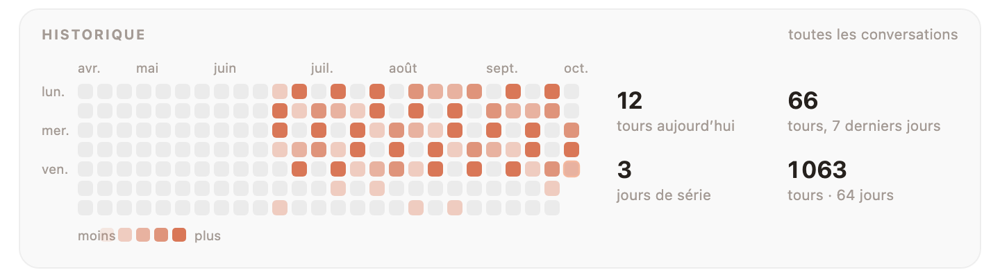

<div align="center">


# Mochi

### Un petit compagnon d’argile qui vit au-dessus de votre prompt Claude Code.

Il réagit à tout ce que fait Claude, arrête les commandes que vous regretteriez,<br>
et garde sous vos yeux vos limites de contexte, de session et de semaine.

<a href="https://cdn.jsdelivr.net/gh/oztrkemree/mochi@main/docs/mochi-short.mp4"></a>

[](LICENSE)
[](#-installer-en-10-secondes)
[](#-16-langues)
[](#-une-garde-robe-qui-grandit-avec-vous)
[](#-ce-que-mochi-touche)

[English](README.md) · [Türkçe](README.tr.md) · [Español](README.es.md) · [Deutsch](README.de.md) · **Français** · [Português](README.pt.md) · [Русский](README.ru.md) · [中文](README.zh.md) · [日本語](README.ja.md) · [한국어](README.ko.md)

<br>


<sub>Un vrai tour. Chaque visage et chaque phrase ici sortent du propre code de dessin et de réaction de Mochi.</sub>

</div>

<br>

## ⚡ Installer en 10 secondes

```
/plugin install mochi --marketplace oztrkemree/mochi
```

Tapez cette commande dans n’importe quelle conversation Claude Code, répondez `y` pour ajouter la marketplace et choisissez la portée **user**. C’est tout : Mochi apparaît aussitôt, puis dans chaque conversation que vous ouvrirez ensuite. Rien à configurer.

> [!NOTE]
> Mochi repose sur les modules de hooks de Claude Code (des hooks sous forme de fonctions) et demande **Claude Code 2.1.293 ou plus récent** (`claude --version` vous indique le vôtre). Les versions plus anciennes, comme la 2.1.286, ne chargent pas du tout le module : Mochi n’apparaît jamais.

> [!TIP]
> **Mettre à jour.** Mochi te prévient quand une nouvelle version sort, et `/mochi maj` montre quoi lancer. Claude Code ne rafraîchit pas seul un marketplace GitHub, le bouton Update peut donc rester gris ; dans un terminal :
>
> ```
> claude plugin marketplace update mochi
> claude plugin update mochi@mochi
> ```
>
> puis redémarre Claude Code.

<br>

<table>
<tr>
<td align="center" width="25%">🎭<br><b>30 humeurs</b><br><sub>qui suivent chaque appel d’outil</sub></td>
<td align="center" width="25%">🛡️<br><b>Un bouclier</b><br><sub>contre <code>rm -rf</code>, les force push et les clés qui fuient</sub></td>
<td align="center" width="25%">📊<br><b>Des anneaux de limites</b><br><sub>avec une prévision du moment où vous serez à court</sub></td>
<td align="center" width="25%">👒<br><b>136 accessoires</b><br><sub>gagnés par du vrai travail</sub></td>
</tr>
</table>

## 🎭 Il ressent ce que fait Claude

Il réfléchit, lit, cherche, tape, lance une commande, vous attend, fête des tests enfin au vert, a le tournis après trois erreurs d’affilée, s’endort quand vous vous absentez. **Trente humeurs, sans à-coups** : chaque pose s’enchaîne en douceur avec la précédente, si bien que le bandeau ne clignote jamais, il respire.

<p align="center">
  
</p>

À côté du visage : ce qui se passe, en mots simples (`modification de checkout.tsx`, `tests réussis · 4 s`), les derniers appels d’outils sous forme d’une rangée de petits carrés (celui en cours respire, celui qui a échoué vire au rouge), votre branche et le nombre de fichiers modifiés.

## 📊 Vos limites d’un coup d’œil, avec une prévision

<picture>
  <source media="(prefers-color-scheme: dark)" srcset="docs/band-fr-dark.png">
  
</picture>

Trois anneaux : la **fenêtre de contexte**, la **session de 5 heures** et la **semaine**. Fini de taper `/usage` toutes les dix minutes.

- **Une prévision, pas juste un chiffre.** Vous consommez une fenêtre plus vite qu’elle ne se réinitialise ? L’anneau vous dit *quand* vous arriverez au bout (`plein à 16:40`), en orange, puis en rouge à l’approche.
- **Les bonnes nouvelles aussi.** Quand une limite presque épuisée se réinitialise, Mochi vous le dit.
- **L’anneau du contexte sait ce qu’il contient** : prompt système, outils, MCP, mémoire, skills, messages, chacun de sa couleur, et un repère à l’endroit où l’auto‑compact se déclenchera.

## 🛡️ Le bouclier : il arrête ce qui ne se rattrape pas

<p align="center">
  
</p>

Le bouclier lit chaque commande que Claude exécute, via Bash ou PowerShell, et chaque modification qu’il fait. Avant tout ce qui ne peut pas être annulé, il s’arrête et demande, **en expliquant clairement ce qui serait détruit** : supprimer pour de bon des fichiers et des dossiers (`rm -rf`, `Remove-Item -Recurse`, `del /s`), effacer un disque, écraser l’historique d’une branche, jeter des modifications non commitées, supprimer une base de données, détruire de l’infrastructure ou un bucket cloud, `npm unpublish`, `docker system prune -a`, un script d’internet envoyé tout droit au shell, `sudo`.

- **Les force push sont jugés selon la branche.** Sur `main`, `master`, `trunk` ou `develop`, il demande et nomme la branche. Sur votre propre branche, il demande avec un regard inquiet plutôt qu’avec l’alarme ; un `--force-with-lease` n’y a droit qu’au regard.
- **Les secrets restent hors de votre historique.** Avant que Claude n’écrive, n’ajoute avec `git add` ou ne commite ce qui ressemble à une vraie clé ou un vrai jeton (AWS, GitHub, Anthropic, OpenAI, Slack, Stripe, une clé privée, un mot de passe), ou un fichier comme `.env` ou `id_rsa`, Mochi demande et montre la valeur masquée : `AKIA••••••LE`. Les valeurs factices et les valeurs de test évidentes passent.
- **Toujours autoriser ici.** La question propose **Exécuter** (ou **Écrire**), **Arrêter** et **Toujours autoriser ici**, qui retient ce type de commande pour ce dépôt. Cela vaut pour ce qui y reste : une commande ou une modification qui en sort (`rm -rf ~`, un fichier de votre dossier personnel) redemande. `/mochi bouclier` liste ce qui est autorisé et où ; `/mochi bouclier réinitialiser` oublie tout.

<details>
<summary><b>Écrivez vos propres règles</b> dans <code>~/.claude/mochi/shield.json</code></summary>

<br>

```json
{
  "add": [{ "match": "terraform\\s+apply", "says": "modifie l’infrastructure en production" }],
  "off": ["publish", "sudo"]
}
```

- `match` est une expression régulière testée sur chaque commande Bash et PowerShell, sans tenir compte de la casse. `says` dit ce que ferait une telle commande et s’affiche dans la question ; sans lui, la question indique que la commande correspond à l’une de vos règles.
- `off` liste les types intégrés pour lesquels ne plus demander : n’importe quelle clé de `danger` dans [`hooks/lang/fr.ts`](hooks/lang/fr.ts) (`rm`, `forcePush`, `publish`, `sudo`…), `secret` ou l’un de ses types (`secret:aws`, `secret:github`, `secret:apiKey`, `secret:slack`, `secret:stripe`, `secret:privateKey`, `secret:generic`), `secretFile` et `secretEdit`.
- Mochi relit le fichier dès qu’il change, et le signale dans un toast. Ce qu’il ne peut pas utiliser est ignoré et nommé ; si le fichier n’est pas un JSON valide, aucune de vos règles ne s’applique tant qu’il ne l’est pas. Avant que Claude lui-même modifie ce fichier, le bouclier demande.

</details>

## 🧡 Tout ce qu’il remarque d’autre

<table>
<tr>
<td width="50%" valign="top">

### 🔁 Une sentinelle anti-boucle
La même commande qui échoue trois fois, la même erreur qui revient, le même appel qui renvoie toujours la même chose : Mochi le repère **avant que votre limite n’y passe**, et vous dit d’appuyer sur Esc.

</td>
<td width="50%" valign="top">

### 🔔 Des alertes pendant votre absence
Une notification système (macOS, Windows ou Linux) quand un tour de plus de deux minutes se termine, quand une longue tâche s’arrête pour vous attendre, quand votre limite se réinitialise ou quand la CI échoue. **Allez donc vous faire un thé.**

</td>
</tr>
<tr>
<td valign="top">

### 💬 Toutes les conversations sur un même tableau
Toutes les conversations Claude Code de votre machine, celle-ci d’abord, puis celles qui vous attendent, chacune avec sa branche (worktrees signalés), ce qu’elle fait et depuis combien de temps. Une conversation qui vous attend depuis cinq minutes envoie une notification de plus.

</td>
<td valign="top">

### 🚦 La CI après un push
Mochi suit vos exécutions GitHub Actions via votre propre `gh` : `ci en cours · 2/5` dans le bandeau, la fête quand elles passent, le nom du workflow en échec sinon. Entre deux exécutions : la pull request de votre branche, sa revue et ses vérifications (`PR #12 · approuvée · vérifications 4/5`).

</td>
</tr>
<tr>
<td valign="top">

### 💡 Des astuces au bon moment
De temps en temps, quand Mochi est au repos, une courte astuce Claude Code en lien avec ce qui vient de se passer : Esc Esc après un tour interrompu, `/compact` quand le contexte se remplit. Donnez la même consigne une troisième fois et Mochi propose de l’ajouter à `CLAUDE.md` ; il n’écrit que si vous choisissez **Ajouter**.

</td>
<td valign="top">

### 🏅 Des badges pour le vrai travail
Dix-huit en tout, chacun fêté une seule fois : des tests au vert pour la première fois, un retour gagnant en un seul tour, une journée de ménage qui supprime plus qu’elle n’ajoute, oiseau de nuit, lève-tôt, polyglotte, un tour marathon, cent commits, et des plus coriaces : une série de 30 jours, 500 commits, 5 000 modifications, 10 000 lignes supprimées…

</td>
</tr>
<tr>
<td valign="top">

### 🎉 Jours spéciaux, petites surprises
La saison des cerisiers en fleurs, Hacktoberfest, Halloween, le Nouvel An et votre anniversaire habillent chacun Mochi, avec ce qu’il a gagné. Souhaitez bonne nuit à Mochi, ou remerciez-le. Après deux heures sans pause, il vous propose de vous étirer.

</td>
<td valign="top">

### 🧩 D’autres plugins peuvent parler à travers lui
Votre plugin de déploiement peut faire applaudir Mochi quand une version part, votre linter peut lui faire froncer les sourcils. Un seul appel : `$.mochi.react({ mood, line })`. Voir [pour les auteurs de plugins](#-pour-les-auteurs-de-plugins).

</td>
</tr>
</table>

## 🔍 Le panneau de détails

**Cliquez sur les anneaux** et tout se déplie : cette session d’un coup d’œil, toutes les conversations de votre machine, votre CI et votre pull request, et **chaque fichier modifié, avec ses lignes ajoutées et supprimées**, ceux que Claude a touchés dans cette conversation en tête de liste, avec le diff de chaque fichier en rouge et vert.

<picture>
  <source media="(prefers-color-scheme: dark)" srcset="docs/details-fr-dark.png">
  
</picture>

Plus bas : le contexte par catégorie, vos derniers tours, un calendrier des journées de toutes vos conversations, votre niveau, votre garde-robe et vos badges, et chaque réglage et chaque action, à un clic.

<picture>
  <source media="(prefers-color-scheme: dark)" srcset="docs/history-fr-dark.png">
  
</picture>

## 👒 Une garde-robe qui grandit avec vous

<p align="center">
  
</p>

Chaque tour, chaque modification, chaque commit et chaque journée de travail rapporte de l’expérience. Les niveaux débloquent de quoi s’habiller : **136 accessoires** pour la tête, le visage, le cou, la main et la place juste à côté de Mochi. Rien ne s’ouvre selon la date : les niveaux en ouvrent la plupart, les habitudes quelques-uns, et les badges coriaces le reste (un chapeau de sorcière et une citrouille pour cent cinquante nuits, un gâteau pour cinq cents commits). Une fois gagnés, le chapeau de sorcière sort à Halloween et le gâteau le jour de votre anniversaire ; le café arrive le matin et le bonnet de nuit après minuit.

<p align="center">
  
</p>

<picture>
  <source media="(prefers-color-scheme: dark)" srcset="docs/level-fr-dark.png">
  
</picture>

Choisissez sa tenue dans la section **Garde-robe** du panneau de détails, ou avec `/mochi porter lunettes`. Donnez votre date d’anniversaire à Mochi avec `/mochi anniversaire 04-23` ; elle reste sur votre machine. Une idée d’accessoire ? [docs/OUTFITS.md](docs/OUTFITS.md) explique comment l’ajouter.

## 📸 Montrez-le

- **`/mochi carte`** dessine une carte : Mochi dans sa tenue du jour, votre niveau, votre expérience et vos séries.
- **`/mochi bilan`** résume votre mois, toutes conversations confondues, en une seule image : heures, tours, commits, votre jour le plus actif, votre plus longue série et le dossier où vous avez passé le plus de temps. `/mochi bilan année` fait de même pour l’année. Pendant la première semaine du mois, Mochi vous prévient une fois que celui du mois précédent est prêt.
- **`/mochi capture`** enregistre le bandeau et le panneau de détails tels qu’ils sont à cet instant. Jetez-y un œil avant de la publier : elle montre ce que montre le bandeau, votre branche comprise. Vos autres conversations et les lignes de votre dernière modification restent dehors.

Ce sont des fichiers SVG rangés dans `~/.claude/mochi/share/`, lisibles sur une page claire comme sombre, et qui se suffisent à eux-mêmes. X et Reddit n’acceptent que le PNG : avec `rsvg-convert` ou ImageMagick installé, `/mochi capture` enregistre aussi un PNG de chacune.

<details>
<summary><b>Mettez votre carte sur votre profil GitHub</b></summary>

<br>

1. Clonez le dépôt de votre profil, celui qui porte le nom de votre compte (`pseudo/pseudo`).
2. Lancez `/mochi carte ~/code/pseudo` avec le chemin de ce dossier ; la carte y arrive sous le nom `mochi-card.svg`.
3. Collez la ligne que Mochi vous donne dans le `README.md` du dépôt, puis faites un commit et un push :

   ```md
   [](https://github.com/oztrkemree/mochi)
   ```

La carte est un instantané : relancez `/mochi carte` après une montée de niveau et poussez la nouvelle.

</details>

## ⌨️ Commandes

Vous n’en avez jamais besoin : Mochi fonctionne dès qu’il est installé. Quand vous voulez le piloter, tout se trouve sous `/mochi`.

| Commande | Ce qu’elle fait |
| --- | --- |
| `/mochi` | Masque ou affiche le bandeau (`/mochi hide` · `/mochi show` pour choisir) |
| `/mochi details` | Ouvre le panneau de détails |
| `/mochi wear [item \| auto \| none]` | Fait porter un accessoire, laisse Mochi choisir sa tenue, ou enlève tout |
| `/mochi shield [on \| off]` | Dit si le bouclier est actif et ce qui est toujours autorisé et où |
| `/mochi card [path]` · `/mochi wrapped [year]` · `/mochi snap` | Enregistre une image à partager |
| `/mochi small` · `/mochi big` | Sur une seule ligne ou en grand |

<details>
<summary><b>Toutes les commandes</b></summary>

<br>

| Commande | Ce qu’elle fait |
| --- | --- |
| `/mochi` | Masque ou affiche le bandeau (`/mochi hide` · `/mochi show` pour choisir) |
| `/mochi details` | Ouvre le panneau de détails |
| `/mochi level` | Votre niveau, votre expérience et ce qui reste à débloquer |
| `/mochi wear [item \| auto \| none]` | Fait porter un accessoire, laisse Mochi choisir sa tenue, ou enlève tout |
| `/mochi badges` | Les badges que vous avez obtenus, et comment obtenir les autres |
| `/mochi chats` | Toutes les conversations de cette machine, celles qui vous attendent en premier |
| `/mochi shield [on \| off]` | Dit si le bouclier est actif et montre ce qui est toujours autorisé et où ; `on` ou `off` le règle |
| `/mochi shield reset` | Oublie tout ce que « Toujours autoriser ici » a retenu |
| `/mochi alerts` | Active ou désactive les notifications (et le message qui annonce que votre bilan est prêt) |
| `/mochi ci` | Active ou désactive le suivi de la CI |
| `/mochi tips` | Active ou désactive les astuces, les suggestions pour `CLAUDE.md` et l’annonce des nouveautés |
| `/mochi breaks` | Active ou désactive la proposition de s’étirer |
| `/mochi sound` | Active ou désactive les sons |
| `/mochi plugins` | Active ou désactive les réactions venues d’autres plugins |
| `/mochi card [path]` | Enregistre une carte pour votre profil GitHub |
| `/mochi wrapped [year]` | Enregistre votre mois, ou votre année, en une seule image |
| `/mochi snap` | Enregistre le bandeau et le panneau de détails en images |
| `/mochi tour` | Relance la visite du premier démarrage |
| `/mochi news` | Ce qu’apporte cette version |
| `/mochi birthday [MM-DD \| none]` | Donne votre anniversaire à Mochi, l’affiche ou le fait oublier |
| `/mochi lang [code \| auto]` | Affiche ou change la langue |
| `/mochi small` · `/mochi big` | Sur une seule ligne ou en grand |
| `/mochi export` | Enregistre tout ce que Mochi conserve dans un seul fichier JSON |
| `/mochi reset [level \| history \| all]` | Efface la mémoire du niveau, l’historique, ou tout, réglages compris ; il demande d’abord, et les exports et votre `shield.json` restent |
| `/mochi feedback` | Un lien vers un rapport de bug, prérempli avec les versions, votre système, l’interface et la langue |
| `/mochi status` | Ce que Mochi sait en ce moment |

Les mots anglais fonctionnent toujours, et chaque langue ajoute les siens (`/mochi porter`, `/mochi bouclier`, `/mochi aksesuar`, `/mochi idioma`, `/mochi sprache`…). Une commande qui active ou désactive quelque chose bascule à chaque fois ; ajoutez `activer` ou `désactiver` pour le fixer : `/mochi astuces désactiver`.

</details>

## 🌍 16 langues

English · Türkçe · Español · Deutsch · Français · Português · Русский · 中文 · 日本語 · 한국어 · Italiano · Polski · Українська · हिन्दी · Bahasa Indonesia · العربية

Mochi parle la langue définie par le réglage `language` de Claude Code quand c’est l’une de celles-ci ; sinon la langue préférée de votre système, puis `LANG` ; à défaut, l’anglais. `/mochi langue ja` vous laisse choisir vous-même, `/mochi langue automatique` revient au mode automatique.

## 🔒 Ce que Mochi touche

**Tout reste sur votre machine.** Mochi lui-même n’effectue **aucune requête réseau** ; la seule chose qui parle à internet, c’est votre propre `gh`, pour le suivi de la CI, et `/mochi ci` le coupe.

<details>
<summary><b>La liste complète</b></summary>

<br>

- **git**, dans le dossier de la conversation, en lecture seule : `git status`, `git log`, `git diff --numstat` et `git rev-parse` pour le bandeau et le panneau de détails. Quand le bouclier doit y regarder de plus près, il demande la branche et la branche par défaut, les fichiers qu’ajouterait un `git add` (`git ls-files`) et ce que committerait un `git commit` (`git diff`).
- **gh**, seulement quand le suivi de la CI est activé, avec votre propre connexion (Mochi ne voit jamais votre jeton) : `gh pr view` au démarrage d’une conversation, à l’ouverture du panneau de détails et autour d’un push ; `gh run list` uniquement après un push dans cette conversation, toutes les 30 secondes jusqu’à la fin des exécutions, une demi-heure au plus. `/mochi ci` coupe les deux.
- **Les outils du système** : les notifications passent par `osascript` sur macOS, PowerShell sur Windows et `notify-send` sur Linux. Pour la langue, `defaults read -g AppleLanguages` sur macOS et `reg query` sur Windows ; `uname` distingue macOS de Linux. Pour les PNG de `/mochi capture`, `rsvg-convert` ou le `magick` d’ImageMagick, si vous en avez un. Les fichiers des conversations fermées, et ce qu’efface `/mochi réinitialiser`, sont supprimés par leur nom avec `rm`, ou le `del` de `cmd` sous Windows, uniquement dans `~/.claude/mochi/`.
- **Des fichiers dans `~/.claude/mochi/`** : l’état de chaque conversation ouverte, les compteurs du jour, votre niveau et vos badges, les relevés d’utilisation pour la prévision, combien de fois chaque astuce a été montrée et les courtes consignes que vous répétez (jamais des prompts entiers), les marqueurs qui désignent la conversation chargée d’annoncer qu’une limite s’est réinitialisée, votre `shield.json` si vous en écrivez un, et ce qu’enregistrent `/mochi carte`, `bilan`, `capture` et `exporter`. Les réglages, ce qui est toujours autorisé et votre anniversaire sont rangés dans l’espace de stockage que Claude Code réserve aux plugins.
- **Votre projet** : Mochi lit `CLAUDE.md` avant de suggérer une consigne et n’y ajoute une ligne qu’après que vous avez choisi **Ajouter**. Il n’y écrit la carte que si vous donnez à `/mochi carte` un chemin qui s’y trouve. Pour compter les lignes et repérer les secrets, il lit un fichier que Claude s’apprête à écraser et, pour une commande qui ajoute et commite d’un coup, les nouveaux fichiers qu’elle ajouterait (20 au plus, de moins de 1 Mo chacun). Rien de ce qu’il lit n’est conservé.
- **Les autres plugins** peuvent afficher une humeur et une courte phrase via Mochi, signées de leur nom, chacun une fois toutes les 10 secondes au plus ; `/mochi extensions` désactive cela. `/mochi avis` se contente d’afficher un lien : rien n’est envoyé.

</details>

## ❓ FAQ

<details>
<summary><b>Je l’ai installé, mais Mochi n’apparaît pas.</b></summary>

<br>

Vérifiez `claude --version` : Mochi demande **2.1.293 ou plus récent**. Les versions plus anciennes ne chargent pas du tout les modules de hooks. Si votre version est assez récente, `/mochi statut` dit ce que Mochi sait, et `/mochi avis` vous donne un rapport de bug déjà rempli.

</details>

<details>
<summary><b>Il prend trop de place.</b></summary>

<br>

`/mochi petit` le met sur une seule ligne. `/mochi` le masque complètement, et le fait revenir la fois suivante.

</details>

<details>
<summary><b>Est-ce qu’il envoie mon code ou mes prompts quelque part ?</b></summary>

<br>

Non. Mochi n’effectue aucune requête réseau. Il garde de courts compteurs dans `~/.claude/mochi/`, jamais des prompts entiers. Voir [ce que Mochi touche](#-ce-que-mochi-touche).

</details>

<details>
<summary><b>Le bouclier peut-il me gêner ?</b></summary>

<br>

Il ne demande qu’avant ce qui ne peut pas être annulé, et **Toujours autoriser ici** retient votre réponse pour ce dépôt. `/mochi bouclier désactiver` le coupe ; `shield.json` désactive des types un par un.

</details>

## 🧩 Pour les auteurs de plugins

Votre plugin peut faire réagir Mochi : le faire applaudir quand un déploiement se termine, lui donner l’air inquiet quand une vérification échoue. Ajoutez `mochi` à vos `dependencies` et appelez `$.mochi.react({ mood, line })` ou `$.mochi.celebrate({ line })`. [docs/API.md](docs/API.md) présente les appels, les limites et un plugin d’exemple complet.

## 🤝 Contribuer

Rapports de bugs, idées, traductions, illustrations, pull requests : tout est le bienvenu. [Ouvrez une issue](https://github.com/oztrkemree/mochi/issues/new/choose) (`/mochi avis` vous donne un rapport de bug déjà rempli), ou lisez [CONTRIBUTING.md](CONTRIBUTING.md) pour vous lancer dans le code : deux commandes vérifient tout (`claude plugin validate .` et `claude plugin test .`), et ajouter une langue demande un dictionnaire et quelques lignes. Les changements de chaque version sont dans [CHANGELOG.md](CHANGELOG.md).

Les images animées de cette page sont dessinées par le propre code de Mochi : `node scripts/gifs.mjs` et `node scripts/demo.mjs` les refont.

## 📄 Licence

[MIT](LICENSE). Utilisez-le, modifiez-le, partagez-le.

<br>

<div align="center">

**Si Mochi vous a fait sourire, une ⭐ aide d’autres personnes à le trouver.**

<sub>Fait avec soin par <a href="https://github.com/oztrkemree">Emre Öztürk</a> et Claude.</sub>

</div>
