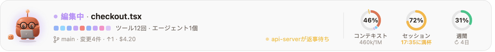
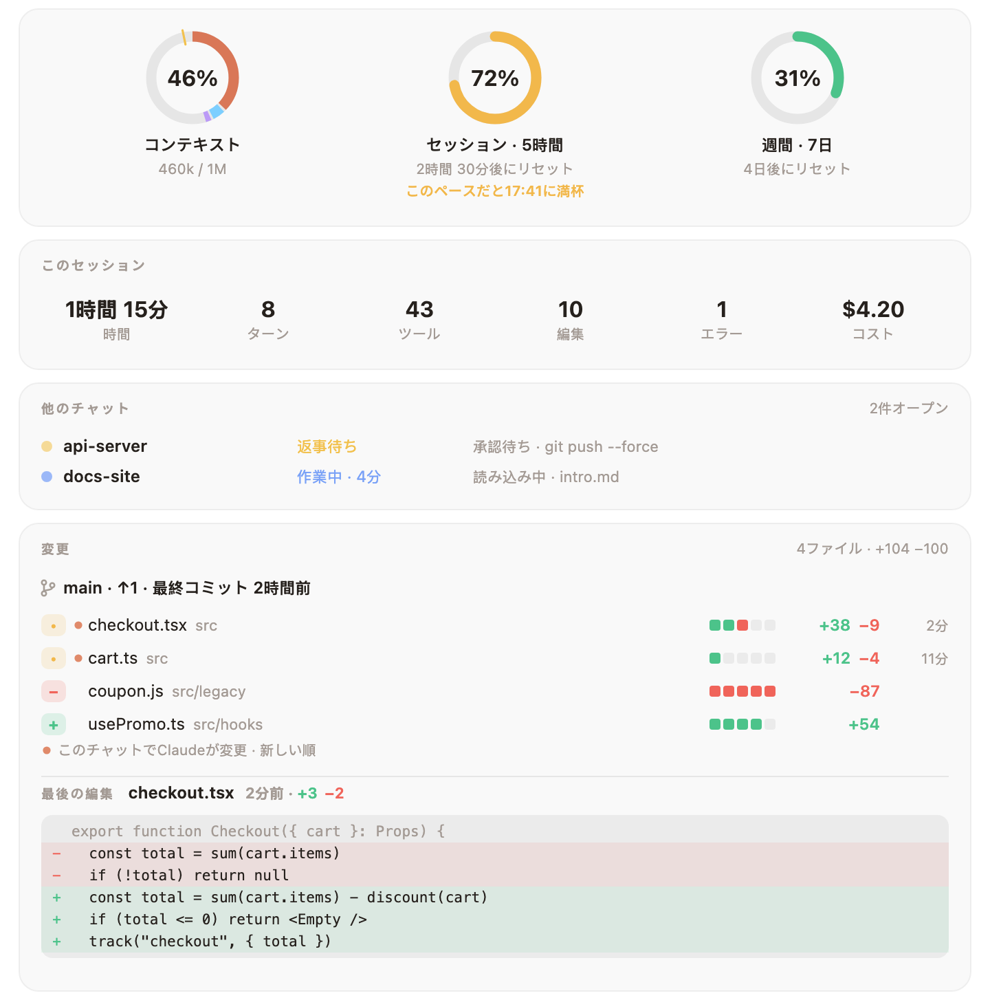
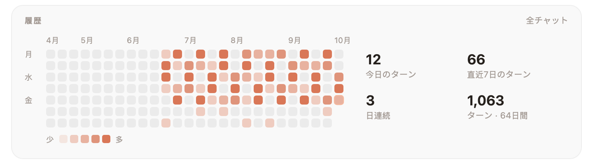

<div align="center">


# Mochi

### Claude Codeのプロンプトの上に住む、小さな粘土の相棒。

Claudeのすることすべてに反応し、あとで後悔しそうなコマンドは止めてくれて、<br>
コンテキスト・セッション・週間の上限を、いつでも見えるところに置いておいてくれます。

[](LICENSE)
[](#-10秒でインストール)
[](#-16言語に対応)
[](#-使うほど増える着せ替え)
[](#-mochiがアクセスするもの)

[English](README.md) · [Türkçe](README.tr.md) · [Español](README.es.md) · [Deutsch](README.de.md) · [Français](README.fr.md) · [Português](README.pt.md) · [Русский](README.ru.md) · [中文](README.zh.md) · **日本語** · [한국어](README.ko.md)

<br>


<sub>実際のひとつのターンです。ここに出てくる表情も一言も、すべてMochi自身の描画とリアクションのコードによるものです。</sub>

</div>

<br>

## ⚡ 10秒でインストール

```
/plugin install mochi --marketplace oztrkemree/mochi
```

どのClaude Codeのチャットでもいいので、これを入力してください。マーケットプレイスを追加するか聞かれたら`y`と答え、スコープは**user**を選びます。これだけです。Mochiはすぐに現れて、それ以降に開くすべてのチャットにも顔を出します。設定は何もいりません。

> [!NOTE]
> MochiはClaude Codeのhooksモジュール（function hooks）の上に作られていて、**Claude Code 2.1.293以降**が必要です（お使いのバージョンは`claude --version`で確認できます）。2.1.286のようなそれより古いビルドではモジュール自体が読み込まれないため、Mochiは現れません。

<br>

<table>
<tr>
<td align="center" width="25%">🎭<br><b>30種類の表情</b><br><sub>ツール呼び出しのたびに変わる</sub></td>
<td align="center" width="25%">🛡️<br><b>シールド</b><br><sub><code>rm -rf</code>、force push、キーの流出から守る</sub></td>
<td align="center" width="25%">📊<br><b>上限のリング</b><br><sub>使い切る時刻の予測つき</sub></td>
<td align="center" width="25%">👒<br><b>134の着せ替え</b><br><sub>実際の作業で手に入る</sub></td>
</tr>
</table>

## 🎭 Claudeのしていることを感じとります

考え中、読んでる、検索してる、コードを書いてる、コマンド実行中、あなたの返事待ち。テストがオールグリーンならお祝いし、3回連続でエラーが出れば目を回し、あなたが席を外せばすやすや眠ります。**30種類の表情、それでいてカクッとした切り替えはなし**。どのポーズも前のポーズから自然につながるので、バーはちらつくことなく、呼吸するように動きます。

<p align="center">
  
</p>

顔の横には、いま起きていることがわかりやすい言葉で（`checkout.tsx を編集中`、`テスト成功 · 4秒`）、直近のツール呼び出しが小さな四角の列で（実行中のものは呼吸するように明滅し、失敗したものは赤くなります）、そして今のブランチと変更されたファイルの数が表示されます。

## 📊 使用量の上限を、ひと目で、予測つきで

<picture>
  <source media="(prefers-color-scheme: dark)" srcset="docs/band-ja-dark.png">
  
</picture>

リングは3つ。**コンテキストウィンドウ**、**5時間のセッション**、そして**1週間**の枠です。もう10分おきに`/usage`を打つ必要はありません。

- **数字だけでなく、予測も。** リセットよりも速いペースで枠を使っていると、*いつ*上限に達するのかをリングが教えてくれます（`16:40 に上限`）。近づくにつれて琥珀色、そして赤に変わります。
- **うれしい知らせも。** 使い切りかけていた枠がリセットされたときも、Mochiがちゃんと知らせてくれます。
- **コンテキストのリングは、中身まで知っています。** システムプロンプト、ツール、MCP、メモリ、スキル、メッセージがそれぞれ色分けされ、自動コンパクトが始まる位置には目盛りがついています。

## 🛡️ シールド: 取り返しのつかない操作を止めます

<p align="center">
  
</p>

シールドは、ClaudeがBashやPowerShellで実行するすべてのコマンドと、すべての編集に目を通します。取り返しのつかない操作の前には、いったん止まって確認し、**何が失われてしまうのかをわかりやすい言葉で伝えます**。ファイルやフォルダの完全な削除（`rm -rf`、`Remove-Item -Recurse`、`del /s`）、ドライブの消去、ブランチの履歴の上書き、未コミットの変更の破棄、データベースの削除、インフラやクラウドのバケットの撤去、`npm unpublish`、`docker system prune -a`、ネットから取ってきたスクリプトのパイプ実行、`sudo`などです。

- **force pushはブランチを見て判断します。** `main`、`master`、`trunk`、`develop`へのforce pushなら、ブランチ名を挙げて確認します。自分のブランチへのforce pushなら、警報ではなく不安そうな顔で確認し、そこでの`--force-with-lease`ならその顔をするだけです。
- **秘密情報は履歴に残しません。** 本物らしいキーやトークン（AWS、GitHub、Anthropic、OpenAI、Slack、Stripe、秘密鍵、パスワード）や、`.env`・`id_rsa`のようなファイルを、Claudeが書き込んだり、`git add`したり、コミットしたりする前に、Mochiは値を伏せて表示し（`AKIA••••••LE`）、確認します。プレースホルダーや明らかなテスト用の値はそのまま通します。
- **「ここでは常に許可」。** 確認では**実行**（または**書き込む**）、**中止**、**ここでは常に許可**を選べます。最後のものを選ぶと、そのリポジトリではその種類のコマンドを覚えておきます。これはリポジトリの中で完結するものだけに効き、外に及ぶコマンドや編集（`rm -rf ~`、ホームフォルダのファイルなど）はまた確認します。どこで何を許可しているかは`/mochi シールド`で一覧でき、`/mochi シールド リセット`ですべて忘れさせられます。

<details>
<summary><b>自分のルールを書く</b>（<code>~/.claude/mochi/shield.json</code>）</summary>

<br>

```json
{
  "add": [{ "match": "terraform\\s+apply", "says": "changes the live infrastructure" }],
  "off": ["publish", "sudo"]
}
```

- `match`は正規表現で、BashとPowerShellのすべてのコマンドに対して、大文字・小文字を区別せずに照合されます。`says`はそのコマンドが何をするかの説明で、確認のメッセージに表示されます。省略すると、あなたのルールのどれかに当てはまる、とだけ表示されます。
- `off`には、確認をやめたい組み込みの種類を並べます。[`hooks/lang/en.ts`](hooks/lang/en.ts)の`danger`のキーならどれでも（`rm`、`forcePush`、`publish`、`sudo`…）、`secret`かその中の1種類（`secret:aws`、`secret:github`、`secret:apiKey`、`secret:slack`、`secret:stripe`、`secret:privateKey`、`secret:generic`）、`secretFile`、`secretEdit`が使えます。
- ファイルが変更されるたびに、Mochiは読み直してトーストで知らせます。使えないものはスキップして、その名前を伝えます。ファイルが正しいJSONでなければ、直るまであなたのルールはどれも適用されません。Claude自身がこのファイルを変更する前には、シールドが確認します。

</details>

## 🧡 ほかにもMochiが気づくこと

<table>
<tr>
<td width="50%" valign="top">

### 🔁 ループの見張り番
同じコマンドが3回失敗する、同じエラーが何度も戻ってくる、同じ呼び出しが同じ結果ばかり返す。そんな堂々めぐりに、**上限に達するより先に**Mochiが気づいて、Escを押すよう教えてくれます。

</td>
<td width="50%" valign="top">

### 🔔 席を外している間も通知
2分以上かかったターンが終わったとき、長い作業があなたの返事待ちで止まったとき、上限がリセットされたとき、CIが失敗したときに、システムの通知（macOS・Windows・Linux）でお知らせします。**その間に、お茶でも淹れてきてください。**

</td>
</tr>
<tr>
<td valign="top">

### 💬 すべてのチャットをひとつのボードに
このマシンのすべてのClaude Codeのチャットを、いまのチャットを先頭に、あなたの返事を待っているものをその次に並べます。それぞれのブランチ（ワークツリーには印つき）、何をしているか、それがどれくらい続いているかもわかります。5分間あなたを待ち続けたチャットは、もう一度だけ通知を送ります。

</td>
<td valign="top">

### 🚦 push後のCI
あなた自身の`gh`を通じて、MochiがGitHub Actionsの実行を追いかけます。バーには`CI 実行中 · 2/5`、成功すればお祝い、失敗すれば落ちたワークフローの名前を表示。実行がないあいだは、今のブランチのプルリクエストと、そのレビューやチェックの状況を表示します（`PR #12 · 承認済み · チェック 4/5`）。

</td>
</tr>
<tr>
<td valign="top">

### 💡 その場に合ったヒント
Mochiが手すきのとき、たまに、いま起きたことに合わせてClaude Codeの短いヒントをひとつ出します。ターンを止めたあとならEsc Esc、コンテキストが埋まってきたら`/compact`。同じ指示を3回出すと、`CLAUDE.md`に追加しようかと提案します。書き込むのは、あなたが**追加**を選んだときだけです。

</td>
<td valign="top">

### 🏅 実際の作業で手に入るバッジ
全部で18個、どれも一度だけお祝いします。初めてのオールグリーン、同じターンでの逆転、追加より削除のほうが多いお片付けの日、夜ふかし、早起き、ポリグロット、マラソンのような長いターン、100回のコミット。そして手ごわいものも。30日連続、500回のコミット、5,000回の編集、10,000行の削除…。

</td>
</tr>
<tr>
<td valign="top">

### 🎉 特別な日と、小さなサプライズ
イード、旧正月、ノウルーズ、ディワリ、チュソク、お花見の季節、Hacktoberfest、ハロウィン、クリスマス、そしてあなたの誕生日には、それぞれMochiがおめかしします。もちろん、手に入れたものの中から。Mochiにおやすみやありがとうを言ってみてください。休憩なしで2時間たつと、ストレッチを提案してくれます。

</td>
<td valign="top">

### 🧩 ほかのプラグインもMochiを通して話せます
デプロイ用のプラグインならリリースのときにMochiを喜ばせ、リンターなら顔をしかめさせることができます。呼び出しはひとつだけ。`$.mochi.react({ mood, line })`。詳しくは[プラグイン作者の方へ](#-プラグイン作者の方へ)をどうぞ。

</td>
</tr>
</table>

## 🔍 詳細パネル

**リングをクリックすると**、すべてが広がります。このセッションの概要、このマシンのすべてのチャット、CIとプルリクエスト、そして**変更されたすべてのファイルと、追加・削除された行数**。このチャットでClaudeが触ったファイルが先頭に並び、それぞれのファイルの差分が赤と緑で表示されます。

<picture>
  <source media="(prefers-color-scheme: dark)" srcset="docs/details-ja-dark.png">
  
</picture>

さらに下には、カテゴリ別のコンテキスト、最近のターン、すべてのチャットの活動日を並べたカレンダー、レベル、着せ替え、バッジ、そしてすべての設定と操作が、どれもワンクリックのところにあります。

<picture>
  <source media="(prefers-color-scheme: dark)" srcset="docs/history-ja-dark.png">
  
</picture>

## 👒 使うほど増える着せ替え

<p align="center">
  
</p>

ターン、編集、コミット、そして作業した日のひとつひとつが経験値になります。レベルが上がるごとに着られるものが増え、頭、顔、首、手、そしてMochiのとなりに、全部で**134アイテム**。日付で解放されるものはありません。ほとんどはレベルで、いくつかは習慣で、残りは手ごわいバッジで手に入ります（150回の夜ふかしで魔女の帽子とかぼちゃ、500回のコミットでケーキ）。一度手に入れれば、ハロウィンには魔女の帽子、誕生日にはケーキ、ディワリにはディヤを身につけます。朝はコーヒー、深夜0時を過ぎたらナイトキャップです。

<p align="center">
  
</p>

<picture>
  <source media="(prefers-color-scheme: dark)" srcset="docs/level-ja-dark.png">
  
</picture>

着るものは、詳細パネルの**着せ替え**セクションから選ぶか、`/mochi 着せ替え メガネ`で選べます。`/mochi 誕生日 04-23`で誕生日を教えておくこともできます。誕生日はあなたのマシンの中にだけ保存されます。新しい着せ替えのアイデアがあれば、[docs/OUTFITS.md](docs/OUTFITS.md)に追加のしかたが書いてあります。

## 📸 シェアする

- **`/mochi カード`** は、今日の服装のMochi、レベル、経験値、連続日数をのせたカードを描きます。
- **`/mochi まとめ`** は、すべてのチャットをまたいだ1か月を1枚の絵にまとめます。作業時間、ターン数、コミット数、いちばん忙しかった日、最長の連続日数、いちばん長く作業したフォルダ。`/mochi まとめ 年`なら1年分です。月の最初の週には、先月分ができたことをMochiが一度だけ知らせてくれます。
- **`/mochi スナップ`** は、いまのバーと詳細パネルをそのまま保存します。投稿する前に中身を確かめてください。バーに表示されているもの、つまりブランチもそのまま写っています。他のチャットと、最後の編集の中身の行は写りません。

どれも`~/.claude/mochi/share/`の下にSVGファイルとして保存されます。ライトとダークどちらのページでも読みやすく、ファイル単体で完結しています。XとRedditはPNGしか受け付けません。`rsvg-convert`かImageMagickが入っていれば、`/mochi スナップ`はそれぞれのPNGも保存します。

<details>
<summary><b>GitHubのプロフィールにカードを載せる</b></summary>

<br>

1. ユーザー名と同じ名前のプロフィールリポジトリ（`you/you`）をクローンします。
2. そのフォルダのパスを付けて`/mochi カード ~/code/you`を実行します。カードは`mochi-card.svg`としてそこに置かれます。
3. Mochiが表示する1行をリポジトリの`README.md`に貼り付けて、コミットしてpushします。

   ```md
   [](https://github.com/oztrkemree/mochi)
   ```

カードはその時点のスナップショットです。レベルが上がったら、もう一度`/mochi カード`を実行して、新しいカードをpushしてください。

</details>

## ⌨️ コマンド

コマンドを覚える必要はありません。Mochiはインストールした瞬間から動きます。操作したくなったときは、すべて`/mochi`の下にそろっています。

| コマンド | できること |
| --- | --- |
| `/mochi` | バーを表示/非表示（`/mochi hide` · `/mochi show`でどちらかを指定） |
| `/mochi details` | 詳細パネルを開く |
| `/mochi wear [item \| auto \| none]` | 何かを着せる、Mochiにおまかせする、または全部外す |
| `/mochi shield [on \| off]` | シールドがONかどうかと、どこで何を常に許可しているかの確認 |
| `/mochi card [path]` · `/mochi wrapped [year]` · `/mochi snap` | シェア用の画像を保存 |
| `/mochi small` · `/mochi big` | 1行表示か、フルサイズか |

<details>
<summary><b>すべてのコマンド</b></summary>

<br>

| コマンド | できること |
| --- | --- |
| `/mochi` | バーを表示/非表示（`/mochi hide` · `/mochi show`でどちらかを指定） |
| `/mochi details` | 詳細パネルを開く |
| `/mochi level` | レベル、経験値、まだ解放されていないもの |
| `/mochi wear [item \| auto \| none]` | 何かを着せる、Mochiにおまかせする、または全部外す |
| `/mochi badges` | 獲得したバッジと、残りのバッジの手に入れ方 |
| `/mochi chats` | このマシンのすべてのチャット。返事待ちのものが先頭 |
| `/mochi shield [on \| off]` | シールドがONかどうかと、どこで何を常に許可しているかの確認。`on`か`off`で切り替え |
| `/mochi shield reset` | 「ここでは常に許可」で覚えたものをすべて忘れる |
| `/mochi alerts` | 通知のON/OFF（月のまとめができたお知らせも含む） |
| `/mochi ci` | CI監視のON/OFF |
| `/mochi tips` | ヒント、`CLAUDE.md`への追加の提案、新機能のお知らせのON/OFF |
| `/mochi breaks` | ストレッチの提案のON/OFF |
| `/mochi sound` | サウンドのON/OFF |
| `/mochi plugins` | 他のプラグインからのリアクションのON/OFF |
| `/mochi card [path]` | GitHubプロフィール用のカードを保存 |
| `/mochi wrapped [year]` | 1か月分、または1年分を1枚の絵にして保存 |
| `/mochi snap` | バーと詳細パネルを画像として保存 |
| `/mochi tour` | 初回のツアーをもう一度見る |
| `/mochi news` | このバージョンで新しくなったこと |
| `/mochi birthday [MM-DD \| none]` | 誕生日を教える、確認する、または忘れさせる |
| `/mochi lang [code \| auto]` | 言語の確認と切り替え |
| `/mochi small` · `/mochi big` | 1行表示か、フルサイズか |
| `/mochi export` | Mochiが保存しているものをすべて1つのJSONファイルに書き出す |
| `/mochi reset [level \| history \| all]` | レベルの記憶、履歴、またはすべて（設定も含む）を消す。消す前に確認があり、エクスポートと`shield.json`は残る |
| `/mochi feedback` | バージョン、OS、使っている画面、言語が入力済みのバグ報告へのリンク |
| `/mochi status` | Mochiがいま把握していること |

英語のコマンドはいつでも使えて、さらに言語ごとのコマンドもあります（`/mochi 着せ替え`、`/mochi aksesuar`、`/mochi idioma`、`/mochi sprache`…）。ON/OFFを切り替えるコマンドは、打つたびに切り替わります。`オン`か`オフ`を付ければ、その状態にします（`/mochi ヒント オフ`）。

</details>

## 🌍 16言語に対応

English · Türkçe · Español · Deutsch · Français · Português · Русский · 中文 · 日本語 · 한국어 · Italiano · Polski · Українська · हिन्दी · Bahasa Indonesia · العربية

Claude Codeの`language`設定がこのどれかなら、Mochiはその言語で話します。そうでなければシステムの優先言語、次に`LANG`、どれにも当てはまらなければ英語になります。`/mochi 言語 ja`で自分で選ぶこともでき、`/mochi 言語 自動`で自動に戻せます。

## 🔒 Mochiがアクセスするもの

**すべてはあなたのマシンの中で完結します。** Mochi自身は**ネットワーク通信を一切行いません**。インターネットとやりとりするのは、CI監視のために使うあなた自身の`gh`だけで、それも`/mochi ci`でOFFにできます。

<details>
<summary><b>すべての一覧</b></summary>

<br>

- **git**: チャットのフォルダで、読み取りにだけ使います。バーと詳細パネルのために`git status`、`git log`、`git diff --numstat`、`git rev-parse`を実行します。シールドがもう少し詳しく調べる必要があるときは、今のブランチとデフォルトブランチ、`git add`で追加されるファイル（`git ls-files`）、`git commit`でコミットされる内容（`git diff`）を確認します。
- **gh**: CI監視がONのときだけ、あなた自身のログインで使います（Mochiがトークンを目にすることはありません）。`gh pr view`はチャットの開始時、詳細パネルを開いたとき、そしてpushの前後に実行します。`gh run list`はこのチャットでpushしたあとだけ、実行が終わるまで30秒ごとに、長くても30分まで実行します。`/mochi ci`でどちらもOFFにできます。
- **システムの仕組み**: 通知にはmacOSでは`osascript`、WindowsではPowerShell、Linuxでは`notify-send`を使います。言語の判定には、macOSで`defaults read -g AppleLanguages`、Windowsで`reg query`を使い、macOSとLinuxの区別には`uname`を使います。`/mochi スナップ`のPNGには、入っていれば`rsvg-convert`かImageMagickの`magick`を使います。閉じたチャットのファイルや`/mochi リセット`で消すものは、`~/.claude/mochi/`の中だけで、名前を指定して`rm`（Windowsでは`cmd`の`del`）で削除します。
- **`~/.claude/mochi/`の下のファイル**: 開いている各チャットの状況、日ごとの集計、レベルとバッジ、予測に使う使用量の記録、各ヒントを表示した回数とあなたが繰り返す短い指示（プロンプト全体は保存しません）、上限のリセットを1つのチャットにだけ知らせてもらうための目印、自分で書いた場合は`shield.json`、そして`/mochi カード`・`まとめ`・`スナップ`・`エクスポート`で保存したもの。設定、常に許可したもの、誕生日は、Claude Codeのプラグイン用のストアに保存されます。
- **あなたのプロジェクト**: 指示の追加を提案する前に`CLAUDE.md`を読み、あなたが**追加**を選んだときだけ1行を書き足します。カードをプロジェクトに書き込むのは、`/mochi カード`にそこのパスを渡したときだけです。行数を数えたり秘密情報を見つけたりするために、Claudeが上書きしようとしているファイルを読みます。追加とコミットを一度に行うコマンドなら、追加される新しいファイルも読みます（最大20個、それぞれ1 MB未満）。読んだものは何も残しません。
- **他のプラグイン**は、Mochiを通じて表情と短い一言を表示できます。一言にはそのプラグインの名前が添えられ、どのプラグインも10秒に1回までです。`/mochi プラグイン`でOFFにできます。`/mochi フィードバック`はリンクを表示するだけで、何も送信しません。

</details>

## ❓ よくある質問

<details>
<summary><b>インストールしたのに、Mochiが現れません。</b></summary>

<br>

`claude --version`を確認してください。Mochiには**2.1.293以降**が必要です。それより古いビルドでは、hooksモジュール自体が読み込まれません。十分新しいビルドなら、`/mochi 状態`でMochiが把握していることがわかり、`/mochi フィードバック`で必要事項が入力済みのバグ報告を開けます。

</details>

<details>
<summary><b>場所をとりすぎます。</b></summary>

<br>

`/mochi 小さく`で1行表示になります。`/mochi`でまるごと隠れ、もう一度打てば戻ってきます。

</details>

<details>
<summary><b>コードやプロンプトをどこかに送っていませんか？</b></summary>

<br>

いいえ。Mochiはネットワーク通信を一切行いません。`~/.claude/mochi/`の下に短い集計を残すだけで、プロンプト全体を保存することはありません。詳しくは[Mochiがアクセスするもの](#-mochiがアクセスするもの)をご覧ください。

</details>

<details>
<summary><b>シールドが邪魔になりませんか？</b></summary>

<br>

確認するのは取り返しのつかない操作の前だけで、**ここでは常に許可**を選べば、そのリポジトリではあなたの答えを覚えておきます。`/mochi シールド オフ`でOFFにでき、`shield.json`で種類ごとにOFFにすることもできます。

</details>

## 🧩 プラグイン作者の方へ

あなたのプラグインから、Mochiを反応させられます。デプロイが終わったら喜ぶ、チェックが落ちたら心配そうな顔をする、といった具合です。`dependencies`に`mochi`を加えて、`$.mochi.react({ mood, line })`か`$.mochi.celebrate({ line })`を呼ぶだけ。呼び出し方、制限、プラグインの完全な例は[docs/API.md](docs/API.md)にあります。

## 🤝 コントリビュート

バグ報告、アイデア、翻訳、イラスト、プルリクエスト、どれも大歓迎です。[issueを立てる](https://github.com/oztrkemree/mochi/issues/new/choose)か（`/mochi フィードバック`を使えば、必要事項が入力済みのバグ報告を開けます）、コードに手をつけるなら[CONTRIBUTING.md](CONTRIBUTING.md)を読んでみてください。2つのコマンド（`claude plugin validate .`と`claude plugin test .`）ですべてをチェックでき、新しい言語の追加は辞書1つと数行で済みます。各バージョンの変更点は[CHANGELOG.md](CHANGELOG.md)にまとめてあります。

このページの動く絵は、Mochi自身のコードで描かれています。`node scripts/gifs.mjs`と`node scripts/demo.mjs`でもう一度作り直せます。

## 📄 ライセンス

[MIT](LICENSE)。使うのも、改造するのも、シェアするのもご自由に。

<br>

<div align="center">

**Mochiを見てくすっとしたら、⭐をひとつ。ほかの人がMochiを見つける手助けになります。**

<sub><a href="https://github.com/oztrkemree">Emre Öztürk</a>とClaudeが、心を込めて作りました。</sub>

</div>
