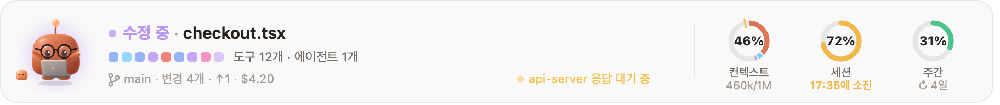
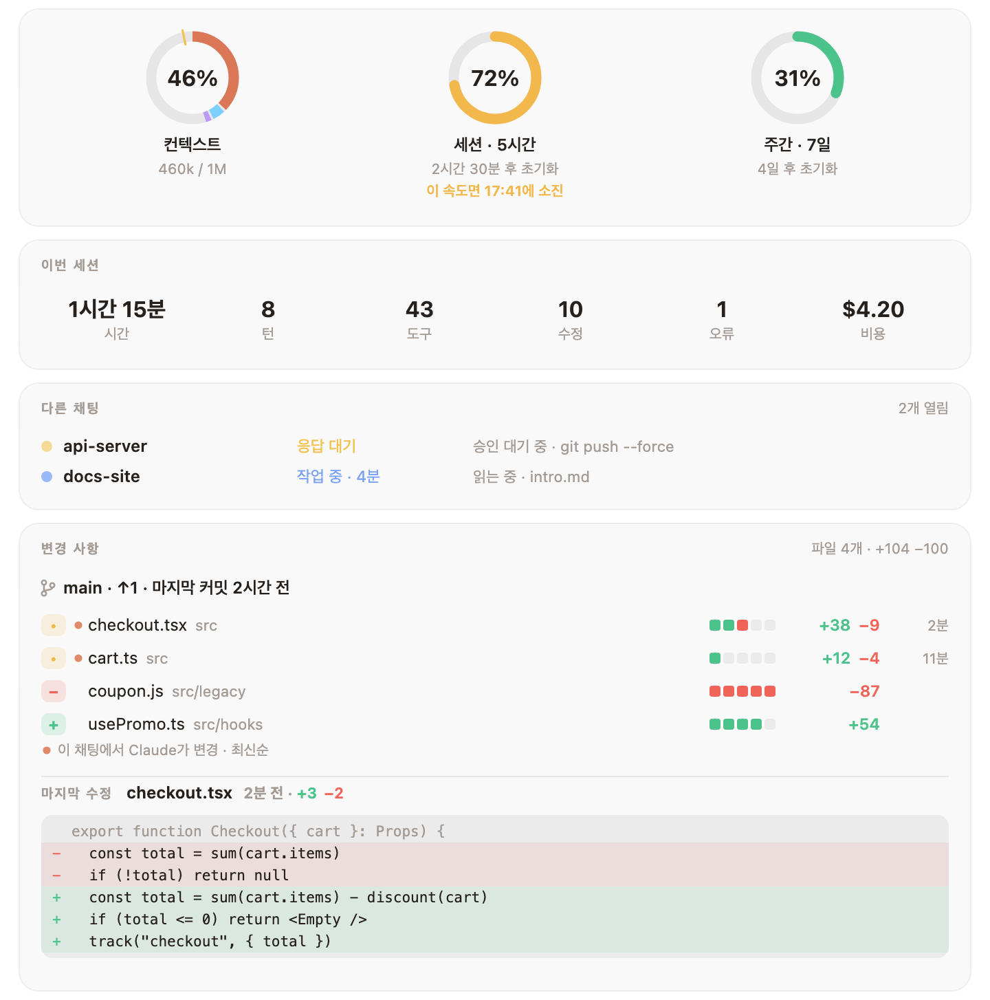
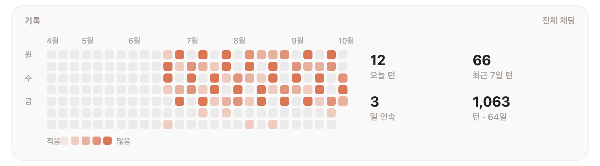
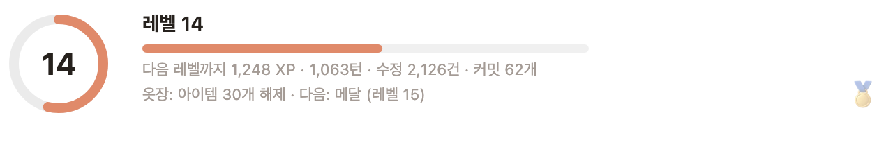

<div align="center">


# Mochi

**Claude Code 곁을 지키는 작은 점토 친구.**<br>
프롬프트 바로 위에 앉아 Claude가 하는 모든 일에 반응하고,<br>
자꾸만 확인하게 되는 숫자들을 늘 눈앞에 띄워 둬요.

[](LICENSE)
[](#-설치)
[](#-언어)
[](#-함께-자라는-옷장)
[](CONTRIBUTING.md)

[English](README.md) · [Türkçe](README.tr.md) · [Español](README.es.md) · [Deutsch](README.de.md) · [Français](README.fr.md) · [Português](README.pt.md) · [Русский](README.ru.md) · [中文](README.zh.md) · [日本語](README.ja.md) · **한국어**

</div>

<br>

<picture>
  <source media="(prefers-color-scheme: dark)" srcset="docs/band-ko-dark.png">
  
</picture>

<p align="center"><sub>모든 걸 한눈에: Claude가 지금 하고 있는 일, 최근 도구 호출, 지금 브랜치, 나를 기다리는 다른 채팅, 그리고 컨텍스트·세션·주간 한도가 얼마나 찼는지까지.</sub></p>

## ✨ 설치

```
/plugin install mochi --marketplace oztrkemree/mochi
```

아무 Claude Code 채팅에나 입력하고, 마켓플레이스를 추가할지 물으면 `y`로 답한 뒤 **user** 범위를 고르세요. Mochi가 곧바로 나타나고, 그 뒤로 여는 모든 채팅에도 함께해요.

> [!NOTE]
> Mochi는 Claude Code의 hooks 모듈(함수 hook) 위에서 동작해요. 그래서 이 기능을 지원하는 Claude Code 빌드가 필요해요.

## 🧡 Mochi가 알아채는 것들

<table>
<tr>
<td width="50%" valign="top">

**🎭 27가지 기분, 끊김 없는 전환**<br>
생각하고, 읽고, 코드를 쓰고, 명령을 실행하고, 내 응답을 기다리고, 테스트가 초록불이면 축하하고, 세 번 연속 오류가 나면 어질어질해하고, 자리를 비우면 잠들어요. 모든 동작이 바로 앞 동작에서 부드럽게 이어져요.

</td>
<td width="50%" valign="top">

**📊 한도와 소진 예측까지**<br>
컨텍스트 창, 5시간 세션, 주간 한도를 링으로 보여 줘요. 초기화되는 속도보다 빠르게 쓰고 있다면, *언제* 소진될지 Mochi가 미리 알려 줘요.

</td>
</tr>
<tr>
<td valign="top">

**🛡️ 무서운 명령 앞엔 보호막**<br>
`rm -rf`, `git push --force`, `git reset --hard`, `DROP TABLE`, `npm publish`, `sudo`… 실행 전에 일단 멈추고, 무엇이 날아가는지 쉬운 말로 알려 준 뒤 물어봐요.

</td>
<td valign="top">

**🔁 반복 감시**<br>
같은 명령이 세 번 연속 실패할 때, 같은 오류가 자꾸 돌아올 때, 같은 호출이 매번 똑같은 결과만 낼 때: 한도가 바닥나기 전에 Mochi가 먼저 눈치채요.

</td>
</tr>
<tr>
<td valign="top">

**🔔 긴 작업 알림**<br>
2분 넘게 걸린 턴이 끝나거나, 긴 작업이 승인을 기다리며 멈추면 macOS 알림을 보내요. 그동안 커피 한 잔 하고 오세요.

</td>
<td valign="top">

**💬 다른 채팅들**<br>
이 컴퓨터에서 Mochi가 켜진 채팅은 모두 서로의 상황을 공유해요. 그래서 다른 채팅이 응답을 기다리거나 작업을 마치면, 지금 채팅에서 바로 알 수 있어요.

</td>
</tr>
</table>

## 🔍 상세 패널

링을 클릭하면 모든 게 펼쳐져요: 이번 세션을 한눈에, 다른 채팅들, 그리고 **변경된 모든 파일과 추가·삭제된 줄 수**까지. 이 채팅에서 Claude가 건드린 파일이 맨 위에 오고, 마지막 수정 내용도 빨간색과 초록색으로 그대로 보여 줘요.

<picture>
  <source media="(prefers-color-scheme: dark)" srcset="docs/details-ko-dark.png">
  
</picture>

조금 더 내려가면: 카테고리별 컨텍스트, 최근 턴, 그리고 모든 채팅의 하루하루를 담은 달력이 있어요.

<picture>
  <source media="(prefers-color-scheme: dark)" srcset="docs/history-ko-dark.png">
  
</picture>

## 👒 함께 자라는 옷장

턴 하나, 수정 하나, 커밋 하나, 그리고 작업한 하루하루가 모두 경험치가 돼요. 레벨이 오르면 입을 거리가 해제돼요: 머리, 얼굴, 목, 손, 그리고 Mochi 옆자리까지 **아이템 36개**. 계절 따라 찾아오는 아이템도 있고(10월 말엔 마녀 모자, 12월엔 산타 모자), 시간 따라 찾아오는 아이템도 있어요(아침엔 커피, 자정이 넘으면 수면 모자).

<p align="center">
  
</p>

<picture>
  <source media="(prefers-color-scheme: dark)" srcset="docs/level-ko-dark.png">
  
</picture>

입을 옷은 상세 패널의 **옷장** 섹션에서 고르거나, `/mochi 착용 안경`처럼 직접 입혀 보세요.

## ⌨️ 명령어

| 명령어 | 하는 일 |
| --- | --- |
| `/mochi` | 밴드 숨기기 또는 보이기 |
| `/mochi 상세` | 상세 패널 열기 |
| `/mochi 레벨` | 내 레벨, 경험치, 아직 잠겨 있는 것들 |
| `/mochi 착용 [아이템 \| 자동 \| 없음]` | 골라서 입히기, Mochi가 알아서 입게 두기, 또는 전부 벗기기 |
| `/mochi 보호막` | 보호막 켜기/끄기 |
| `/mochi 알림` | 긴 작업 알림 켜기/끄기 |
| `/mochi 소리` | 소리 켜기/끄기 |
| `/mochi 언어 [코드 \| 자동]` | 언어 확인 또는 변경 |
| `/mochi 작게` · `/mochi 크게` | 한 줄 또는 전체 크기 |
| `/mochi 상태` | Mochi가 지금 알고 있는 것 |

영어 명령어도 언제나 그대로 쓸 수 있어요 (`/mochi details`, `/mochi wear`, `/mochi lang`…).

## 🌍 언어

English · Türkçe · Español · Deutsch · Français · Português · Русский · 中文 · 日本語 · 한국어

Claude Code의 `language` 설정이 이 중 하나라면 Mochi는 그 언어로 말해요. 아니라면 시스템의 기본 언어를, 그다음엔 `LANG`을 따르고, 그래도 맞는 게 없으면 영어로 말해요. `/mochi 언어 ko`로 직접 고를 수 있고, `/mochi 언어 자동`으로 다시 자동 설정으로 돌아가요.

## 🔒 Mochi가 손대는 것들

모든 건 내 컴퓨터 안에만 머물러요. Mochi는 **네트워크 요청을 전혀 보내지 않아요**.

- 채팅 폴더에서 `git status`, `git log`, `git diff --numstat`을 읽어요.
- macOS에서는 알림을 위해 `osascript`를, 언어 확인을 위해 `defaults read -g AppleLanguages`를 실행해요. 어느 OS에서든 현지 시간을 알기 위해 `date +%z`도 실행하고요.
- `~/.claude/mochi/` 아래에 작은 JSON 파일을 써요: 열려 있는 채팅별 상태, 일별 카운트, 내 레벨, 그리고 소진 예측에 쓰는 사용량 기록.

## 🤝 기여하기

버그 제보, 아이디어, 번역, 그림, PR 모두 대환영이에요. [이슈를 열거나](https://github.com/oztrkemree/mochi/issues/new/choose), 코드부터 살펴보고 싶다면 [CONTRIBUTING.md](CONTRIBUTING.md)를 읽어 보세요. 명령어 두 개로 전부 검사할 수 있고(`claude plugin validate .`와 `claude plugin test .`), 새 언어는 파일 하나면 충분해요.

## 📄 라이선스

[MIT](LICENSE). 마음껏 쓰고, 고치고, 나눠 주세요.

<p align="center"><sub><a href="https://github.com/oztrkemree">Emre Öztürk</a>, 그리고 Claude가 정성껏 만들었어요.</sub></p>
