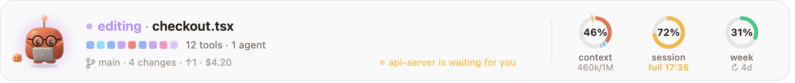
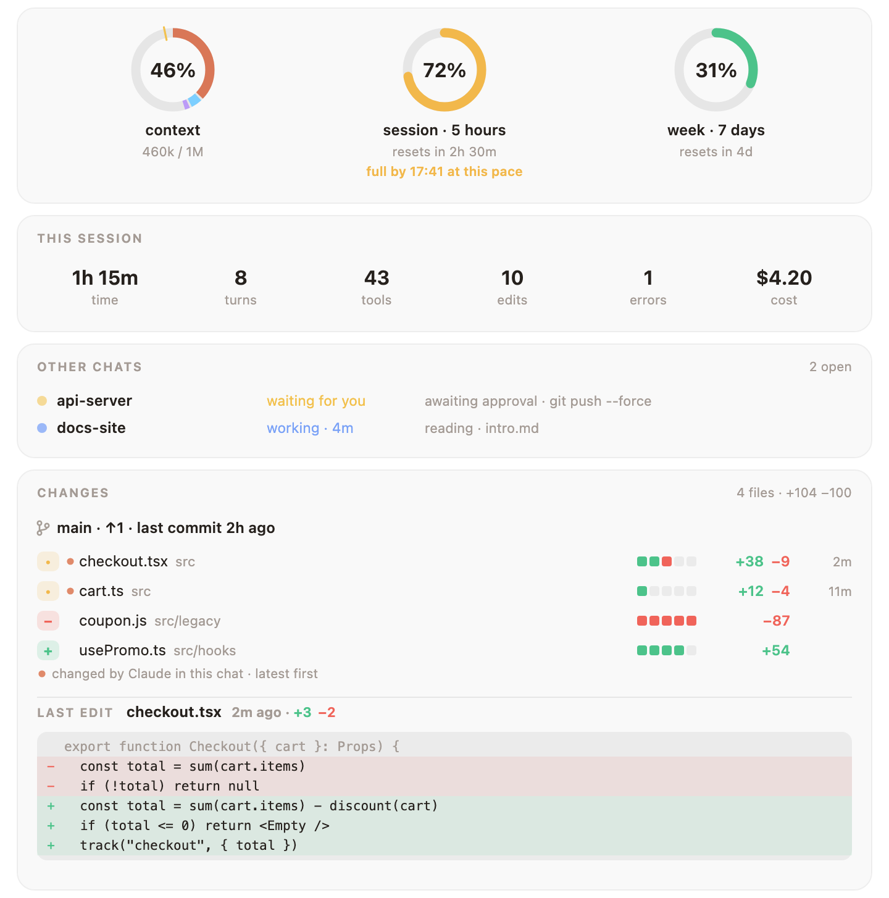
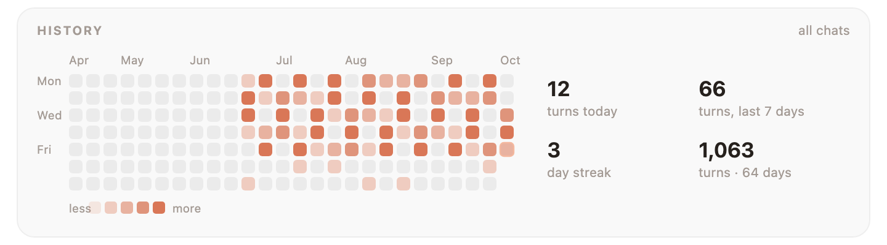

<div align="center">


# Mochi

### A little clay friend that lives above your Claude Code prompt.

It reacts to everything Claude does, stops the commands you would regret,<br>
and keeps your context, session and weekly limits in plain sight.

<a href="https://cdn.jsdelivr.net/gh/oztrkemree/mochi@main/docs/mochi-short.mp4"></a>

[](LICENSE)
[](#-install-in-10-seconds)
[](#-16-languages)
[](#-a-wardrobe-that-grows-with-you)
[](#-what-it-touches)

<sub>**English** · [Türkçe](README.tr.md) · [Español](README.es.md) · [Deutsch](README.de.md) · [Français](README.fr.md) · [Português](README.pt.md) · [Русский](README.ru.md) · [中文](README.zh.md) · [日本語](README.ja.md) · [한국어](README.ko.md)</sub>

<br>


<sub>One real turn. Every face and line here is Mochi's own drawing and reaction code.</sub>

</div>

<br>

## ⚡ Install in 10 seconds

```
/plugin install mochi --marketplace oztrkemree/mochi
```

Type it in any Claude Code chat, answer `y` to add the marketplace and pick the **user** scope. That's it: Mochi appears at once, and in every chat you open after that. Nothing to configure.

> [!NOTE]
> Mochi is built on Claude Code's hooks modules (function hooks) and needs **Claude Code 2.1.293 or later** (`claude --version` tells you yours). Older builds, such as 2.1.286, do not load the module at all, so Mochi never appears.

> [!TIP]
> **Updating.** Mochi tells you when a new version is out, and `/mochi update` shows what to run. Claude Code does not refresh a GitHub marketplace by itself, so the Update button can stay grey; in a terminal:
>
> ```
> claude plugin marketplace update mochi
> claude plugin update mochi@mochi
> ```
>
> then restart Claude Code.

<br>

<table>
<tr>
<td align="center" width="25%">🎭<br><b>30 moods</b><br><sub>that follow every tool call</sub></td>
<td align="center" width="25%">🛡️<br><b>A shield</b><br><sub>for <code>rm -rf</code>, force pushes and leaked keys</sub></td>
<td align="center" width="25%">📊<br><b>Limit rings</b><br><sub>with a forecast of when you run out</sub></td>
<td align="center" width="25%">👒<br><b>136 things to wear</b><br><sub>earned by real work</sub></td>
</tr>
</table>

## 🎭 It feels what Claude is doing

Thinking, reading, searching, typing, running a command, waiting for you, celebrating a green test run, dizzy after three errors in a row, asleep when you are away. **Thirty moods, and no jump cuts**: every pose eases out of the last, so the band never flickers, it breathes.

<p align="center">
  
</p>

Beside the face: what is happening in plain words (`editing checkout.tsx`, `tests passed · 4s`), the last tool calls as a row of little squares (a running one breathes, a failed one turns red), your branch and how many files changed.

## 📊 Your limits, at a glance, with a forecast

<picture>
  <source media="(prefers-color-scheme: dark)" srcset="docs/band-en-dark.png">
  
</picture>

Three rings: the **context window**, the **5‑hour session** and the **week**. No more typing `/usage` every ten minutes.

- **A forecast, not just a number.** Burning through a window faster than it resets? The ring says *when* it will run out (`full 16:40`), amber, then red as it gets close.
- **Good news too.** When a limit you had nearly used up resets, Mochi tells you.
- **The context ring knows what's in it**: system prompt, tools, MCP, memory, skills, messages, each its own color, and a tick where auto‑compact will kick in.

## 🛡️ The shield: stops what you can't undo

<p align="center">
  
</p>

The shield reads every command Claude runs, through Bash or PowerShell, and every edit it makes. Before anything that cannot be undone it stops and asks, **saying in plain words what would be destroyed**: deleting files and folders for good (`rm -rf`, `Remove-Item -Recurse`, `del /s`), wiping a drive, overwriting a branch's history, throwing away uncommitted changes, dropping a database, tearing down infrastructure or a cloud bucket, `npm unpublish`, `docker system prune -a`, a script piped from the internet, `sudo`.

- **Force pushes are judged by branch.** Onto `main`, `master`, `trunk` or `develop` it asks and names the branch. Onto your own branch it asks with a nervous look instead of the alarm; a `--force-with-lease` there only gets the look.
- **Secrets stay out of your history.** Before Claude writes, `git add`s or commits something that looks like a live key or token (AWS, GitHub, Anthropic, OpenAI, Slack, Stripe, a private key, a password) or a file like `.env` or `id_rsa`, Mochi asks and shows the value masked: `AKIA••••••LE`. Placeholders and obvious test values go through.
- **Always allow here.** The question offers **Run** (or **Write**), **Stop** and **Always allow here**, which remembers that kind of command for this repository. It holds for what stays inside it: a command or an edit that reaches outside (`rm -rf ~`, a file in your home folder) asks again. `/mochi shield` lists what is allowed where; `/mochi shield reset` forgets it all.

<details>
<summary><b>Write your own rules</b> in <code>~/.claude/mochi/shield.json</code></summary>

<br>

```json
{
  "add": [{ "match": "terraform\\s+apply", "says": "changes the live infrastructure" }],
  "off": ["publish", "sudo"]
}
```

- `match` is a regular expression tried on every Bash and PowerShell command, case ignored. `says` is what such a command would do, shown in the question; without it the question says it matches one of your rules.
- `off` lists built-in kinds to stop asking about: any key of `danger` in [`hooks/lang/en.ts`](hooks/lang/en.ts) (`rm`, `forcePush`, `publish`, `sudo`…), `secret` or one kind of it (`secret:aws`, `secret:github`, `secret:apiKey`, `secret:slack`, `secret:stripe`, `secret:privateKey`, `secret:generic`), `secretFile` and `secretEdit`.
- Mochi reads the file again whenever it changes, and says so in a toast. Whatever it cannot use is skipped and named; if the file is not valid JSON, none of your rules apply until it is. Before Claude itself changes the file, the shield asks.

</details>

## 🧡 Everything else it notices

<table>
<tr>
<td width="50%" valign="top">

### 🔁 A loop watch
The same command failing three times, the same error coming back, the same call returning the same thing: Mochi notices **before your limit does**, and tells you to press Esc.

</td>
<td width="50%" valign="top">

### 🔔 Alerts while you're away
A system notification (macOS, Windows or Linux) when a turn longer than two minutes ends, when a long job stops to wait for you, when your limit resets or when CI fails. **Go make tea.**

</td>
</tr>
<tr>
<td valign="top">

### 💬 Every chat on one board
Every Claude Code chat on your machine, this one first and the ones waiting for you next, with its branch (worktrees marked), what it is doing and for how long. A chat that has waited five minutes for you sends one more notification.

</td>
<td valign="top">

### 🚦 CI after a push
Mochi follows your GitHub Actions runs through your own `gh`: `ci running · 2/5` in the band, a party when they pass, the failed workflow's name when they don't. Between runs: your branch's pull request, its review and its checks (`PR #12 · approved · checks 4/5`).

</td>
</tr>
<tr>
<td valign="top">

### 💡 Tips that fit the moment
Now and then, while idle, one short Claude Code tip about what just happened: Esc Esc after a stopped turn, `/compact` as the context fills. Give the same instruction a third time and Mochi offers to add it to `CLAUDE.md`; it writes only if you say **Add**.

</td>
<td valign="top">

### 🏅 Badges for real work
Eighteen of them, each celebrated once: a first green test run, a comeback in a single turn, a tidy day that removes more than it adds, night owl, early bird, polyglot, a marathon turn, a hundred commits, and hard ones: a 30‑day streak, 500 commits, 5,000 edits, 10,000 lines removed…

</td>
</tr>
<tr>
<td valign="top">

### 🎉 Special days, small surprises
Sakura season, Hacktoberfest, Halloween, New Year and your birthday each dress Mochi, in what it has earned. Say good night to Mochi, or thank it. After two hours without a break, it suggests a stretch.

</td>
<td valign="top">

### 🧩 Other plugins can talk through it
Your deploy plugin can make Mochi cheer when a release goes out, your linter can make it frown. One call: `$.mochi.react({ mood, line })`. See [for plugin authors](#-for-plugin-authors).

</td>
</tr>
</table>

## 🔍 The details pane

**Click the rings** and everything opens up: this session at a glance, every chat on your machine, your CI and pull request, and **every changed file with the lines added and removed**, the ones Claude touched in this chat first, with each file's diff in red and green.

<picture>
  <source media="(prefers-color-scheme: dark)" srcset="docs/details-en-dark.png">
  
</picture>

Further down: the context by category, your recent turns, a calendar of every chat's days, your level, wardrobe and badges, and every setting and action, one click away.

<picture>
  <source media="(prefers-color-scheme: dark)" srcset="docs/history-en-dark.png">
  
</picture>

## 👒 A wardrobe that grows with you

<p align="center">
  
</p>

Every turn, edit, commit and working day earns experience. Levels unlock things to wear: **136 items** across head, face, neck, hand and the spot beside Mochi. Nothing opens by the date: levels open most, habits some, and the hard badges the rest (a witch hat and a pumpkin for a hundred and fifty nights, a cake for five hundred commits). Once earned, a witch hat comes on at Halloween, a cake on your birthday; coffee comes in the morning and a night cap after midnight.

<p align="center">
  
</p>

<picture>
  <source media="(prefers-color-scheme: dark)" srcset="docs/level-en-dark.png">
  
</picture>

Pick what to wear in the **Wardrobe** section of the details pane, or with `/mochi wear glasses`. Tell Mochi your birthday with `/mochi birthday 04-23`; it stays on your machine. Have an idea for something new to wear? [docs/OUTFITS.md](docs/OUTFITS.md) shows how to add it.

## 📸 Show it off

- **`/mochi card`** draws a card: Mochi in today's outfit, your level, experience and streaks.
- **`/mochi wrapped`** sums up your month across every chat in one picture: hours, turns, commits, your busiest day, your longest streak and the folder you spent most time in. `/mochi wrapped year` does the year. In the first week of a month, Mochi tells you once that last month's is ready.
- **`/mochi snap`** saves the band and the details pane as they are right now. Have a look before you post it: it shows what the band shows, your branch included. Your other chats and the lines of your last edit stay out.

They are SVG files under `~/.claude/mochi/share/`, made to read on light and dark pages and needing nothing outside themselves. X and Reddit take only PNG: with `rsvg-convert` or ImageMagick installed, `/mochi snap` saves a PNG of each as well.

<details>
<summary><b>Put your card on your GitHub profile</b></summary>

<br>

1. Clone your profile repository, the one named after your username (`you/you`).
2. Run `/mochi card ~/code/you` with the path to that folder; the card lands there as `mochi-card.svg`.
3. Paste the line Mochi gives you into the repository's `README.md`, then commit and push:

   ```md
   [](https://github.com/oztrkemree/mochi)
   ```

The card is a snapshot: run `/mochi card` again after a level-up and push the new one.

</details>

## ⌨️ Commands

You never need one: Mochi works the moment it is installed. When you want to steer it, it is all under `/mochi`.

| Command | What it does |
| --- | --- |
| `/mochi` | Hide or show the band (`/mochi hide` · `/mochi show` say which) |
| `/mochi details` | Open the details pane |
| `/mochi wear [item \| auto \| none]` | Put something on, let Mochi dress itself, or take everything off |
| `/mochi shield [on \| off]` | See whether the shield is on and what is always allowed where |
| `/mochi card [path]` · `/mochi wrapped [year]` · `/mochi snap` | Save a picture to share |
| `/mochi small` · `/mochi big` | One line or full size |

<details>
<summary><b>All commands</b></summary>

<br>

| Command | What it does |
| --- | --- |
| `/mochi` | Hide or show the band (`/mochi hide` · `/mochi show` say which) |
| `/mochi details` | Open the details pane |
| `/mochi level` | Your level, experience and what is still locked |
| `/mochi wear [item \| auto \| none]` | Put something on, let Mochi dress itself, or take everything off |
| `/mochi badges` | The badges you have earned, and how to earn the rest |
| `/mochi chats` | Every chat on this machine, the ones waiting for you first |
| `/mochi shield [on \| off]` | See whether the shield is on and what is always allowed where; `on` or `off` turns it so |
| `/mochi shield reset` | Forget everything “Always allow here” remembered |
| `/mochi alerts` | Turn the notifications on or off (and the note that your wrapped is ready) |
| `/mochi ci` | Turn the CI watch on or off |
| `/mochi tips` | Turn tips, `CLAUDE.md` suggestions and the what's-new note on or off |
| `/mochi breaks` | Turn the stretch suggestion on or off |
| `/mochi sound` | Turn the sounds on or off |
| `/mochi plugins` | Turn reactions from other plugins on or off |
| `/mochi card [path]` | Save a card for your GitHub profile |
| `/mochi wrapped [year]` | Save your month, or your year, in one picture |
| `/mochi snap` | Save the band and the details pane as pictures |
| `/mochi tour` | Watch the first-run tour again |
| `/mochi news` | What this version brought |
| `/mochi birthday [MM-DD \| none]` | Tell Mochi your birthday, see it, or forget it |
| `/mochi lang [code \| auto]` | Show or change the language |
| `/mochi small` · `/mochi big` | One line or full size |
| `/mochi export` | Save everything Mochi keeps in one JSON file |
| `/mochi reset [level \| history \| all]` | Clear the level's memory, the history, or everything, settings included; it asks first, and exports and your `shield.json` stay |
| `/mochi feedback` | A link to a bug report, filled in with the versions, your system, the surface and the language |
| `/mochi status` | What Mochi knows right now |

English command words always work, and each language adds its own (`/mochi aksesuar`, `/mochi idioma`, `/mochi sprache`…). A command that turns something on or off switches it each time; add `on` or `off` to set it: `/mochi tips off`.

</details>

## 🌍 16 languages

English · Türkçe · Español · Deutsch · Français · Português · Русский · 中文 · 日本語 · 한국어 · Italiano · Polski · Українська · हिन्दी · Bahasa Indonesia · العربية

Mochi speaks Claude Code's `language` setting when it is one of these; otherwise your system's preferred language, then `LANG`; otherwise English. `/mochi lang ja` picks one yourself, `/mochi lang auto` goes back to automatic.

## 🔒 What it touches

**Everything stays on your machine.** Mochi itself makes **no network requests**; the one thing that talks to the internet is your own `gh`, for the CI watch, and `/mochi ci` turns that off.

<details>
<summary><b>The full list</b></summary>

<br>

- **git**, in the chat's folder, only to read: `git status`, `git log`, `git diff --numstat` and `git rev-parse` for the band and the details pane. When the shield has to look closer, it asks for the branch and the default branch, the files a `git add` would add (`git ls-files`) and what a `git commit` would commit (`git diff`).
- **gh**, only while the CI watch is on, with your own login (Mochi never sees your token): `gh pr view` when a chat starts, when you open the details pane and around a push; `gh run list` only after a push in this chat, every 30 seconds until the runs end, half an hour at most. `/mochi ci` turns both off.
- **The system's own tools**: notifications through `osascript` on macOS, PowerShell on Windows and `notify-send` on Linux. For the language, `defaults read -g AppleLanguages` on macOS and `reg query` on Windows; `uname` tells macOS from Linux. For `/mochi snap`'s PNGs, `rsvg-convert` or ImageMagick's `magick`, if you have one. Files of closed chats, and what `/mochi reset` clears, are deleted by name with `rm`, or `cmd`'s `del` on Windows, only inside `~/.claude/mochi/`.
- **Files under `~/.claude/mochi/`**: where each open chat stands, daily counts, your level and badges, usage readings for the forecast, how often each tip was shown and the short instructions you repeat (never whole prompts), the markers that tell one chat to announce a limit reset, your `shield.json` if you write one, and what `/mochi card`, `wrapped`, `snap` and `export` save. Settings, what is always allowed and your birthday live in Claude Code's store for plugins.
- **Your project**: Mochi reads `CLAUDE.md` before it suggests an instruction and appends one line only after you pick **Add**. It writes the card there only if you give `/mochi card` a path there. To count lines and spot secrets it reads a file Claude is about to overwrite, and for a command that adds and commits at once, the new files it would add (up to 20, under 1 MB each). Nothing it reads is kept.
- **Other plugins** can show a mood and a short line through Mochi, signed with their name, each at most once every 10 seconds; `/mochi plugins` turns that off. `/mochi feedback` only prints a link: nothing is sent.

</details>

## ❓ FAQ

<details>
<summary><b>I installed it, but Mochi doesn't show up.</b></summary>

<br>

Check `claude --version`: Mochi needs **2.1.293 or later**. Older builds do not load hooks modules at all. If you are on a new enough build, `/mochi status` says what Mochi knows, and `/mochi feedback` gives you a bug report already filled in.

</details>

<details>
<summary><b>It takes too much room.</b></summary>

<br>

`/mochi small` puts it on one line. `/mochi` hides it altogether, and again brings it back.

</details>

<details>
<summary><b>Does it send my code or prompts anywhere?</b></summary>

<br>

No. Mochi makes no network requests at all. It keeps short counts under `~/.claude/mochi/`, never whole prompts. See [what it touches](#-what-it-touches).

</details>

<details>
<summary><b>Can the shield get in my way?</b></summary>

<br>

It only asks before what cannot be undone, and **Always allow here** remembers your answer for that repository. `/mochi shield off` turns it off; `shield.json` turns single kinds off.

</details>

## 🧩 For plugin authors

Your plugin can make Mochi react: cheer when a deploy finishes, look worried when a check fails. List `mochi` under `dependencies` and call `$.mochi.react({ mood, line })` or `$.mochi.celebrate({ line })`. [docs/API.md](docs/API.md) has the calls, the limits and a whole example plugin.

## 🤝 Contributing

Bug reports, ideas, translations, art and pull requests are all welcome. [Open an issue](https://github.com/oztrkemree/mochi/issues/new/choose) (`/mochi feedback` gives you a bug report already filled in), or read [CONTRIBUTING.md](CONTRIBUTING.md) to start on the code: two commands check everything (`claude plugin validate .` and `claude plugin test .`), and adding a language takes one dictionary and a few lines. What changed in each version is in [CHANGELOG.md](CHANGELOG.md).

The moving pictures on this page are drawn by Mochi's own code: `node scripts/gifs.mjs` and `node scripts/demo.mjs` make them again.

## 📄 License

[MIT](LICENSE). Use it, change it, share it.

<br>

<div align="center">

**If Mochi made you smile, a ⭐ helps other people find it.**

<sub>Made with care by <a href="https://github.com/oztrkemree">Emre Öztürk</a> and Claude.</sub>

</div>
