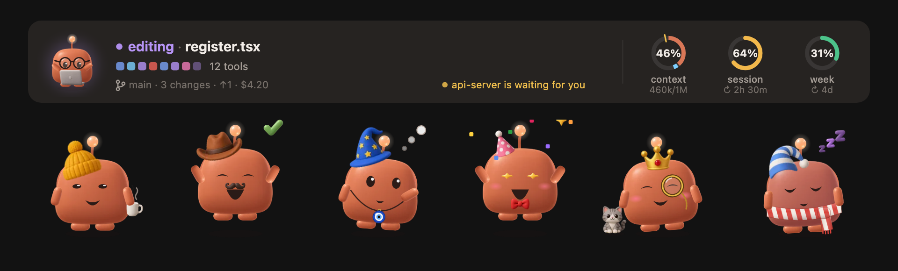

# Mochi

A small clay mascot that lives above the Claude Code prompt and reacts to everything Claude does: thinking, reading, editing, running commands, waiting for you, errors, tests, commits. Around it, the facts you keep checking: context, your 5‑hour and weekly limits, git, and what the other chats are doing.



## Install

Mochi is a Claude Code plugin built on hooks modules (function hooks), so it needs a Claude Code build that supports them. In a session, type:

```
/plugin install mochi --marketplace oztrkemree/mochi
```

Answer `y` to add the marketplace, then choose the **user** scope. Mochi starts at once and appears in every chat you open after that.

To update later: `claude plugin update mochi@mochi`, then restart Claude Code.

## What it does

- **A band above the prompt** (desktop app and terminal): 27 moods with eased transitions, the current action and file, a strip of the last tool calls, the branch, and three rings for context, the 5‑hour session and the week.
- **Limit forecast**: from the pace of the last hour (the last day for the week), the ring tells you when a window will run out if that happens before it resets, and Mochi warns once when it is close.
- **Details pane** (click the rings): this session at a glance, the other chats, the context by category, recent turns, a calendar of every chat's days, tools used, and **Changes**: every changed file with the lines added and removed (from git), the files Claude touched in this chat first, and the last edit itself, red and green.
- **Shield**: commands that cannot be undone (`rm -rf`, `git push --force`, `git reset --hard`, `git clean -f`, `DROP TABLE`, `npm publish`, `sudo`, …) stop and ask, saying what they would do. Stop, and the command never runs.
- **Loop watch**: speaks up when the same command fails three times in a row, the same error comes back three times, or the same call returns the same result four times.
- **Long-job alerts** (macOS): a notification when a turn longer than two minutes ends, or when a long job stops to wait for your approval.
- **Other chats**: every chat on the machine running Mochi shares where it stands, so this one can tell you that another is waiting for you or has finished.
- **Levels and a wardrobe**: experience from turns, edits, commits and days across all chats. 36 things to wear unlock with levels and habits (hats, glasses, a bow tie, a tea glass, a cat, …), plus a few that appear by season and by hour. Pick them in the Wardrobe section of the details pane.
- **10 languages**: English, Türkçe, Español, Deutsch, Français, Português, Русский, 中文, 日本語, 한국어.

## Commands

| Command | What it does |
| --- | --- |
| `/mochi` | Hide or show the band |
| `/mochi details` | Open the details pane |
| `/mochi level` | Your level, experience and what is still locked |
| `/mochi wear [item \| auto \| none]` | Put something on, let Mochi dress itself, or take everything off |
| `/mochi shield` | Turn the shield on or off |
| `/mochi alerts` | Turn long-job notifications on or off |
| `/mochi sound` | Turn the sounds on or off |
| `/mochi lang [code \| auto]` | Show or change the language |
| `/mochi small` · `/mochi big` | One line or full size |
| `/mochi status` | What Mochi knows right now |

English command words always work; each language adds its own (for example `/mochi aksesuar` in Turkish).

## Language

Mochi speaks Claude Code's `language` setting when it is one of the ten; otherwise your system's preferred language (macOS), then `LANG`; otherwise English. `/mochi lang de` picks one yourself, `/mochi lang auto` goes back to automatic.

## What it touches

Everything stays on your machine; Mochi makes no network requests.

- It reads `git status`, `git log` and `git diff --numstat` in the chat's folder, and counts the lines of new files.
- On macOS it runs `osascript` for notifications and `defaults read -g AppleLanguages` for the language; everywhere, `date +%z` for the local time.
- It writes small JSON files under `~/.claude/mochi/`: where each open chat stands, each chat's daily counts, your level, and usage readings for the forecast.

## Development

```
git clone https://github.com/oztrkemree/mochi
cd mochi
claude plugin validate .
claude plugin test .
```

To run your copy in every session while you work on it, set `CLAUDE_CODE_PLUGIN_DIRS` to the folder (and `CLAUDE_CODE_PLUGIN_DIR_WATCH=1` to reload on save) in the `env` of `~/.claude/settings.json`.

The texts live in `hooks/lang/`, one file per language, each shaped exactly like `en.ts`; a new language is a new file there and one line in `hooks/i18n.ts`. The art was made with image generation and cut into `hooks/assets.ts` and `hooks/wear.ts`; the sheets are in `art/`.

## Contributing

Bug reports, ideas, translations and pull requests are welcome. Open an [issue](https://github.com/oztrkemree/mochi/issues/new/choose) or read [CONTRIBUTING.md](CONTRIBUTING.md) to start working on the code.

## License

[MIT](LICENSE): use it, change it, share it.

---

## Türkçe

Mochi, Claude Code'da yazı alanının üstünde duran ve Claude'un yaptığı her şeye tepki veren küçük bir maskot. Context, 5 saatlik ve haftalık limitler, git ve diğer sohbetler tek bakışta; geri alınamayan komutlar için kalkan, döngü bekçisi, uzun iş bildirimleri, seviyeler ve 36 aksesuarlık bir gardırop.

Kurmak için bir sohbete yaz:

```
/plugin install mochi --marketplace oztrkemree/mochi
```

`y` ile marketplace'i ekle, **user** kapsamını seç. Dil otomatik seçilir; `/mochi dil tr` ile Türkçe'ye sabitleyebilirsin.

Hata bildirmek, fikir önermek ya da katkı yapmak için [issue](https://github.com/oztrkemree/mochi/issues/new/choose) açabilir veya PR gönderebilirsin; ayrıntılar [CONTRIBUTING.md](CONTRIBUTING.md) içinde. Lisans: MIT.
