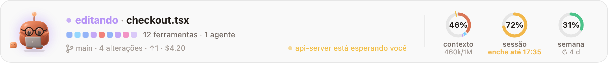
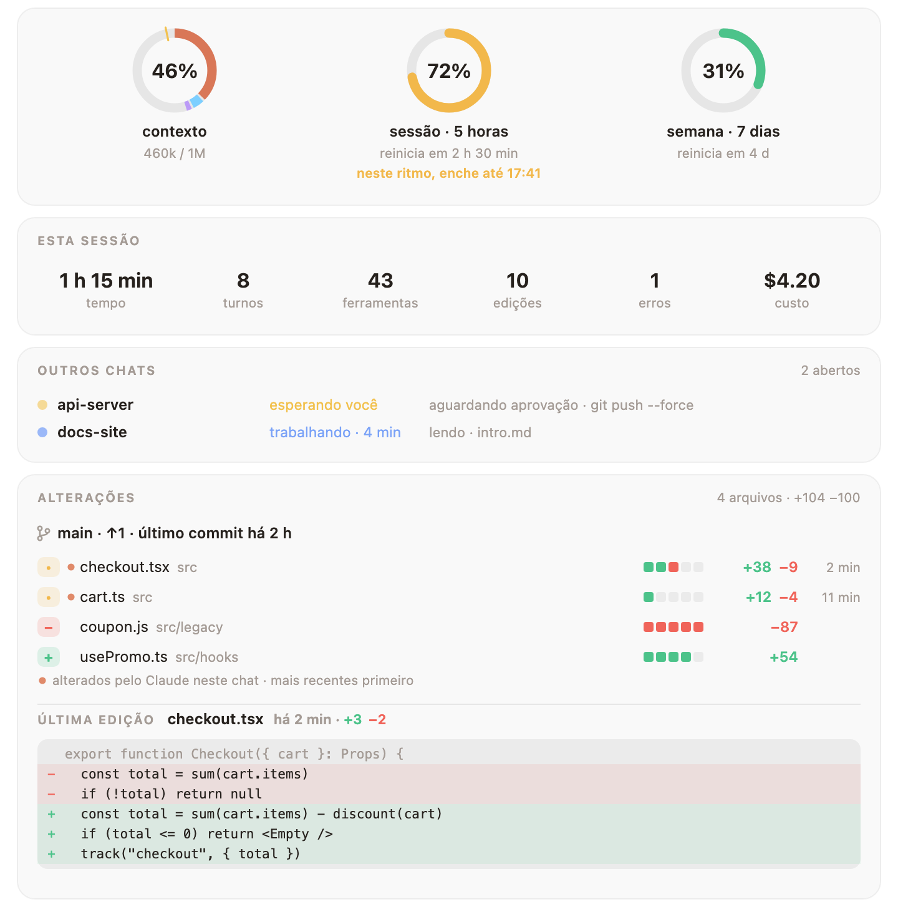
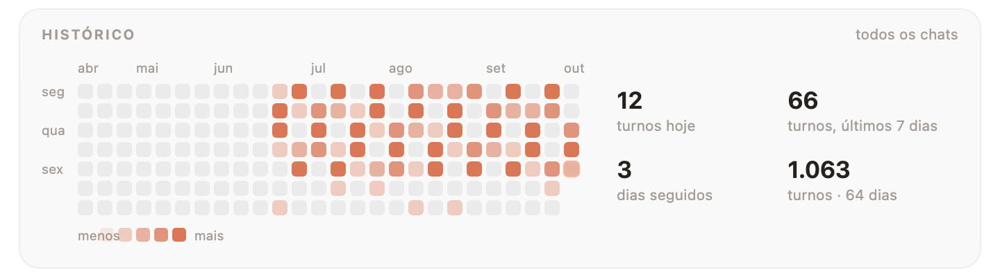

<div align="center">


# Mochi

**Um amiguinho de argila para o Claude Code.**<br>
Ele fica logo acima do seu prompt, reage a tudo o que o Claude faz<br>
e deixa à vista os números que você vive conferindo.

[](LICENSE)
[](#-instalação)
[](#-idiomas)
[](#-um-guarda-roupa-que-cresce-com-você)
[](CONTRIBUTING.md)

[English](README.md) · [Türkçe](README.tr.md) · [Español](README.es.md) · [Deutsch](README.de.md) · [Français](README.fr.md) · **Português** · [Русский](README.ru.md) · [中文](README.zh.md) · [日本語](README.ja.md) · [한국어](README.ko.md)

</div>

<br>

<picture>
  <source media="(prefers-color-scheme: dark)" srcset="docs/band-pt-dark.png">
  
</picture>

<p align="center"><sub>Tudo num relance: o que o Claude está fazendo agora, as últimas chamadas de ferramentas, seu branch, outro chat que precisa de você e o quanto o contexto, a sessão e a semana já encheram.</sub></p>

## ✨ Instalação

```
/plugin install mochi --marketplace oztrkemree/mochi
```

Digite isso em qualquer chat do Claude Code, responda `y` para adicionar o marketplace e escolha o escopo **user**. O Mochi aparece na hora, e em todo chat que você abrir depois.

> [!NOTE]
> O Mochi é construído sobre os módulos de hooks do Claude Code (function hooks), então precisa de uma versão do Claude Code que tenha suporte a eles.

## 🧡 O que o Mochi percebe

<table>
<tr>
<td width="50%" valign="top">

**🎭 27 humores, sem cortes bruscos**<br>
Pensando, lendo, digitando, rodando um comando, esperando você, comemorando os testes no verde, tonto depois de três erros seguidos, dormindo quando você sai. Cada pose flui suavemente da anterior.

</td>
<td width="50%" valign="top">

**📊 Seus limites, com previsão**<br>
Anéis para a janela de contexto, a sessão de 5 horas e a semana. Se você está gastando um limite mais rápido do que ele reinicia, o Mochi avisa *quando* ele vai acabar.

</td>
</tr>
<tr>
<td valign="top">

**🛡️ Um escudo para os comandos assustadores**<br>
`rm -rf`, `git push --force`, `git reset --hard`, `DROP TABLE`, `npm publish`, `sudo`… eles param e perguntam antes, dizendo com todas as letras o que vão destruir.

</td>
<td valign="top">

**🔁 Um vigia de loops**<br>
O mesmo comando falhando três vezes, o mesmo erro voltando, a mesma chamada devolvendo sempre a mesma coisa: o Mochi percebe antes que o seu limite acabe.

</td>
</tr>
<tr>
<td valign="top">

**🔔 Alertas de tarefas longas**<br>
Uma notificação do sistema (macOS, Windows ou Linux) quando termina um turno de mais de dois minutos, ou quando uma tarefa longa para e fica esperando sua aprovação. Vai passar um café.

</td>
<td valign="top">

**💬 Seus outros chats**<br>
Todo chat com o Mochi na sua máquina compartilha em que pé está, então este aqui pode te avisar que outro está esperando você ou já terminou.

</td>
</tr>
</table>

## 🔍 O painel de detalhes

Clique nos anéis e tudo se abre: esta sessão num relance, seus outros chats e **cada arquivo alterado, com as linhas adicionadas e removidas**, os que o Claude mexeu neste chat no topo, e a própria última edição, em vermelho e verde.

<picture>
  <source media="(prefers-color-scheme: dark)" srcset="docs/details-pt-dark.png">
  
</picture>

Mais abaixo: o contexto por categoria, seus turnos recentes e um calendário com os dias de todos os seus chats.

<picture>
  <source media="(prefers-color-scheme: dark)" srcset="docs/history-pt-dark.png">
  
</picture>

## 👒 Um guarda-roupa que cresce com você

Cada turno, edição, commit e dia de trabalho rende experiência. Os níveis liberam coisas para vestir: **36 itens** entre cabeça, rosto, pescoço, mão e o cantinho ao lado do Mochi. Alguns chegam com a estação (chapéu de bruxa no fim de outubro, gorro de Papai Noel em dezembro), outros com a hora (café de manhã, touca de dormir depois da meia-noite).

<p align="center">
  
</p>

<picture>
  <source media="(prefers-color-scheme: dark)" srcset="docs/level-pt-dark.png">
  
</picture>

Escolha o que vestir na seção **Guarda-roupa** do painel de detalhes, ou com `/mochi vestir óculos`.

## ⌨️ Comandos

| Comando | O que faz |
| --- | --- |
| `/mochi` | Esconde ou mostra a faixa |
| `/mochi detalhes` | Abre o painel de detalhes |
| `/mochi nível` | Seu nível, sua experiência e o que ainda está bloqueado |
| `/mochi vestir [item \| automático \| nenhum]` | Veste algo, deixa o Mochi se vestir sozinho ou tira tudo |
| `/mochi escudo` | Liga ou desliga o escudo |
| `/mochi alertas` | Liga ou desliga os alertas de tarefas longas |
| `/mochi som` | Liga ou desliga os sons |
| `/mochi idioma [código \| automático]` | Mostra ou troca o idioma |
| `/mochi pequeno` · `/mochi grande` | Uma linha ou tamanho completo |
| `/mochi status` | O que o Mochi sabe neste momento |

Os comandos em inglês também funcionam sempre (`/mochi details`, `/mochi wear`, `/mochi lang`…).

## 🌍 Idiomas

English · Türkçe · Español · Deutsch · Français · Português · Русский · 中文 · 日本語 · 한국어

O Mochi fala o idioma da configuração `language` do Claude Code quando ela é um destes; senão, o idioma preferido do seu sistema, depois o `LANG`; e, se nada disso servir, inglês. Com `/mochi idioma pt` você mesmo escolhe, e `/mochi idioma automático` volta para o automático.

## 🔒 O que ele acessa

Tudo fica na sua máquina. O Mochi **não faz nenhuma requisição de rede**.

- Ele lê `git status`, `git log` e `git diff --numstat` na pasta do chat.
- Para as notificações, roda a ferramenta do sistema: `osascript` no macOS, PowerShell no Windows, `notify-send` no Linux. Para o idioma, `defaults read -g AppleLanguages` no macOS e PowerShell no Windows; `uname` distingue o macOS do Linux.
- Ele grava pequenos arquivos JSON em `~/.claude/mochi/`: em que pé está cada chat aberto, contagens diárias, seu nível e as leituras de uso para a previsão.

## 🤝 Como contribuir

Relatos de bugs, ideias, traduções, arte e pull requests: tudo é bem-vindo. [Abra uma issue](https://github.com/oztrkemree/mochi/issues/new/choose) ou leia o [CONTRIBUTING.md](CONTRIBUTING.md) para começar a mexer no código: dois comandos verificam tudo (`claude plugin validate .` e `claude plugin test .`), e um idioma novo é um arquivo só.

## 📄 Licença

[MIT](LICENSE). Use, modifique, compartilhe.

<p align="center"><sub>Feito com carinho por <a href="https://github.com/oztrkemree">Emre Öztürk</a> e Claude.</sub></p>
