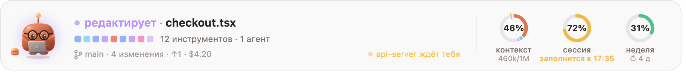
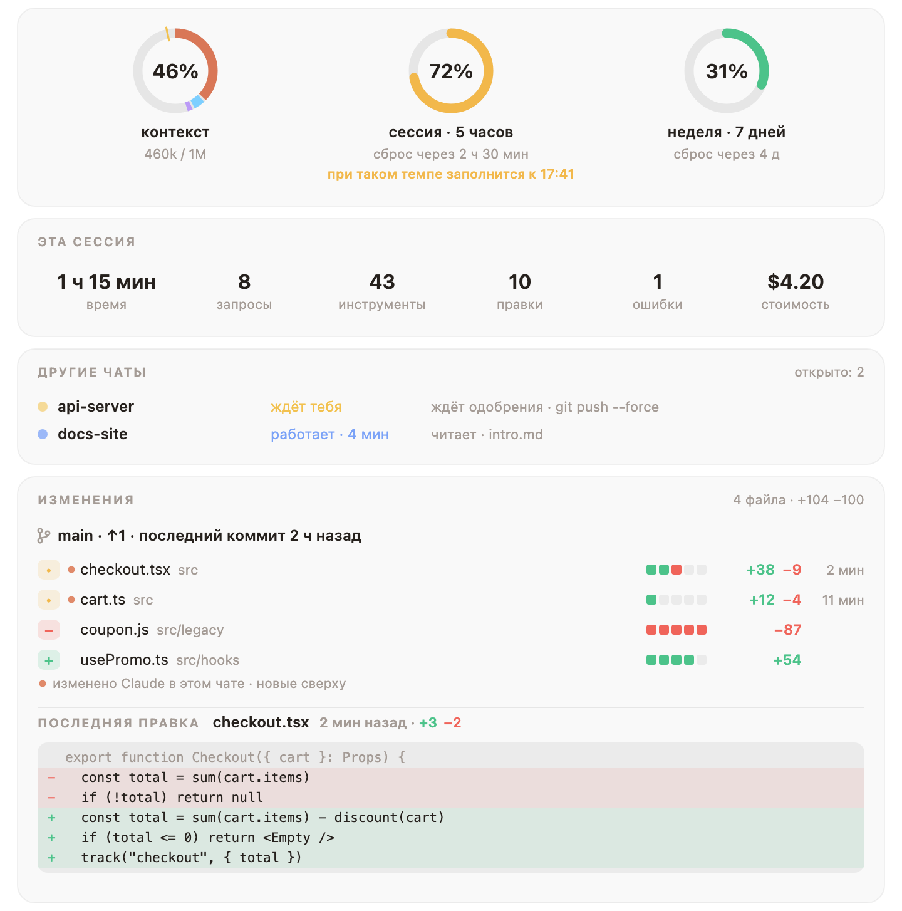
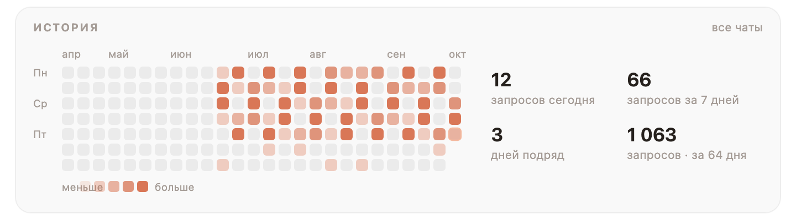

<div align="center">


# Mochi

### Маленький пластилиновый друг, который живёт над полем ввода Claude Code.

Он реагирует на всё, что делает Claude, останавливает команды, о которых ты пожалел бы,<br>
и держит на виду твой контекст, сессию и недельные лимиты.

<a href="https://cdn.jsdelivr.net/gh/oztrkemree/mochi@main/docs/mochi-short.mp4"></a>

[](LICENSE)
[](#-установка-за-10-секунд)
[](#-16-языков)
[](#-гардероб-который-растёт-вместе-с-тобой)
[](#-к-чему-прикасается-mochi)

[English](README.md) · [Türkçe](README.tr.md) · [Español](README.es.md) · [Deutsch](README.de.md) · [Français](README.fr.md) · [Português](README.pt.md) · **Русский** · [中文](README.zh.md) · [日本語](README.ja.md) · [한국어](README.ko.md)

<br>


<sub>Один настоящий запрос. Каждое лицо и каждая строка здесь нарисованы собственным кодом Mochi и его реакциями.</sub>

</div>

<br>

## ⚡ Установка за 10 секунд

```
/plugin install mochi --marketplace oztrkemree/mochi
```

Введи это в любом чате Claude Code, ответь `y`, чтобы добавить маркетплейс, и выбери область **user**. Вот и всё: Mochi появится сразу и будет рядом в каждом чате, который ты откроешь потом. Ничего настраивать не нужно.

> [!NOTE]
> Mochi построен на модулях хуков Claude Code (function hooks), и ему нужен **Claude Code 2.1.293 или новее** (свою версию покажет `claude --version`). Более старые сборки, например 2.1.286, вообще не загружают модуль, и Mochi просто не появится.

> [!TIP]
> **Обновление.** Mochi сообщит, когда выйдет новая версия, а `/mochi обновить` покажет, что запустить. Claude Code сам не обновляет маркетплейс с GitHub, поэтому кнопка Update может оставаться серой; в терминале:
>
> ```
> claude plugin marketplace update mochi
> claude plugin update mochi@mochi
> ```
>
> затем перезапустите Claude Code.

<br>

<table>
<tr>
<td align="center" width="25%">🎭<br><b>30 настроений</b><br><sub>вслед за каждым вызовом инструмента</sub></td>
<td align="center" width="25%">🛡️<br><b>Щит</b><br><sub>от <code>rm -rf</code>, force push и утёкших ключей</sub></td>
<td align="center" width="25%">📊<br><b>Кольца лимитов</b><br><sub>с прогнозом, когда они закончатся</sub></td>
<td align="center" width="25%">👒<br><b>136 вещи, чтобы надеть</b><br><sub>за настоящую работу</sub></td>
</tr>
</table>

## 🎭 Чувствует, что делает Claude

Думает, читает, ищет, печатает, запускает команду, ждёт тебя, празднует зелёные тесты, ходит с кружащейся головой после трёх ошибок подряд и спит, пока тебя нет. **Тридцать настроений, и никаких рывков**: каждая поза плавно перетекает из предыдущей, так что полоска не мигает, а дышит.

<p align="center">
  
</p>

Рядом с лицом: что происходит, простыми словами (`редактирует checkout.tsx`, `тесты прошли · 4 с`), последние вызовы инструментов рядом маленьких квадратиков (тот, что выполняется, дышит, упавший краснеет), твоя ветка и сколько файлов изменено.

## 📊 Твои лимиты с одного взгляда и с прогнозом

<picture>
  <source media="(prefers-color-scheme: dark)" srcset="docs/band-ru-dark.png">
  
</picture>

Три кольца: **окно контекста**, **5‑часовая сессия** и **неделя**. Больше не нужно набирать `/usage` каждые десять минут.

- **Прогноз, а не просто число.** Расходуешь лимит быстрее, чем он сбрасывается? Кольцо скажет, *когда* он закончится (`заполнится в 16:40`), сначала янтарным, а ближе к концу красным.
- **И хорошие новости тоже.** Когда сбросится почти исчерпанный лимит, Mochi скажет и об этом.
- **Кольцо контекста знает, что внутри**: системный промпт, инструменты, MCP, память, навыки, сообщения, у каждого свой цвет, и засечка там, где сработает автосжатие.

## 🛡️ Щит: останавливает то, что не отменить

<p align="center">
  
</p>

Щит читает каждую команду, которую Claude запускает через Bash или PowerShell, и каждую его правку. Перед всем, что нельзя отменить, он останавливается и спрашивает, **простыми словами объясняя, что именно будет уничтожено**: безвозвратное удаление файлов и папок (`rm -rf`, `Remove-Item -Recurse`, `del /s`), очистка диска, перезапись истории ветки, отказ от незакоммиченных изменений, удаление базы данных, снос инфраструктуры или облачного бакета, `npm unpublish`, `docker system prune -a`, скрипт, запущенный прямо из интернета, `sudo`.

- **Force push оценивается по ветке.** Перед force push в `main`, `master`, `trunk` или `develop` щит спросит и назовёт ветку. Перед force push в твою собственную ветку он спросит с нервным взглядом вместо тревоги; `--force-with-lease` туда отделается одним взглядом.
- **Секреты не попадут в историю.** Прежде чем Claude запишет, добавит через `git add` или закоммитит что-то похожее на живой ключ или токен (AWS, GitHub, Anthropic, OpenAI, Slack, Stripe, закрытый ключ, пароль) или файл вроде `.env` или `id_rsa`, Mochi спросит и покажет значение под маской: `AKIA••••••LE`. Заглушки и явно тестовые значения проходят без вопросов.
- **Всегда разрешать здесь.** В вопросе есть кнопки **Запустить** (или **Записать**), **Остановить** и **Всегда разрешать здесь**; последняя запоминает такой вид команд для этого репозитория. Это действует для того, что остаётся внутри него: команда или правка, которая выходит за его пределы (`rm -rf ~`, файл в домашней папке), снова спросит. `/mochi щит` показывает, что где разрешено, а `/mochi щит сбросить` забывает всё.

<details>
<summary><b>Свои правила</b> в <code>~/.claude/mochi/shield.json</code></summary>

<br>

```json
{
  "add": [{ "match": "terraform\\s+apply", "says": "changes the live infrastructure" }],
  "off": ["publish", "sudo"]
}
```

- `match` — регулярное выражение, которое проверяется на каждой команде Bash и PowerShell без учёта регистра. `says` — что сделает такая команда; это показывается в вопросе. Без него вопрос скажет, что команда подходит под одно из твоих правил.
- `off` перечисляет встроенные виды, о которых больше не нужно спрашивать: любой ключ `danger` в [`hooks/lang/ru.ts`](hooks/lang/ru.ts) (`rm`, `forcePush`, `publish`, `sudo`…), `secret` или один из его видов (`secret:aws`, `secret:github`, `secret:apiKey`, `secret:slack`, `secret:stripe`, `secret:privateKey`, `secret:generic`), `secretFile` и `secretEdit`.
- Mochi перечитывает файл при каждом его изменении и сообщает об этом во всплывающем сообщении. Всё, что он не смог использовать, пропускается и перечисляется; если файл не является корректным JSON, ни одно из твоих правил не действует, пока его не исправишь. Прежде чем сам Claude изменит этот файл, щит спросит.

</details>

## 🧡 Что ещё замечает Mochi

<table>
<tr>
<td width="50%" valign="top">

### 🔁 Сторож циклов
Одна и та же команда падает третий раз, возвращается всё та же ошибка, тот же вызов снова выдаёт тот же результат: Mochi заметит это **раньше, чем закончится твой лимит**, и подскажет нажать Esc.

</td>
<td width="50%" valign="top">

### 🔔 Уведомления, пока тебя нет
Системное уведомление (macOS, Windows или Linux), когда закончится запрос дольше двух минут, когда долгая задача остановится и будет ждать тебя, когда сбросится лимит или когда упадёт CI. **Можно смело ставить чайник.**

</td>
</tr>
<tr>
<td valign="top">

### 💬 Все чаты на одной доске
Каждый чат Claude Code на твоём компьютере: сначала этот, следом те, что ждут тебя. У каждого видно ветку (worktree отмечены), чем он занят и как долго. Если чат ждёт тебя уже пять минут, придёт ещё одно уведомление.

</td>
<td valign="top">

### 🚦 CI после push
Mochi следит за запусками GitHub Actions через твой собственный `gh`: `CI идёт · 2/5` в полоске, праздник, когда всё прошло, и имя упавшего workflow, когда нет. Между запусками: pull request твоей ветки, его ревью и проверки (`PR #12 · одобрен · проверки 4/5`).

</td>
</tr>
<tr>
<td valign="top">

### 💡 Советы к месту
Время от времени, пока Mochi отдыхает, один короткий совет по Claude Code о том, что только что произошло: Esc Esc после остановленного запроса, `/compact`, когда заполняется контекст. Дай одно и то же указание в третий раз, и Mochi предложит добавить его в `CLAUDE.md`; запишет, только если ты нажмёшь **Добавить**.

</td>
<td valign="top">

### 🏅 Значки за настоящую работу
Их восемнадцать, и каждый празднуется один раз: первые зелёные тесты, камбэк за один запрос, день уборки, когда удалено больше, чем добавлено, сова, жаворонок, полиглот, запрос-марафон, сто коммитов, а ещё трудные: 30 дней подряд, 500 коммитов, 5 000 правок, 10 000 удалённых строк…

</td>
</tr>
<tr>
<td valign="top">

### 🎉 Особые дни, маленькие сюрпризы
Сезон сакуры, Hacktoberfest, Хэллоуин, Новый год и твой день рождения: в каждый из них Mochi наряжается в то, что уже заслужил. Пожелай Mochi спокойной ночи или скажи ему спасибо. После двух часов без перерыва он предложит потянуться.

</td>
<td valign="top">

### 🧩 Другие плагины могут говорить через него
Твой плагин для деплоя может заставить Mochi ликовать, когда релиз вышел, а линтер — хмуриться. Один вызов: `$.mochi.react({ mood, line })`. Подробнее в разделе [для авторов плагинов](#-авторам-плагинов).

</td>
</tr>
</table>

## 🔍 Панель деталей

**Нажми на кольца**, и всё раскроется: эта сессия с одного взгляда, все чаты на твоём компьютере, твой CI и pull request и **каждый изменённый файл с добавленными и удалёнными строками**. Сверху то, что Claude трогал в этом чате, и у каждого файла свой diff, красным и зелёным.

<picture>
  <source media="(prefers-color-scheme: dark)" srcset="docs/details-ru-dark.png">
  
</picture>

Ещё ниже: контекст по категориям, твои последние запросы, календарь, где видны дни всех твоих чатов, твой уровень, гардероб и значки, а также все настройки и действия, в один клик.

<picture>
  <source media="(prefers-color-scheme: dark)" srcset="docs/history-ru-dark.png">
  
</picture>

## 👒 Гардероб, который растёт вместе с тобой

<p align="center">
  
</p>

Каждый запрос, правка, коммит и рабочий день приносят опыт. Новые уровни открывают, что надеть: **136 вещи** для головы, лица, шеи, руки и места рядом с Mochi. Ничего не открывается по календарю: большую часть открывают уровни, кое-что — привычки, а остальное — трудные значки (шляпа ведьмы и тыква за сто пятьдесят ночей, торт за пятьсот коммитов). Однажды заслуженная шляпа ведьмы появляется на Хэллоуин, торт в твой день рождения; кофе приходит по утрам, а ночной колпак после полуночи.

<p align="center">
  
</p>

<picture>
  <source media="(prefers-color-scheme: dark)" srcset="docs/level-ru-dark.png">
  
</picture>

Выбрать, что надеть, можно в разделе **Гардероб** на панели деталей или командой `/mochi надеть очки`. Скажи Mochi, когда у тебя день рождения: `/mochi др 04-23`; дата хранится только на твоём компьютере. Есть идея, что ещё можно надеть? В [docs/OUTFITS.md](docs/OUTFITS.md) написано, как это добавить.

## 📸 Похвастайся

- **`/mochi карточка`** рисует карточку: Mochi в сегодняшнем наряде, твой уровень, опыт и серии дней подряд.
- **`/mochi итоги`** собирает твой месяц во всех чатах в одну картинку: часы, запросы, коммиты, самый загруженный день, самая длинная серия и папка, в которой прошло больше всего времени. `/mochi итоги год` делает то же за год. В первую неделю месяца Mochi один раз скажет, что итоги прошлого месяца готовы.
- **`/mochi снимок`** сохраняет полоску и панель деталей такими, какие они сейчас. Посмотри на снимок, прежде чем выкладывать: на нём всё, что видно в полоске, включая твою ветку. Другие чаты и строки твоей последней правки на него не попадают.

Это SVG-файлы в `~/.claude/mochi/share/`: они хорошо читаются и на светлых, и на тёмных страницах и ни от чего внешнего не зависят. X и Reddit принимают только PNG: если установлен `rsvg-convert` или ImageMagick, `/mochi снимок` сохранит и PNG каждого.

<details>
<summary><b>Поставь карточку в профиль GitHub</b></summary>

<br>

1. Склонируй репозиторий профиля, тот, что называется так же, как твой логин (`you/you`).
2. Запусти `/mochi карточка ~/code/you` с путём к этой папке; карточка появится там как `mochi-card.svg`.
3. Вставь строку, которую даст Mochi, в `README.md` этого репозитория, затем закоммить и запушь:

   ```md
   [](https://github.com/oztrkemree/mochi)
   ```

Карточка — это снимок момента: после нового уровня снова запусти `/mochi карточка` и запушь новую.

</details>

## ⌨️ Команды

Они тебе вообще не нужны: Mochi работает сразу после установки. А когда захочешь им управлять, всё лежит под `/mochi`.

| Команда | Что делает |
| --- | --- |
| `/mochi` | Скрывает или показывает полоску (или явно: `/mochi hide` · `/mochi show`) |
| `/mochi details` | Открывает панель деталей |
| `/mochi wear [item \| auto \| none]` | Надевает вещь, доверяет Mochi одеться самому или снимает всё |
| `/mochi shield [on \| off]` | Показывает, включён ли щит и что где всегда разрешено |
| `/mochi card [path]` · `/mochi wrapped [year]` · `/mochi snap` | Сохраняет картинку, чтобы поделиться |
| `/mochi small` · `/mochi big` | Одна строка или полный размер |

<details>
<summary><b>Все команды</b></summary>

<br>

| Команда | Что делает |
| --- | --- |
| `/mochi` | Скрывает или показывает полоску (или явно: `/mochi hide` · `/mochi show`) |
| `/mochi details` | Открывает панель деталей |
| `/mochi level` | Твой уровень, опыт и что ещё закрыто |
| `/mochi wear [item \| auto \| none]` | Надевает вещь, доверяет Mochi одеться самому или снимает всё |
| `/mochi badges` | Полученные значки и как получить остальные |
| `/mochi chats` | Все чаты на этом компьютере, сначала те, что ждут тебя |
| `/mochi shield [on \| off]` | Показывает, включён ли щит и что где всегда разрешено; `on` или `off` переключают его |
| `/mochi shield reset` | Забывает всё, что запомнило «Всегда разрешать здесь» |
| `/mochi alerts` | Включает или выключает уведомления (и сообщение, что итоги готовы) |
| `/mochi ci` | Включает или выключает слежение за CI |
| `/mochi tips` | Включает или выключает советы, предложения для `CLAUDE.md` и заметку о новой версии |
| `/mochi breaks` | Включает или выключает предложение потянуться |
| `/mochi sound` | Включает или выключает звуки |
| `/mochi plugins` | Включает или выключает реакции от других плагинов |
| `/mochi card [path]` | Сохраняет карточку для профиля GitHub |
| `/mochi wrapped [year]` | Сохраняет твой месяц или год в одной картинке |
| `/mochi snap` | Сохраняет полоску и панель деталей картинками |
| `/mochi tour` | Ещё раз показывает знакомство, как при первом запуске |
| `/mochi news` | Что нового в этой версии |
| `/mochi birthday [MM-DD \| none]` | Запоминает твой день рождения, показывает его или забывает |
| `/mochi lang [code \| auto]` | Показывает или меняет язык |
| `/mochi small` · `/mochi big` | Одна строка или полный размер |
| `/mochi export` | Сохраняет всё, что хранит Mochi, в один JSON-файл |
| `/mochi reset [level \| history \| all]` | Очищает память уровня, историю или всё сразу, включая настройки; сначала спрашивает, а экспорты и твой `shield.json` остаются |
| `/mochi feedback` | Ссылка на баг-репорт, где уже заполнены версии, твоя система, интерфейс и язык |
| `/mochi status` | Что Mochi знает прямо сейчас |

Английские слова команд работают всегда, а у каждого языка есть ещё и свои (`/mochi надеть`, `/mochi язык`, `/mochi щит`…): русские работают, когда Mochi говорит по-русски. Команда, которая что-то включает или выключает, каждый раз переключает его; добавь `вкл` или `выкл`, чтобы задать точно: `/mochi советы выкл`.

</details>

## 🌍 16 языков

English · Türkçe · Español · Deutsch · Français · Português · Русский · 中文 · 日本語 · 한국어 · Italiano · Polski · Українська · हिन्दी · Bahasa Indonesia · العربية

Mochi говорит на языке из настройки `language` в Claude Code, если это один из этих; иначе на предпочитаемом языке системы, затем по `LANG`; а если ничего не подошло, то по-английски. `/mochi язык ru` выбирает язык вручную, `/mochi язык авто` возвращает автоматический выбор.

## 🔒 К чему прикасается Mochi

**Всё остаётся на твоём компьютере.** Сам Mochi **не делает никаких сетевых запросов**; в интернет ходит только твой собственный `gh`, для слежения за CI, и `/mochi ci` это выключает.

<details>
<summary><b>Полный список</b></summary>

<br>

- **git** в папке чата, только на чтение: `git status`, `git log`, `git diff --numstat` и `git rev-parse` для полоски и панели деталей. Когда щиту нужно присмотреться, он узнаёт ветку и ветку по умолчанию, файлы, которые добавит `git add` (`git ls-files`), и то, что попадёт в `git commit` (`git diff`).
- **gh**, только пока включено слежение за CI, и с твоим собственным логином (токен Mochi никогда не видит): `gh pr view` при старте чата, при открытии панели деталей и вокруг push; `gh run list` только после push в этом чате, раз в 30 секунд, пока запуски не закончатся, и не дольше получаса. `/mochi ci` выключает и то и другое.
- **Средства самой системы**: уведомления через `osascript` на macOS, PowerShell на Windows и `notify-send` на Linux. Для языка — `defaults read -g AppleLanguages` на macOS и `reg query` на Windows; `uname` отличает macOS от Linux. Для PNG от `/mochi снимок` — `rsvg-convert` или `magick` из ImageMagick, если они есть. Файлы закрытых чатов и то, что очищает `/mochi сброс`, удаляются по имени через `rm`, а на Windows через `del` из `cmd`, и только внутри `~/.claude/mochi/`.
- **Файлы в `~/.claude/mochi/`**: как дела у каждого открытого чата, счётчики по дням, твой уровень и значки, замеры использования для прогноза, как часто показывался каждый совет и короткие указания, которые ты повторяешь (но никогда не сообщения целиком), метки, по которым один из чатов сообщает о сбросе лимита, твой `shield.json`, если он у тебя есть, и то, что сохраняют `/mochi карточка`, `итоги`, `снимок` и `экспорт`. Настройки, то, что всегда разрешено, и твой день рождения лежат в хранилище Claude Code для плагинов.
- **Твой проект**: Mochi читает `CLAUDE.md`, прежде чем предложить указание, и дописывает одну строку только после того, как ты выберешь **Добавить**. Карточку он пишет туда, только если ты дашь `/mochi карточка` путь в проект. Чтобы посчитать строки и заметить секреты, он читает файл, который Claude собирается перезаписать, а для команды, которая сразу добавляет и коммитит, — новые файлы, которые она добавит (до 20, каждый меньше 1 МБ). Ничего из прочитанного не сохраняется.
- **Другие плагины** могут показать через Mochi настроение и короткую строку за своей подписью, каждый не чаще раза в 10 секунд; `/mochi плагины` это выключает. `/mochi отзыв` только выводит ссылку: ничего не отправляется.

</details>

## ❓ Вопросы и ответы

<details>
<summary><b>Я установил его, но Mochi не появляется.</b></summary>

<br>

Проверь `claude --version`: Mochi нужна версия **2.1.293 или новее**. Более старые сборки вообще не загружают модули хуков. Если сборка достаточно новая, `/mochi статус` расскажет, что Mochi знает, а `/mochi отзыв` даст уже заполненный баг-репорт.

</details>

<details>
<summary><b>Он занимает слишком много места.</b></summary>

<br>

`/mochi маленький` сворачивает его в одну строку. `/mochi` прячет его совсем, а повторный вызов возвращает обратно.

</details>

<details>
<summary><b>Он куда-нибудь отправляет мой код или запросы?</b></summary>

<br>

Нет. Mochi вообще не делает сетевых запросов. Он хранит короткие счётчики в `~/.claude/mochi/` и никогда не хранит сообщения целиком. Подробнее в разделе [к чему прикасается Mochi](#-к-чему-прикасается-mochi).

</details>

<details>
<summary><b>Щит не будет мне мешать?</b></summary>

<br>

Он спрашивает только перед тем, что нельзя отменить, а **Всегда разрешать здесь** запоминает твой ответ для этого репозитория. `/mochi щит выкл` выключает его целиком, а `shield.json` выключает отдельные виды.

</details>

## 🧩 Авторам плагинов

Твой плагин может заставить Mochi реагировать: радоваться, когда закончился деплой, волноваться, когда упала проверка. Добавь `mochi` в `dependencies` и вызывай `$.mochi.react({ mood, line })` или `$.mochi.celebrate({ line })`. В [docs/API.md](docs/API.md) есть все вызовы, ограничения и целый пример плагина.

## 🤝 Участие в проекте

Баг-репорты, идеи, переводы, рисунки и пул-реквесты: всему очень рады. [Открой issue](https://github.com/oztrkemree/mochi/issues/new/choose) (`/mochi отзыв` даст тебе уже заполненный баг-репорт) или загляни в [CONTRIBUTING.md](CONTRIBUTING.md), чтобы взяться за код: две команды проверяют всё (`claude plugin validate .` и `claude plugin test .`), а новый язык — это словарь и несколько строк. Что менялось в каждой версии, смотри в [CHANGELOG.md](CHANGELOG.md).

Анимации на этой странице нарисованы собственным кодом Mochi: `node scripts/gifs.mjs` и `node scripts/demo.mjs` создают их заново.

## 📄 Лицензия

[MIT](LICENSE). Пользуйся, меняй, делись.

<br>

<div align="center">

**Если Mochi заставил тебя улыбнуться, ⭐ поможет другим его найти.**

<sub>С заботой сделали <a href="https://github.com/oztrkemree">Emre Öztürk</a> и Claude.</sub>

</div>
