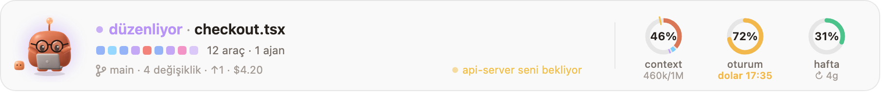
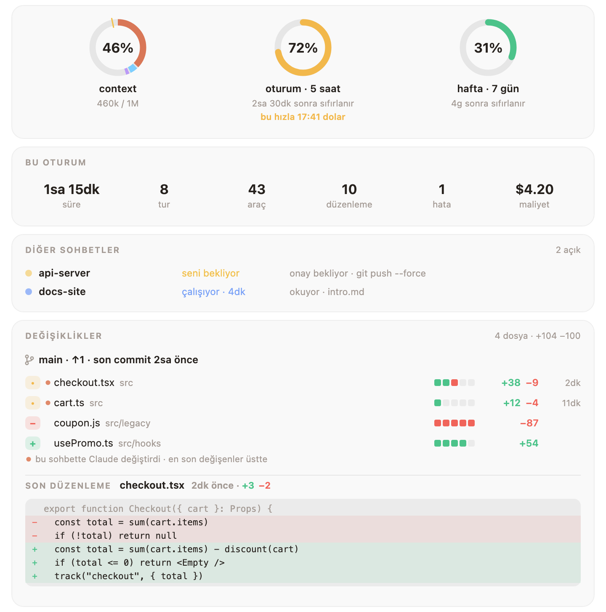
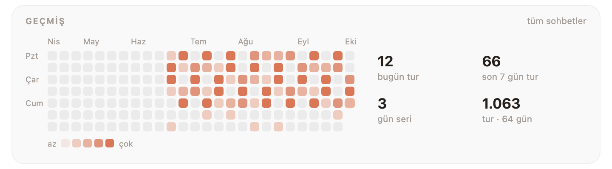
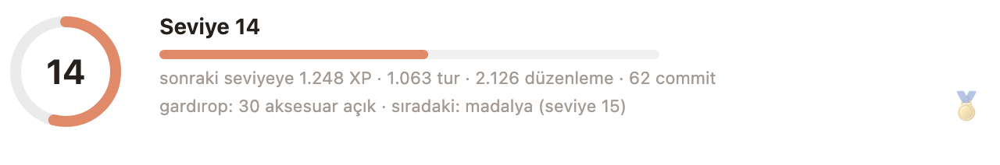

<div align="center">


# Mochi

**Claude Code için kilden küçük bir arkadaş.**<br>
Yazı alanının hemen üstünde durur, Claude'un yaptığı her şeye tepki verir,<br>
dönüp dönüp baktığın rakamları da hep göz önünde tutar.

[](LICENSE)
[](#-kurulum)
[](#-diller)
[](#-seninle-büyüyen-bir-gardırop)
[](CONTRIBUTING.md)

[English](README.md) · **Türkçe** · [Español](README.es.md) · [Deutsch](README.de.md) · [Français](README.fr.md) · [Português](README.pt.md) · [Русский](README.ru.md) · [中文](README.zh.md) · [日本語](README.ja.md) · [한국어](README.ko.md)

</div>

<br>

<picture>
  <source media="(prefers-color-scheme: dark)" srcset="docs/band-tr-dark.png">
  
</picture>

<p align="center"><sub>Her şey tek bakışta: Claude'un şu an ne yaptığı, son araç çağrıları, dalın, seni bekleyen başka bir sohbet ve context'in, oturumun, haftanın ne kadar dolduğu.</sub></p>

## ✨ Kurulum

```
/plugin install mochi --marketplace oztrkemree/mochi
```

Herhangi bir Claude Code sohbetine yaz, marketplace'i eklemek için `y` de ve **user** kapsamını seç. Mochi hemen gelir, sonra açtığın her sohbette de orada olur.

> [!NOTE]
> Mochi, Claude Code'un hooks modülleri (fonksiyon hook'ları) üzerine kurulu; bu yüzden bunları destekleyen bir Claude Code sürümü gerekiyor.

## 🧡 Mochi neleri fark eder

<table>
<tr>
<td width="50%" valign="top">

**🎭 27 ruh hali, hiç kesik yok**<br>
Düşünür, okur, yazar, komut çalıştırır, seni bekler, testler geçince kutlar, üst üste üç hatada başı döner, sen yokken uyur. Her poz bir öncekinden yumuşakça akar.

</td>
<td width="50%" valign="top">

**📊 Limitlerin, tahminiyle birlikte**<br>
Context, 5 saatlik oturum ve hafta için halkalar. Bir limiti sıfırlanmasından hızlı tüketiyorsan Mochi sana *ne zaman* dolacağını söyler.

</td>
</tr>
<tr>
<td valign="top">

**🛡️ Korkutucu komutlar için kalkan**<br>
`rm -rf`, `git push --force`, `git reset --hard`, `DROP TABLE`, `npm publish`, `sudo`… çalışmadan önce durur ve sorar; neyi yok edeceklerini de açıkça söyler.

</td>
<td valign="top">

**🔁 Döngü bekçisi**<br>
Aynı komutun üç kez hata vermesi, aynı hatanın geri gelmesi, aynı çağrının hep aynı sonucu döndürmesi: Mochi bunu limitin bitmeden fark eder.

</td>
</tr>
<tr>
<td valign="top">

**🔔 Uzun iş bildirimleri**<br>
İki dakikadan uzun bir iş bitince ya da uzun bir iş onayını beklemeye başlayınca macOS bildirimi gelir. Git bir çay koy.

</td>
<td valign="top">

**💬 Diğer sohbetlerin**<br>
Bilgisayarındaki her Mochi'li sohbet durumunu paylaşır; böylece bu sohbet sana bir diğerinin seni beklediğini ya da işini bitirdiğini söyleyebilir.

</td>
</tr>
</table>

## 🔍 Detay ekranı

Halkalara tıkla, her şey açılsın: bu oturum tek bakışta, diğer sohbetlerin ve **değişen her dosya, eklenen ve silinen satırlarıyla**. Claude'un bu sohbette dokunduğu dosyalar en üstte, son düzenlemenin kendisi de kırmızı ve yeşil satırlarla en altta.

<picture>
  <source media="(prefers-color-scheme: dark)" srcset="docs/details-tr-dark.png">
  
</picture>

Aşağısında: kategorilere göre context, son turların ve bütün sohbetlerinin günlerini gösteren bir takvim.

<picture>
  <source media="(prefers-color-scheme: dark)" srcset="docs/history-tr-dark.png">
  
</picture>

## 👒 Seninle büyüyen bir gardırop

Her tur, her düzenleme, her commit ve çalıştığın her gün deneyim kazandırır. Seviyeler giyilecek şeyler açar: baş, yüz, boyun, el ve Mochi'nin yanı için **36 parça**. Bazıları mevsimle gelir (ekim sonunda cadı şapkası, aralıkta Noel şapkası), bazıları saatle (sabah kahve, gece yarısından sonra gece şapkası).

<p align="center">
  
</p>

<picture>
  <source media="(prefers-color-scheme: dark)" srcset="docs/level-tr-dark.png">
  
</picture>

Ne giyeceğini detay ekranındaki **Gardırop** bölümünden ya da `/mochi aksesuar gözlük` ile seç.

## ⌨️ Komutlar

| Komut | Ne yapar |
| --- | --- |
| `/mochi` | Bandı gizler ya da gösterir |
| `/mochi detay` | Detay ekranını açar |
| `/mochi seviye` | Seviyen, deneyimin ve hâlâ kilitli olanlar |
| `/mochi aksesuar [ad \| otomatik \| yok]` | Bir şey tak, Mochi kendi giyinsin ya da hepsini çıkar |
| `/mochi kalkan` | Kalkanı açar ya da kapatır |
| `/mochi bildirim` | Uzun iş bildirimlerini açar ya da kapatır |
| `/mochi ses` | Sesleri açar ya da kapatır |
| `/mochi dil [kod \| otomatik]` | Dili gösterir ya da değiştirir |
| `/mochi küçük` · `/mochi büyük` | Tek satır ya da tam boy |
| `/mochi durum` | Mochi'nin şu an bildikleri |

İngilizce komutlar da her zaman çalışır (`/mochi details`, `/mochi wear`, `/mochi lang`…).

## 🌍 Diller

English · Türkçe · Español · Deutsch · Français · Português · Русский · 中文 · 日本語 · 한국어

Claude Code'un `language` ayarı bunlardan biriyse Mochi o dili konuşur; değilse sisteminin tercih ettiği dili, sonra `LANG`'i; hiçbiri uymazsa İngilizce'yi. `/mochi dil tr` ile kendin seçebilir, `/mochi dil otomatik` ile otomatiğe dönebilirsin.

## 🔒 Neye dokunur

Her şey bilgisayarında kalır. Mochi **hiçbir ağ isteği yapmaz**.

- Sohbetin klasöründe `git status`, `git log` ve `git diff --numstat` okur.
- macOS'te bildirimler için `osascript`, dil için `defaults read -g AppleLanguages` çalıştırır; her yerde yerel saat için `date +%z`.
- `~/.claude/mochi/` altına küçük JSON dosyaları yazar: açık sohbetlerin durumu, günlük sayılar, seviyen ve tahmin için kullanım ölçümleri.

## 🤝 Katkı

Hata bildirimleri, fikirler, çeviriler, çizimler ve PR'lar hepsi baş tacı. [Bir issue aç](https://github.com/oztrkemree/mochi/issues/new/choose) ya da koda başlamak için [CONTRIBUTING.md](CONTRIBUTING.md)'yi oku: iki komut her şeyi kontrol eder (`claude plugin validate .` ve `claude plugin test .`), yeni bir dil de tek bir dosyadan ibaret.

## 📄 Lisans

[MIT](LICENSE). Kullan, değiştir, paylaş.

<p align="center"><sub><a href="https://github.com/oztrkemree">Emre Öztürk</a> ve Claude tarafından özenle yapıldı.</sub></p>
