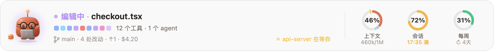
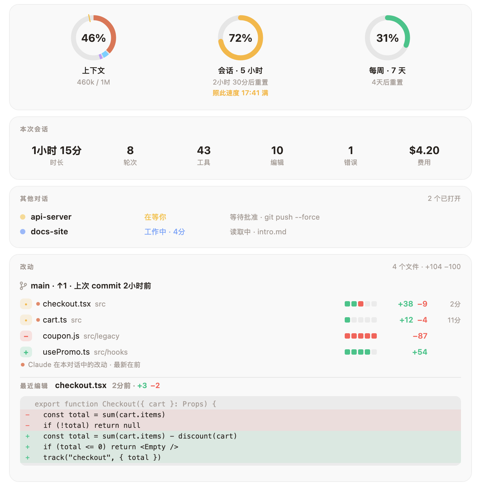
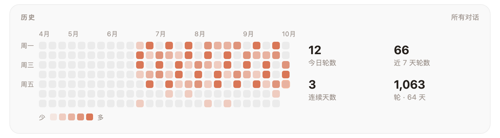

<div align="center">


# Mochi

**Claude Code 的黏土小伙伴。**<br>
它住在你的输入框上方，Claude 的一举一动它都有反应，<br>
那些你总忍不住去看的数字，它也一直替你摆在眼前。

[](LICENSE)
[](#-安装)
[](#-语言)
[](#-和你一起成长的衣橱)
[](CONTRIBUTING.md)

[English](README.md) · [Türkçe](README.tr.md) · [Español](README.es.md) · [Deutsch](README.de.md) · [Français](README.fr.md) · [Português](README.pt.md) · [Русский](README.ru.md) · **中文** · [日本語](README.ja.md) · [한국어](README.ko.md)

</div>

<br>

<p align="center">
  
</p>

<picture>
  <source media="(prefers-color-scheme: dark)" srcset="docs/band-zh-dark.png">
  
</picture>

<p align="center"><sub>一眼看全：Claude 此刻在做什么、最近的工具调用、你的分支、需要你回应的另一个对话，还有上下文、会话和每周限额各用了多少。</sub></p>

## ✨ 安装

```
/plugin install mochi --marketplace oztrkemree/mochi
```

在任意 Claude Code 对话里输入这一行，按 `y` 添加 marketplace，再选择 **user** 作用域。Mochi 立刻就会出现，之后你打开的每个对话里也都有它。

> [!NOTE]
> Mochi 基于 Claude Code 的 hooks 模块（function hooks）构建，需要 **Claude Code 2.1.293 或更高版本**（用 `claude --version` 查看你的版本）。更早的版本（比如 2.1.286）根本不会加载这个模块，Mochi 也就不会出现。

## 🧡 Mochi 都在留意什么

<table>
<tr>
<td width="50%" valign="top">

**🎭 30 种心情，无缝切换**<br>
思考、阅读、打字、运行命令、等你回复、测试全绿时庆祝、连错三次就晕头转向、你离开时就呼呼大睡。每个姿势都从上一个自然过渡，绝不生硬跳切。

</td>
<td width="50%" valign="top">

**📊 你的限额，附带预测**<br>
上下文窗口、5 小时会话和每周限额，各有一个圆环。如果你的消耗速度比重置还快，Mochi 会提前告诉你*什么时候*会用完。快用光的限额一重置，它也会告诉你。

</td>
</tr>
<tr>
<td valign="top">

**🛡️ 危险命令，护盾挡住**<br>
`rm -rf`、`Remove-Item -Recurse`、强推到 `main`、`git reset --hard`、`DROP TABLE`、直接运行从网上下载的脚本……运行前都会先停下来问你，并用大白话说清楚它们会毁掉什么。密钥或令牌眼看要被写入或提交时，也一样。

</td>
<td valign="top">

**🔁 循环监测**<br>
同一条命令连续失败三次、同一个错误反复出现、同一个调用总是返回同样的结果：Mochi 会赶在你的限额耗尽之前发现它。

</td>
</tr>
<tr>
<td valign="top">

**🔔 你不在时，有通知**<br>
超过两分钟的一轮结束、长任务停下来等你、限额重置或者 CI 失败时，都会弹出系统通知（macOS、Windows 或 Linux）。放心去泡杯茶吧。

</td>
<td valign="top">

**💬 所有对话，一览无余**<br>
这台电脑上的每个对话都在这里：当前对话排第一，在等你的紧随其后，每个都标出分支（worktree 会单独标注）、正在做什么、做了多久。一个对话等了你五分钟，还会再发一条通知。

</td>
</tr>
<tr>
<td valign="top">

**🚦 push 之后盯着 CI**<br>
Mochi 通过你自己的 `gh` 跟踪 GitHub Actions 的运行：状态栏里显示 `CI 运行中 · 2/5`，全部通过就开个派对，没通过就告诉你是哪个 workflow 失败了。没有运行时，状态栏会显示你这个分支的 pull request、它的审查状态和各项检查；详情面板里能看到全部内容。

</td>
<td valign="top">

**💡 恰到好处的小提示**<br>
Mochi 空闲时，偶尔会针对刚发生的事给一条简短的 Claude Code 提示：一轮被中断后提醒你可以按 Esc Esc，上下文快满时提醒你用 `/compact`。同一条指示你说到第三遍，Mochi 会提议把它加进 `CLAUDE.md`；只有你点了**加入**，它才会写。

</td>
</tr>
<tr>
<td valign="top">

**🏅 徽章，凭真本事拿**<br>
一共十二枚，每枚只庆祝一次：第一次测试全绿、一轮之内反败为胜、删得比加得多的清理日、夜猫子、早起鸟、多语言、马拉松式的一轮、一百次 commit……

</td>
<td valign="top">

**🎉 特别的日子，小小的惊喜**<br>
开斋节和古尔邦节、春节、诺鲁孜节、排灯节、秋夕、樱花季、Hacktoberfest、万圣节、圣诞节，还有你的生日，都会带来一件新装扮。跟 Mochi 道声晚安，或者谢谢它。连续工作两小时没休息，它会提醒你起来伸个懒腰。

</td>
</tr>
</table>

## 🛡️ 护盾

护盾会检查 Claude 通过 Bash 或 PowerShell 运行的每条命令，以及它做的每次编辑。遇到无法撤销的操作，它会先停下来问你：永久删除文件和文件夹（`rm -rf`、`Remove-Item -Recurse`、`del /s`）、清空磁盘、覆盖分支的历史、丢弃未提交的改动、删除数据库、销毁基础设施或云存储桶、`npm unpublish`、`docker system prune -a`、直接运行从网上下载的脚本、`sudo`。

- **强推看分支。** 推到 `main`、`master`、`trunk` 或 `develop` 时，它会问你，并点明是哪个分支。强推到你自己的分支时，它不拉警报，而是紧张地问你并点明分支；用 `--force-with-lease` 的话，它只会紧张地看一眼。
- **密钥不进历史。** Claude 写入、`git add` 或提交看起来像真实密钥或令牌的内容（AWS、GitHub、Anthropic、OpenAI、Slack、Stripe、私钥、密码），或者 `.env`、`id_rsa` 这类文件之前，Mochi 会先问你，并把值打码显示：`AKIA••••••LE`。占位符和明显的测试值直接放行。
- **此处始终允许。** 询问时有**运行**（或**写入**）、**停止**和**此处始终允许**三个选项；选最后一个，它会在这个仓库里记住这类命令。这只对留在仓库内的操作有效：伸到仓库之外的命令或编辑（`rm -rf ~`、主目录里的文件）仍会再问。`/mochi 护盾` 显示护盾是否开启、哪里允许了什么，`/mochi 护盾 重置` 全部忘掉。

你自己的规则写在 `~/.claude/mochi/shield.json` 里：

```json
{
  "add": [{ "match": "terraform\\s+apply", "says": "修改线上基础设施" }],
  "off": ["publish", "sudo"]
}
```

- `match` 是一个正则表达式，会拿来匹配每条 Bash 和 PowerShell 命令，不区分大小写。`says` 说明这类命令会造成什么后果，显示在询问里；不写的话，询问只会说它匹配了你的一条规则。
- `off` 列出不想再被询问的内置类别：[`hooks/lang/en.ts`](hooks/lang/en.ts) 里 `danger` 的任意一个键（`rm`、`forcePush`、`publish`、`sudo`…）、`secret` 或其中某一类（`secret:aws`、`secret:github`、`secret:apiKey`、`secret:slack`、`secret:stripe`、`secret:privateKey`、`secret:generic`）、`secretFile` 和 `secretEdit`。
- 文件一有改动，Mochi 就会重新读取，并弹出提示告诉你。用不了的部分会被跳过并列出来；如果文件不是有效的 JSON，在你修好之前，其中的规则都不会生效。在 Claude 自己改动这个文件之前，护盾会先问你。

## 🔍 详情面板

点一下圆环，一切尽收眼底：本次会话概览、这台电脑上的所有对话、你的 CI 和 pull request，以及**每个改动过的文件和增删的行数**。Claude 在本对话中改过的文件排在最前，最近一次编辑本身也会用红绿两色展示出来。

<picture>
  <source media="(prefers-color-scheme: dark)" srcset="docs/details-zh-dark.png">
  
</picture>

再往下还有：按类别划分的上下文、最近几轮、记录所有对话每一天的日历，以及你的等级、衣橱和徽章。

<picture>
  <source media="(prefers-color-scheme: dark)" srcset="docs/history-zh-dark.png">
  
</picture>

## 👒 和你一起成长的衣橱

每一轮对话、每次编辑、每个 commit、每个工作日都会积累经验值。升级就能解锁可以穿戴的东西：头部、脸部、颈部、手持和 Mochi 身旁，一共 **134 件**。有些随日子而来（十月底的女巫帽、春节的红包、排灯节的油灯、你生日那天的派对帽和蛋糕），有些随时间出现（早上的咖啡、午夜之后的睡帽）。

<p align="center">
  
</p>

<picture>
  <source media="(prefers-color-scheme: dark)" srcset="docs/level-zh-dark.png">
  
</picture>

在详情面板的**衣橱**区域挑选要穿戴的配饰，或者直接用 `/mochi 穿戴 眼镜`。用 `/mochi 生日 04-23` 告诉 Mochi 你的生日，它只保存在你的电脑上。有新装扮的点子？[docs/OUTFITS.md](docs/OUTFITS.md) 写了怎么加进来。

## 📸 晒出来

- **`/mochi 卡片`** 生成一张卡片：穿着今日装扮的 Mochi，加上你的等级、经验值和连续天数。
- **`/mochi 回顾`** 把你这个月在所有对话里的情况浓缩成一张图：时长、轮数、commit 数、最忙的一天、最长连续天数，以及你花时间最多的文件夹。`/mochi 回顾 年` 则回顾一整年。每月第一周，Mochi 会提醒你一次：上个月的回顾已经好了。
- **`/mochi 快照`** 把状态栏和详情面板此刻的样子保存下来。发出去之前先看一眼：状态栏上显示的东西它都会带上，包括你的分支；其他对话和你最近一次编辑的代码行不会出现。

它们都是 SVG 文件，保存在 `~/.claude/mochi/share/` 下，在浅色和深色页面上都清晰好看，而且完全自包含，不依赖任何外部资源。X 和 Reddit 只接受 PNG：装有 `rsvg-convert` 或 ImageMagick 时，`/mochi 快照` 还会为每张图另存一份 PNG。

把卡片放到你的 GitHub 个人主页上：

1. 克隆你的个人主页仓库，也就是和你用户名同名的那个（`you/you`）。
2. 运行 `/mochi 卡片 ~/code/you`，把路径换成那个文件夹；卡片会以 `mochi-card.svg` 保存到那里。
3. 把 Mochi 给你的那一行粘贴到仓库的 `README.md` 里，然后 commit 并 push：

   ```md
   [](https://github.com/oztrkemree/mochi)
   ```

卡片只是一张快照：升级之后再运行一次 `/mochi 卡片`，把新卡片 push 上去就行。

## ⌨️ 命令

| 命令 | 作用 |
| --- | --- |
| `/mochi` | 隐藏或显示状态栏（`/mochi 隐藏` · `/mochi 显示` 可以直接指定） |
| `/mochi 详情` | 打开详情面板 |
| `/mochi 等级` | 你的等级、经验值，以及还有哪些未解锁 |
| `/mochi 穿戴 [物品 \| 自动 \| 无]` | 戴上一件配饰、让 Mochi 自己搭配，或者全部摘下 |
| `/mochi 徽章` | 你已获得的徽章，以及剩下的怎么拿 |
| `/mochi 对话` | 这台电脑上的所有对话，在等你的排在前面 |
| `/mochi 护盾 [开 \| 关]` | 查看护盾是否开启、哪里始终允许了什么；加上 `开` 或 `关` 即可切换 |
| `/mochi 护盾 重置` | 忘掉“此处始终允许”记住的一切 |
| `/mochi 提醒` | 开启或关闭通知（包括回顾已就绪的提示） |
| `/mochi ci` | 开启或关闭 CI 跟踪 |
| `/mochi 提示` | 开启或关闭小提示、`CLAUDE.md` 建议和新版本说明 |
| `/mochi 休息` | 开启或关闭伸懒腰提醒 |
| `/mochi 声音` | 开启或关闭声音 |
| `/mochi 插件` | 开启或关闭来自其他插件的反应 |
| `/mochi 卡片 [路径]` | 为你的 GitHub 个人主页保存一张卡片 |
| `/mochi 回顾 [年]` | 把你的这个月（或这一年）浓缩成一张图保存下来 |
| `/mochi 快照` | 把状态栏和详情面板保存为图片 |
| `/mochi 导览` | 重看首次运行时的导览 |
| `/mochi 新功能` | 这个版本带来了什么 |
| `/mochi 生日 [MM-DD \| 无]` | 告诉 Mochi 你的生日、查看它，或者删掉它 |
| `/mochi 语言 [代码 \| 自动]` | 查看或切换语言 |
| `/mochi 小` · `/mochi 大` | 单行显示或全尺寸 |
| `/mochi 导出` | 把 Mochi 保存的一切存进一个 JSON 文件 |
| `/mochi 重置 [等级 \| 历史 \| 全部]` | 清除等级记录、历史，或者连同设置在内的一切；清除前会先问你，导出的文件和你的 `shield.json` 会保留 |
| `/mochi 反馈` | 给你一个 bug 报告链接，版本、系统、界面和语言都已填好 |
| `/mochi 状态` | Mochi 此刻知道的一切 |

英文命令词始终可用（`/mochi details`、`/mochi wear`、`/mochi lang`…），每种语言也都有自己的命令词，比如上表里的中文。开关类命令每输入一次就切换一次；加上 `开` 或 `关` 则直接设定，例如 `/mochi 提示 关`。

## 🌍 语言

English · Türkçe · Español · Deutsch · Français · Português · Русский · 中文 · 日本語 · 한국어 · Italiano · Polski · Українська · हिन्दी · Bahasa Indonesia · العربية

如果 Claude Code 的 `language` 设置是其中之一，Mochi 就说这种语言；否则依次参考系统的首选语言和 `LANG`；都不匹配时就用英文。用 `/mochi 语言 zh` 可以自己指定，`/mochi 语言 自动` 则恢复自动选择。

## 🔒 它会访问什么

一切都留在你的电脑上。Mochi 自己**不发起任何网络请求**；唯一会联网的是你自己的 `gh`，用于跟踪 CI。

- **git**：只在对话所在的文件夹里读取，为状态栏和详情面板运行 `git status`、`git log`、`git diff --numstat` 和 `git rev-parse`。护盾需要细看时，会查询当前分支和默认分支、`git add` 会添加哪些文件（`git ls-files`），以及 `git commit` 会提交什么（`git diff`）。
- **gh**：只在 CI 跟踪开启时运行，用的是你自己的登录（Mochi 从不经手你的令牌）。`gh pr view` 在对话开始时、你打开详情面板时以及 push 前后运行；`gh run list` 只在本对话 push 之后运行，每 30 秒一次，直到运行结束，最多半小时。`/mochi ci` 会把两者都关掉。
- **系统自带的工具**：通知在 macOS 上用 `osascript`，Windows 上用 PowerShell，Linux 上用 `notify-send`。获取语言时，macOS 上运行 `defaults read -g AppleLanguages`，Windows 上运行 `reg query`；用 `uname` 区分 macOS 和 Linux。`/mochi 快照` 的 PNG 由 `rsvg-convert` 或 ImageMagick 的 `magick` 生成（如果装了的话）。已关闭对话的文件，以及 `/mochi 重置` 清除的内容，都按文件名用 `rm`（Windows 上用 `cmd` 的 `del`）删除，且只限于 `~/.claude/mochi/` 之内。
- **`~/.claude/mochi/` 下的文件**：每个打开的对话进行到哪一步、每日计数、你的等级和徽章、用于预测的用量读数、每条提示显示过几次、你反复给出的简短指示（绝不保存完整的 prompt）、决定由哪个对话来播报限额重置的标记、你写的 `shield.json`（如果有的话），以及 `/mochi 卡片`、`回顾`、`快照` 和 `导出` 保存的文件。设置、始终允许的项和你的生日，存放在 Claude Code 为插件提供的存储里。
- **你的项目**：Mochi 在建议一条指示之前会读取 `CLAUDE.md`，只有你选了**加入**之后，才会在末尾追加一行。只有你给 `/mochi 卡片` 指定了项目里的路径，它才会把卡片写到那里。为了统计行数和发现密钥，它会读取 Claude 即将覆盖的文件；遇到一次完成添加和提交的命令，还会读取它将要添加的新文件（最多 20 个，每个不超过 1 MB）。读到的内容一概不保留。
- **其他插件**可以借 Mochi 显示一种心情和一句短话，并署上自己的名字，每个插件最多每 10 秒一次；`/mochi 插件` 可以关掉。`/mochi 反馈` 只会显示一个链接：什么都不会发送。

## 🧩 给插件作者

你的插件可以让 Mochi 做出反应：部署完成时欢呼，检查失败时一脸担心。在 `dependencies` 里加上 `mochi`，然后调用 `$.mochi.react({ mood, line })` 或 `$.mochi.celebrate({ line })`。[docs/API.md](docs/API.md) 里有全部调用、限制，以及一个完整的示例插件。

## 🤝 参与贡献

bug 报告、想法、翻译、美术和 pull request，统统欢迎。[提一个 issue](https://github.com/oztrkemree/mochi/issues/new/choose)（`/mochi 反馈` 会给你一份已经填好的 bug 报告），或者阅读 [CONTRIBUTING.md](CONTRIBUTING.md) 开始写代码：两条命令就能检查一切（`claude plugin validate .` 和 `claude plugin test .`），新增一种语言只需要一个词典和几行代码。每个版本改了什么，都写在 [CHANGELOG.md](CHANGELOG.md) 里。

## 📄 许可证

[MIT](LICENSE)。尽管用，尽管改，尽管分享。

<p align="center"><sub>由 <a href="https://github.com/oztrkemree">Emre Öztürk</a> 和 Claude 用心打造。</sub></p>
